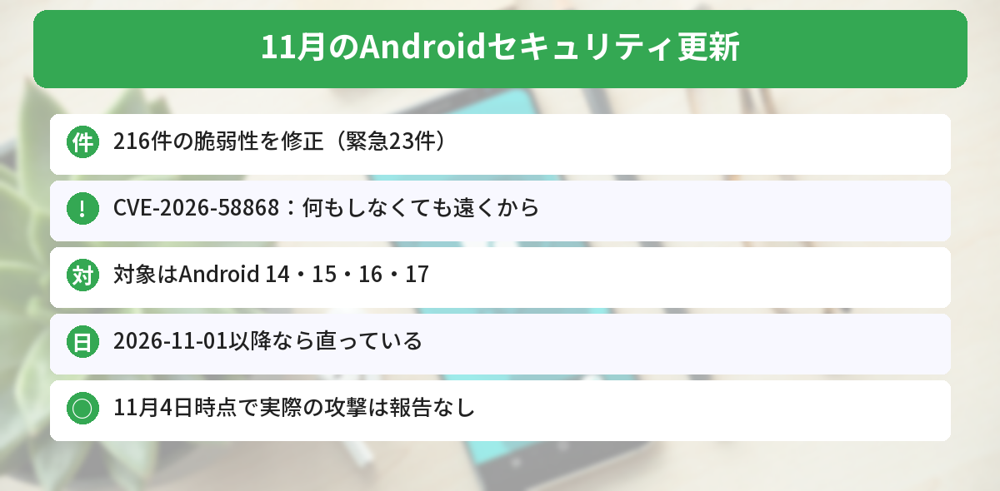
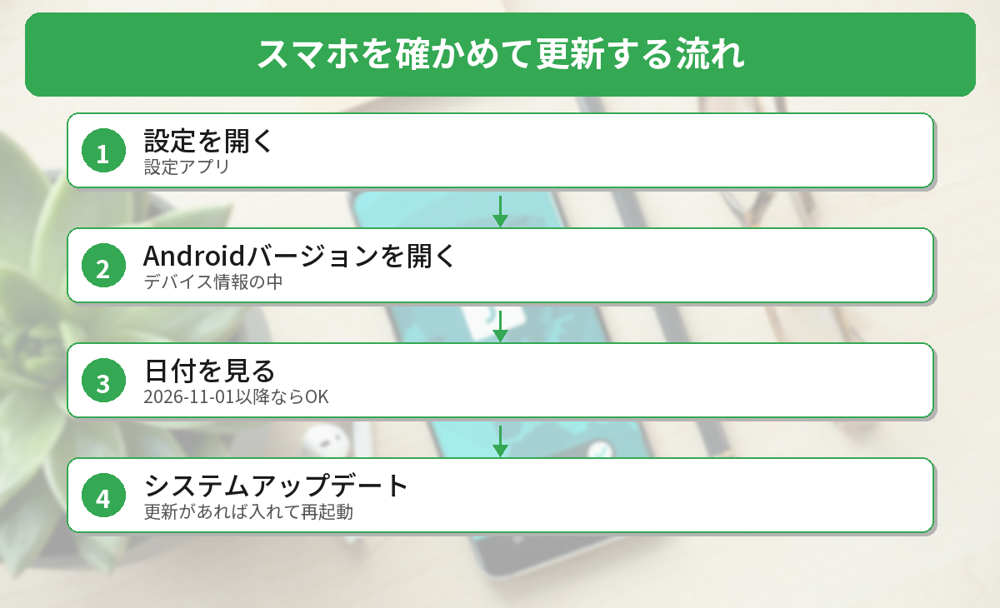

## この記事で分かること

「Androidで、タップしなくても乗っ取られるおそれ」ってニュースを見たの。こわすぎるんだけど、わたしのスマホは大丈夫？


11月の更新で直されたよ。スマホの「セキュリティアップデートの日付」を見れば、直っているかが分かるんだ。見る場所と、更新のしかたを説明するね。


こんなことが気になっていませんか？
- どんな不具合が直されたの？
- 自分のスマホは直っている？
- 更新はどうすればいいの？

この記事は、Googleの11月のAndroidセキュリティ情報を伝えた[The Hacker Newsの記事](https://thehackernews.com/2026/11/google-patches-critical-android-flaw.html)（2026年11月4日）などの報道をもとにまとめています（2026年11月5日に確認）。

## 何が直されたの？
| 項目 | 内容 |
|------|------|
| 直った脆弱性 | **216件**（うち**緊急23件**） |
| いちばん深刻なもの | **CVE-2026-58868**（Framework＝Androidの土台の部分） |
| 対象 | **Android 14・15・16・17** |
| 直っている日付 | セキュリティアップデートが **2026-11-01 以降** |
| すべて直っている日付 | **2026-11-05 以降** |
| 実際の攻撃 | 報告なし（11月4日時点） |



### とくに注意したい1件
**CVE-2026-58868** は、画像のプレビューなどをつくる部分の不具合です。

- 利用者が**何もしなくても**（タップや許可なしで）起こりうる
- **遠くから**スマホの中でコードを動かされるおそれがある
- どうやって攻撃者がそこに届くかは、公開されていない

Googleの「緊急」という評価は、Androidやグーグルのサービスに組み込まれた守りが、オフになっているか、すり抜けられた場合を想定したものです。

### SMSで電話アプリが落ちる不具合も
もう1つの緊急の不具合 **CVE-2026-58882** は、SMSで届く特別なメッセージ（WAP Push）を処理する部分のものです。

研究者が10月29日に公開した「SMS of Death」という報告では、同じ部分の不具合で、**電話番号だけ分かれば**、細工したメッセージ1通で**電話アプリが落ち、通話（緊急通報も）が切れる**とされています。メッセージは受信箱に出ず、スマホを起動するたびにまた落ちることがあるそうです。今回の修正がこの報告と同じものかは、公表されていません。


緊急通報まで切れるのはこわいね…。


だから更新が来たら、なるべく早く入れておこう。まずは日付を見るところからだよ。


## 自分のスマホを確かめよう

筆者の手元にはいまAndroidのスマホがないため、実機の画面では確かめられていません。手順は、Googleのヘルプの案内をもとにしています。メーカーによって、項目の名前が少しちがうことがあります。

### ステップ1: 設定を開く
ホーム画面などから［**設定**］アプリを開きます。

### ステップ2: Androidバージョンを開く
［**デバイス情報**］（または［端末情報］［タブレット情報］）→［**Androidバージョン**］をタップします。

### ステップ3: 日付を見る
**「Androidセキュリティアップデート」**の日付を見ます。

- **2026-11-01 以降**：CVE-2026-58868は直っている
- **2026-11-05 以降**：今回のすべての修正が入っている
- **それより前**：更新が必要

「Google Playシステムアップデート」の日付もありますが、CVE-2026-58868はこちらでは直りません。見るのは**「Androidセキュリティアップデート」**です。

### ステップ4: 更新する
［設定］→［**システム**］→［**システムアップデート**］（メーカーによっては［ソフトウェア更新］）を開いて、更新があれば入れます。再起動したら、もう一度ステップ3で日付を確かめます。

### 更新がまだ来ないときは
- Androidの更新は、**メーカーや携帯会社が自分の予定で配る**ので、すぐには届かないことがあります
- 届くまでのあいだの、**回避策は案内されていません**
- 知らない相手からのメッセージやファイルに気をつけつつ、更新が来たら早めに入れましょう
- 何年も更新が来ていないスマホは、**買いかえ**も考えておくと安心です

パソコンの更新も忘れずに。Windowsは[Windows 11 24H2の更新終了の記事](/posts/windows11-24h2-end-26h2-update/)、Chromeは[Chromeの52件の脆弱性を直す更新の記事](/posts/chrome-156-security-update-2026-10/)で解説しています。




設定 → デバイス情報 → Androidバージョンで、セキュリティアップデートが2026-11-01以降か見る。だね！


その通り。2026-11-05以降なら全部入っているよ。まだなら、システムアップデートを確かめよう。


## まとめ
- 11月のAndroidセキュリティ情報で216件（緊急23件）の脆弱性が公開された
- CVE-2026-58868は、何もしなくても遠くからコードを動かされるおそれ。対象はAndroid 14〜17
- セキュリティアップデートの日付が2026-11-01以降なら直っている。すべての修正は2026-11-05以降
- 11月4日時点で、実際の攻撃は報告されていない
- 更新はメーカーや携帯会社から順番に届く。届いたら早めに入れる

---
### あわせて読みたい
- [【Windows 11】24H2のHome・Proは更新終了 26H2に上げよう（バージョンの確かめ方つき）](/posts/windows11-24h2-end-26h2-update/)
- [【Chrome】52件の脆弱性を修正 156.0.8078.73以上か確かめよう（手元は古いままだった）](/posts/chrome-156-security-update-2026-10/)
