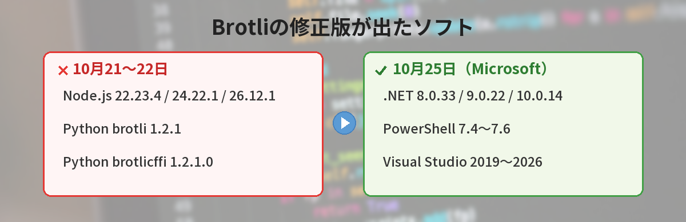
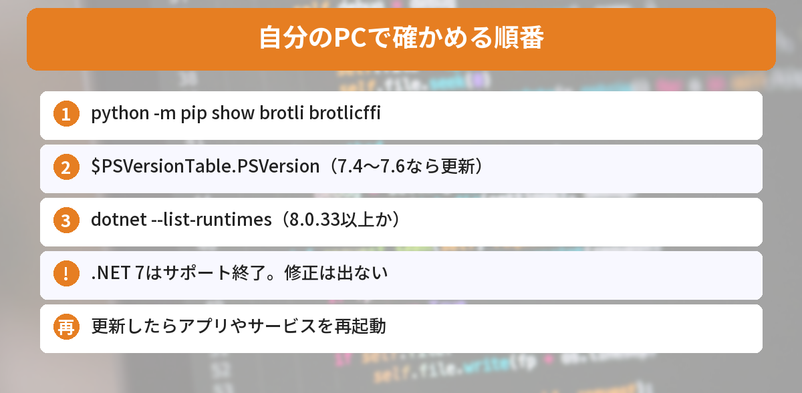
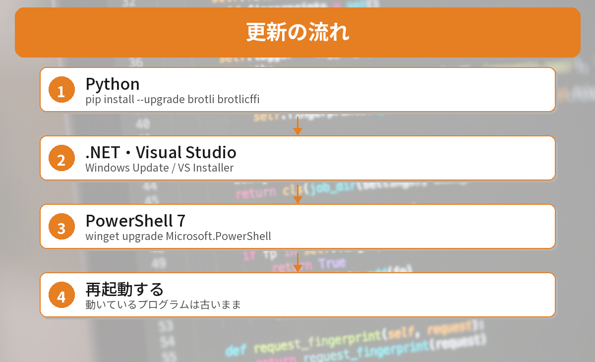

## この記事で分かること

先週Node.jsを更新したばかりなのに、今度は「同じ脆弱性でPythonやPowerShellも更新」って見たの。私のPC、何を確かめればいいの？


もとは「Brotli」っていう圧縮の部品の問題なんだ。その部品を中に入れているソフトが、次々に直しているんだよ。手元のPCで確かめた結果と一緒に、見るところを説明するね。



こんなことで迷っていませんか？
- Node.js以外に、何を更新すればいいのか分からない
- Pythonでbrotliを入れた覚えがない
- PowerShellや.NETの版の確かめ方が分からない

Node.jsの更新は[10/21のNode.jsのセキュリティ更新の記事](/posts/nodejs-security-release-2026-10-21/)にまとめています。この記事はその続きです。

## Brotliって何？何が起きたの？
**Brotli（ブロトリ）**は、Googleが作ったデータの圧縮形式です。Webページを小さくして速く届けるのによく使われています。

今回見つかったのは、Brotliのデータを**展開（デコード）する部分**の脆弱性です。

| 項目 | 内容 |
|------|------|
| 番号 | CVE-2026-111497（通称 Node2Shell） |
| 影響する版 | Brotli 1.0.3〜1.2.0 |
| 直った版 | Brotli 1.0.10、1.1.1、1.2.1 |
| 深刻さ | Googleの評価でCVSS v4 9.2（緊急） |
| 起こりうること | 細工した圧縮データで、プログラムが落ちる、メモリの中身がもれる、外からプログラムを実行される |

見つけたのは、OpenAIのセキュリティチームです。実際の攻撃は、10月27日時点で報告されていません。



## 更新が出たソフト


Brotliを中に入れているソフトが、次々に修正版を出しています（[SecurityWeekの記事](https://www.securityweek.com/node2shell-brotli-flaw-triggers-patching-across-microsoft-node-js-python-packages/)より）。

| ソフト | 修正版 | 公開 |
|------|------|------|
| Node.js | 22.23.4、24.22.1、26.12.1 | 10月21日 |
| Python **brotli** | **1.2.1** | 10月22日 |
| Python **brotlicffi** | **1.2.1.0** | 10月22日 |
| .NET | 8.0.33、9.0.22、10.0.14 | 10月25日 |
| PowerShell | 7.4、7.5、7.6 の更新版 | 10月25日 |
| Visual Studio | 2019、2022、2026 の更新版 | 10月25日 |

ほかに、Bun 1.4.4、Envoy、Istioも更新されています。

### 影響があるのは「信用できない圧縮データ」を展開するとき
攻撃が成り立つのは、**細工したBrotliのデータが、展開する部分まで届いたとき**です。たとえば、知らないサーバーから受け取った圧縮データや、外から送られてきた圧縮つきのリクエストです。

## 自分のPCで確かめてみた
2026年10月27日に、Windows 11のこのPCで確かめました。

### 1. Pythonのbrotli・brotlicffi
```bash
python -m pip show brotli brotlicffi
```

結果は「**WARNING: Package(s) not found: brotli, brotlicffi**」。どちらも入っていませんでした。

requestsやurllib3は、brotliが入っているときだけBrotliを使います。urllib3が送る「受け取れる圧縮形式」も見てみました。

```bash
python -c "import urllib3.util.request as r; print(r.ACCEPT_ENCODING)"
```

結果は **gzip,deflate**。Brotli（br）は入っていません。つまり、このPCのPythonは、そもそもBrotliで展開していないことが分かります。

PyPIで確かめると、brotliの最新は **1.2.1**、brotlicffiの最新は **1.2.1.0** で、どちらも10月22日の公開でした。

### 2. PowerShell
```powershell
$PSVersionTable.PSVersion
```

結果は **5.1**（Windowsに最初から入っているWindows PowerShell）。Microsoftが修正版を出したのはPowerShell **7.4〜7.6** で、`pwsh`（PowerShell 7）はこのPCには入っていませんでした。

### 3. .NET
```powershell
dotnet --list-runtimes
```

| 入っていたもの | 版 | 判定 |
|------|------|------|
| Microsoft.NETCore.App | **8.0.33** | 修正済みの版 |
| Microsoft.NETCore.App | **7.0.20** | サポート終了。修正は出ない |

.NET 8は、すでに修正版の8.0.33になっていました。一方、**.NET 7はサポートが終わっていて、修正版は出ません**。


.NET 7なんて入れた覚えないけど、入ってた…。


アプリと一緒に入ることが多いんだ。使っているアプリがなければ、アンインストールしておくと安心だよ。


## 更新のしかた


### Python
brotliやbrotlicffiが入っていたら、仮想環境ごとに更新します。

```bash
python -m pip install --upgrade brotli brotlicffi
```

入っていないほうは「入っていない」と出るだけなので、気にしなくて大丈夫です。

### .NET・Visual Studio
- **Windows Update**（［設定］→［Windows Update］→［詳細オプション］→「その他のMicrosoft製品の更新プログラムを受け取る」をオン）で入ることがあります
- Visual Studioは、**Visual Studio Installer**から更新します
- 使っていない古い.NET（7など）は、［設定］→［アプリ］からアンインストールできます

### PowerShell 7
`pwsh` を使っている人は、入れた方法に合わせて更新します。

```powershell
winget upgrade Microsoft.PowerShell
```

### 更新したら再起動
動いているプログラムは、古い部品のまま動き続けます。**更新後は、アプリやサービスを再起動**しましょう。Dockerを使っている人は、新しいイメージで作り直します。

PowerShellで困ったときは[PowerShellの実行ポリシーの記事](/posts/powershell-execution-policy-error/)も参考になります。




Pythonはbrotliが入っているか、.NETは版を見る。古い.NET 7は消す、だね！


その通り。今月はPHP、Node.js、Python、LiteLLMと続いたから、入っているソフトの棚卸しにちょうどいいよ。


## まとめ
- 圧縮形式Brotliの展開部分に深刻な脆弱性（CVE-2026-111497）が見つかった
- Node.jsに続き、Pythonのbrotli 1.2.1・brotlicffi 1.2.1.0、.NET・PowerShell 7・Visual Studioが修正版を公開
- 手元のPCでは、Pythonにbrotliは入っておらず、.NET 8は8.0.33で対応済み
- サポートが終わった.NET 7には修正が出ない。使っていなければアンインストール
- 更新したら、アプリやサービスを再起動する

---
### あわせて読みたい
- [【Node.js】10/21のセキュリティ更新が公開 24.22.1などへの上げ方](/posts/nodejs-security-release-2026-10-21/)
- [【Python】LiteLLM 1.107.0に不正コード 入れてしまったか確かめる方法と対処](/posts/litellm-1107-supply-chain/)
