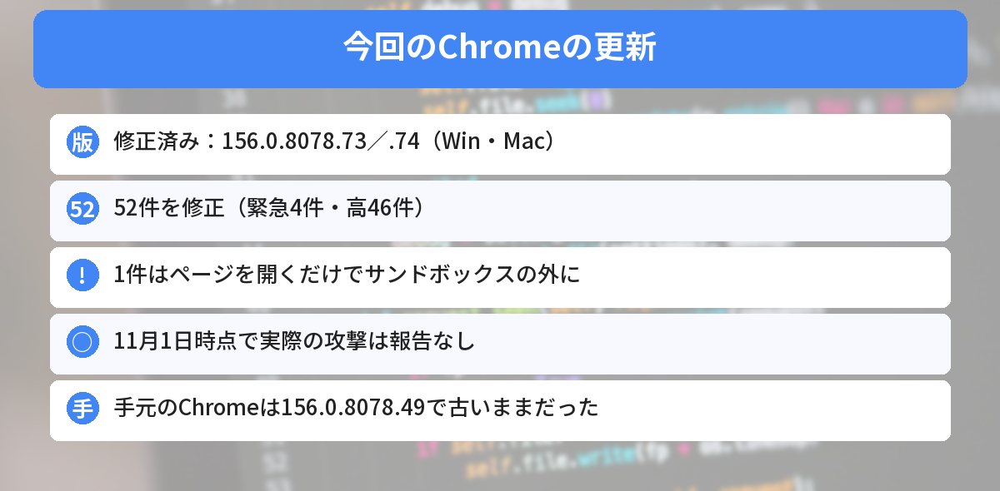
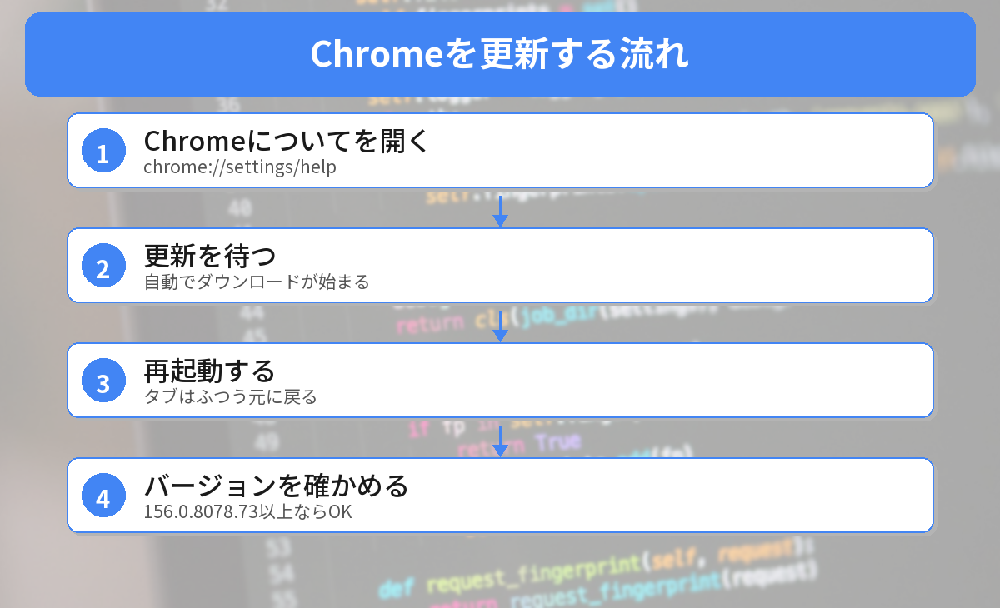

## この記事で分かること

Chromeの更新で「緊急の脆弱性を修正」ってニュースを見たの。Chromeって勝手に更新されるんじゃないの？


ダウンロードは自動でも、再起動しないと新しい版にならないんだ。実は、このパソコンのChromeも古いままだったよ。確かめ方と更新のしかたを一緒に見ていこう。



こんなことが気になっていませんか？
- 自分のChromeは更新されているの？
- どのバージョンなら大丈夫？
- EdgeやBraveは関係あるの？

この記事は、[Daily Security Reviewの記事](https://dailysecurityreview.com/resources/chrome-156-update-fixes-52-flaws-including-sandbox-escape/)など、今回の更新を伝えた報道をもとにまとめています（2026年11月1日に確認）。

## 何が直されたの？
| 項目 | 内容 |
|------|------|
| 修正済みの版 | Windows・Mac：**156.0.8078.73／.74**、Linux：**156.0.8078.73** |
| 直った脆弱性 | **52件**（緊急4件、高46件） |
| 影響する版 | 156.0.8078.73 より前 |
| 実際の攻撃 | 報告なし（11月1日時点） |

10月22日のChrome 156の公開（353件を修正）とは別の、**追加の更新**です。



### とくに注意したい1件
いちばん深刻なのは **CVE-2026-118306**（FileSystemという部品の不具合）です。

- 細工した**Webページを開くだけ**で起こりうる
- ブラウザは、ページを**サンドボックス**（安全な囲い）の中で動かして守っている
- この不具合は、**その囲いの外**でコードが動くおそれがある

ほかの緊急3件（FileAPI、Skia、Layout）は、囲いの中でコードが動くおそれがあるものです。

### AIが見つけた不具合も
今回の52件のうち、研究者がClaudeの助けを借りて見つけたものが6件、OpenAIのCodex Securityが見つけたものが4件あると報じられています。

## 自分のChromeを確かめてみた
2026年11月1日に、このWindows 11のパソコンで、Chromeのファイルのバージョンを確かめました。

```powershell
(Get-Item "$env:ProgramFiles\Google\Chrome\Application\chrome.exe").VersionInfo.ProductVersion
```

結果は **156.0.8078.49** でした。修正済みの **156.0.8078.73 より古い**ので、更新が必要です。

同じパソコンのMicrosoft Edgeは **156.0.4314.58** でした。Edgeは版の数え方がChromeとちがうので、Edgeの更新は［設定］→［Microsoft Edge について］で確かめます。


毎日使ってるのに、古いままだったんだ…。


Chromeを閉じずにずっと使っていると、こうなりやすいんだ。更新は数日〜数週間かけて順番に配られるから、自分で確かめるのがいちばん早いよ。


## 更新のしかた


### ステップ1: 「Chromeについて」を開く
アドレスバーに次のように入れて開きます。

```text
chrome://settings/help
```

または、右上の［︙］→［ヘルプ］→［Google Chrome について］でも開けます。

### ステップ2: 更新を待つ
開くと、自動で更新を確かめて、ダウンロードが始まります。

### ステップ3: 再起動する
［**再起動**］ボタンを押します。開いていたタブは、ふつう元に戻ります。

### ステップ4: バージョンを確かめる
もう一度 `chrome://settings/help` を開いて、**156.0.8078.73 以上**になっていれば完了です。

まだ古い版のままのときは、順番待ちでまだ届いていない可能性があります。少し時間をおいて、もう一度開いてみてください。

## EdgeやBraveは？
EdgeやBraveなど、**Chromiumをもとにしたブラウザ**も同じ部品を使っています。それぞれの会社が修正版を出すと見られているので、各ブラウザの「バージョン情報」で更新を確かめましょう。

- **Edge**：［設定］→［Microsoft Edge について］
- **Brave**：［設定］→［Braveについて］

今月はNode.jsやPythonなど、更新が続いています。Node.jsは[Node.jsの脆弱性が実際に悪用された記事](/posts/nodejs-node2shell-exploited-26-lts/)で解説しています。




chrome://settings/help を開いて、再起動。156.0.8078.73以上になってたらOK、だね！


その通り。Edgeを使っている人は、Edgeの「バージョン情報」も見ておこう。


## まとめ
- Chromeの安定版に、52件の脆弱性を直す更新（156.0.8078.73／.74）が出た
- 緊急4件のうち1件は、細工したページを開くだけでサンドボックスの外でコードが動くおそれ
- 11月1日時点で、実際の攻撃は報告されていない
- 手元のChromeは156.0.8078.49で、古いままだった
- chrome://settings/help を開いて更新し、再起動する。EdgeやBraveも確かめる

---
### あわせて読みたい
- [【Node.js】Brotli脆弱性が「実際に悪用」された 24.22.1以上に上げよう／26がLTSに](/posts/nodejs-node2shell-exploited-26-lts/)
- [【VS Code 1.143】更新で何が変わった？Copilotが標準に・初心者が知っておくこと](/posts/vscode-1143-update/)
