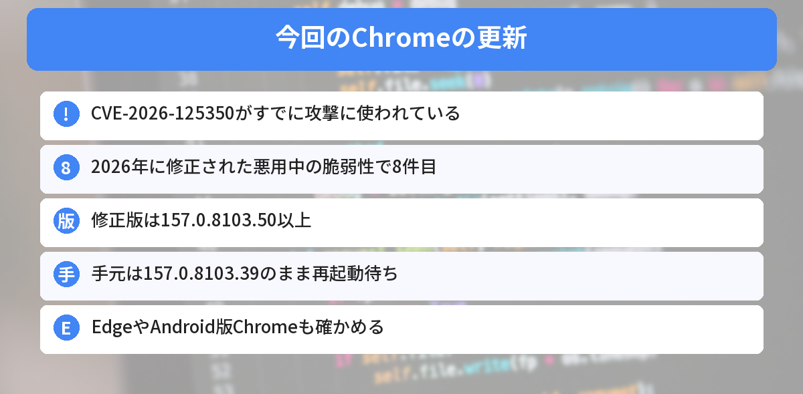
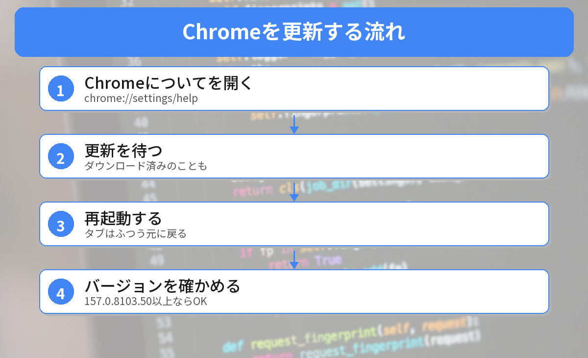

## この記事で分かること

またChromeの脆弱性のニュースを見たの。先月も更新したばっかりなのに…。


今回は「もう攻撃に使われている」ものなんだ。このパソコンでも確かめたら、新しい版はダウンロードされてたのに、再起動していなくて古いままだったよ。確かめ方を説明するね。



こんなことが気になっていませんか？
- どんな不具合なの？
- 自分のChromeは直っている？
- 何をすればいいの？

この記事は、[Malwarebytesの記事](https://www.malwarebytes.com/blog/bugs/2026/11/update-chrome-now-to-fix-a-flaw-attackers-are-exploiting)、[The Hacker Newsの記事](https://thehackernews.com/2026/11/google-issues-chrome-security-update.html)と、[Chromeのリリース情報](https://chromereleases.googleblog.com/2026/11/stable-channel-update-for-desktop_01744469280.html)をもとにまとめています（2026年11月12日に確認）。

## 何が起きたの？
| 項目 | 内容 |
|------|------|
| 脆弱性 | **CVE-2026-125350**（深刻度：高） |
| 場所 | ChromeのXMLという部品（使い終わったメモリを使ってしまう不具合） |
| 起きること | 細工したWebページで、**ブラウザの中でコードを動かされる**おそれ |
| 実際の攻撃 | **あり**（Googleが確認。CISAも11月10日に警告） |
| 修正版 | **157.0.8103.50／.51**（11月9日）。その後**157.0.8103.78／.79**も公開 |
| 今年何件目か | 2026年に修正された悪用中のChromeの脆弱性で**8件目** |



### くわしいことは、まだ伏せられている
Googleは、この脆弱性を**11月6日に外部から知らされ**、3日後に修正版を出しました。ただ、**だれが攻撃したか、だれがねらわれたか、どうやって届けたか**は公表していません。多くの人が更新するまで、くわしい情報を伏せるのはよくあることです。

## 手元のChromeを確かめてみた
2026年11月12日に、このWindows 11のパソコンで、Chromeのファイルの版と、Chromeのフォルダの中を確かめました。

```powershell
(Get-Item "$env:ProgramFiles\Google\Chrome\Application\chrome.exe").VersionInfo.ProductVersion
(Get-ChildItem "$env:ProgramFiles\Google\Chrome\Application" -Directory).Name
```

結果は次の通りです。

```text
157.0.8103.39
157.0.8103.39
157.0.8103.78
SetupMetrics
```

- 動いているChromeは **157.0.8103.39**。修正版の **.50 より古い**
- フォルダには **157.0.8103.78** も入っている。新しい版は**ダウンロード済み**で、**再起動を待っている**状態
- 同じパソコンのMicrosoft Edgeは **157.0.4341.46**（Edgeは版の数え方がChromeとちがう）


新しいのが届いてるのに、まだ古いほうで動いてるってこと？


そう。Chromeを開きっぱなしにしていると、こうなるんだ。右上に「更新」や色のついた印が出ていたら、それが再起動の合図だよ。


## 更新のしかた


### ステップ1: 「Chromeについて」を開く
アドレスバーに次のように入れて開きます。

```text
chrome://settings/help
```

右上の［︙］→［ヘルプ］→［Google Chrome について］でも開けます。

### ステップ2: 更新を待つ
開くと、自動で更新を確かめてダウンロードします。手元のパソコンのように、もうダウンロード済みのこともあります。

### ステップ3: 再起動する
［**再起動**］ボタンを押します。開いていたタブは、ふつう元に戻ります。

### ステップ4: バージョンを確かめる
もう一度 `chrome://settings/help` を開いて、**157.0.8103.50 以上**になっていれば完了です。

## EdgeやスマホのChromeは？
- **Edge**：［設定］→［Microsoft Edge について］で更新を確かめる
- **Android版Chrome**：Google Playストアで［Chrome］→［更新］。157.0.8103.50が11月9日に出ています
- **Brave**などChromiumをもとにしたブラウザも、それぞれの「バージョン情報」で確かめる

今週はWindowsとOfficeの月例更新も出ています。[11月のWindows更新の記事](/posts/patch-tuesday-2026-11-outlook-zero-day/)もあわせて確かめてください。




chrome://settings/help を開いて、再起動。157.0.8103.50以上ならOK、だね！


その通り。Chromeはときどき閉じて開き直す習慣をつけると、古いままになりにくいよ。


## まとめ
- Chromeの脆弱性CVE-2026-125350が、すでに攻撃に使われている。2026年で8件目
- 細工したページを開くと、ブラウザの中でコードを動かされるおそれ
- 修正版は157.0.8103.50／.51（11月9日）。その後157.0.8103.78／.79も出ている
- 手元のChromeは157.0.8103.39で、新しい版がダウンロード済みのまま再起動待ちだった
- chrome://settings/help を開いて再起動する。EdgeやAndroid版も確かめる

---
### あわせて読みたい
- [【11月のWindows更新】Outlookの脆弱性が悪用中 Windows Updateだけでは直らない（手元はOfficeが古いままだった）](/posts/patch-tuesday-2026-11-outlook-zero-day/)
- [【Chrome】52件の脆弱性を修正 156.0.8078.73以上か確かめよう（手元は古いままだった）](/posts/chrome-156-security-update-2026-10/)
