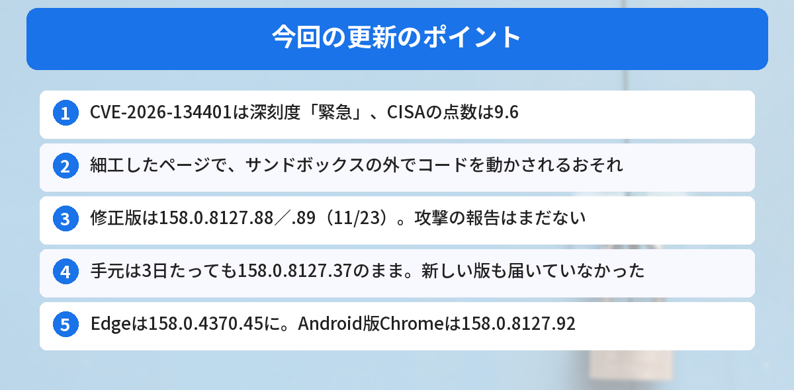
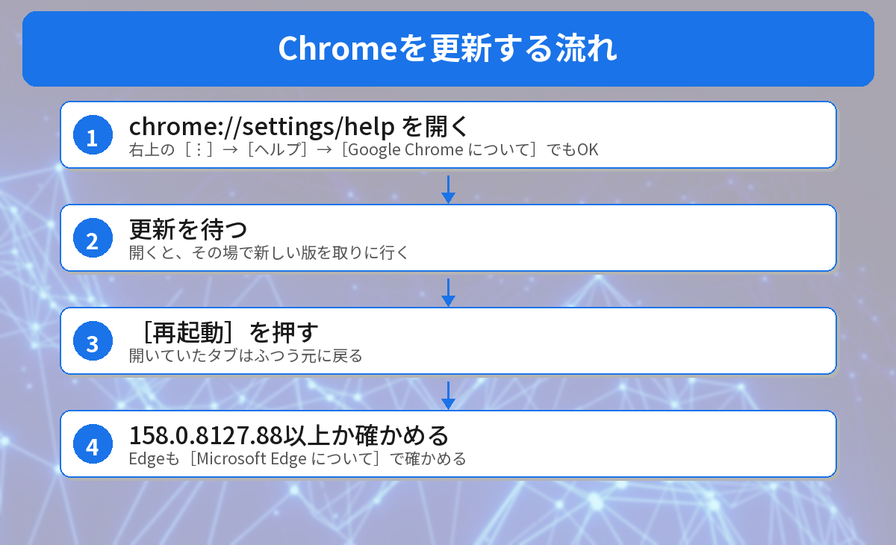

## この記事で分かること

またChromeのニュース…。今度は「緊急」って書いてあって、ちょっとこわいの。


今回は深刻度がいちばん高い「緊急」なんだ。まだ攻撃には使われていないけど、このパソコンで確かめたら、3日たっても古いままだったよ。確かめ方を説明するね。


こんなことが気になっていませんか？
- どんな不具合なの？
- 自分のChromeは直っている？
- 何をすればいいの？
この記事は、[Chromeのリリース情報](https://chromereleases.googleblog.com/2026/11/stable-channel-update-for-desktop_01734282054.html)、[ロケットボーイズのセキュリティ記事](https://rocket-boys.co.jp/security-measures-lab/chrome-cve-2026-134401-sandbox-escape-20261123/)、[Microsoft Edgeのセキュリティ更新情報](https://learn.microsoft.com/en-us/deployedge/microsoft-edge-relnotes-security)をもとにまとめています（2026年11月26日に確認）。
## 何が起きたの？
| 項目 | 内容 |
|------|------|
| 脆弱性 | **CVE-2026-134401**（深刻度：**緊急**） |
| 場所 | Chromeの「Variations」（新しい機能を少しずつ配るための仕組み） |
| 起きること | 細工したWebページで、**サンドボックスの外でコードを動かされる**おそれ |
| 点数 | CISAの評価で**9.6**（10点満点） |
| 実際の攻撃 | 11月24日の時点で**報告なし** |
| 修正版 | **158.0.8127.88／.89**（Windows・Mac、11月23日） |

### 「サンドボックスの外」がポイント
Chromeは、Webページを**サンドボックス**という囲いの中で動かしています。もしページに悪いプログラムがまぎれていても、パソコンのファイルなどには手が届きにくくなっています。

今回の不具合は、**この囲いの外で動かされる**おそれがあるものです。そのため、Googleは深刻度を最も高い「緊急」にしています。ただし、すぐにパソコン全体を乗っ取られるとはかぎらず、影響はパソコンの設定によってちがいます。
### 11月23日の更新は、この1件だけ
今回の更新で直されたセキュリティの不具合は、**CVE-2026-134401の1件だけ**です。Googleは8月28日に自分で見つけ、修正版を用意していました。くわしい中身は、多くの人が更新するまで伏せられています。
## 手元のChromeを確かめてみた
2026年11月26日（修正版が出て3日後）に、このWindows 11のパソコンで、ChromeとEdgeのファイルの版と、Chromeのフォルダの中を確かめました。
```powershell
(Get-Item "$env:ProgramFiles\Google\Chrome\Application\chrome.exe").VersionInfo.ProductVersion
(Get-ChildItem "$env:ProgramFiles\Google\Chrome\Application" -Directory).Name
(Get-Item "${env:ProgramFiles(x86)}\Microsoft\Edge\Application\msedge.exe").VersionInfo.ProductVersion
```
結果は次の通りです。
```text
158.0.8127.37
158.0.8127.37
SetupMetrics
158.0.4370.33
```
- 動いているChromeは **158.0.8127.37**。修正版の **.88 より古い**
- フォルダに新しい版は**なかった**。まだ**ダウンロードもされていない**状態
- 同じパソコンのEdgeは **158.0.4370.33**。11月25日に出た **.45 より古い**

前回は「ダウンロード済みで再起動待ち」だったけど、今回はまだ届いてもいないんだね。


そう。Googleは「数日から数週間かけて順番に配る」としているから、待っているとしばらく古いままのこともある。自分で「Chromeについて」を開くと、その場で取りに行ってくれるよ。

## 更新のしかた

### ステップ1: 「Chromeについて」を開く
アドレスバーに次のように入れて開きます。
```text
chrome://settings/help
```
右上の［︙］→［ヘルプ］→［Google Chrome について］でも開けます。
### ステップ2: 更新を待つ
開くと、自動で更新を確かめてダウンロードします。手元のパソコンのように、まだ届いていない場合も、ここで取りに行きます。
### ステップ3: 再起動する
［**再起動**］ボタンを押します。開いていたタブは、ふつう元に戻ります。
### ステップ4: バージョンを確かめる
もう一度 `chrome://settings/help` を開いて、**158.0.8127.88 以上**になっていれば完了です。
## EdgeやスマホのChromeは？
| ブラウザ | 修正版 |
|------|------|
| Chrome（Windows・Mac） | 158.0.8127.88／.89 |
| Chrome（Android） | 158.0.8127.92 |
| Chrome 長期サポート版（会社向け） | 156.0.8078.114 |
| Edge | 158.0.4370.45（11月25日） |

- **Edge**：［設定］→［Microsoft Edge について］で更新を確かめる。Microsoftは「Chromiumの最新のセキュリティ修正を取りこんだ」と説明しています（CVE番号はあとで書き足すとしています）
- **Android版Chrome**：Google Playストアで［Chrome］→［更新］
- **Brave**などChromiumをもとにしたブラウザも、それぞれの「バージョン情報」で確かめる

前回のChromeの更新は、[Chrome 157の悪用中の脆弱性の記事](/posts/chrome-157-zero-day-2026-11/)で紹介しています。


chrome://settings/help を開いて、再起動。158.0.8127.88以上ならOK。Edgeも忘れずに、だね！


その通り。自動で届くのを待たずに、自分で開いて確かめるのがいちばん早いよ。

## まとめ
- Chromeの脆弱性CVE-2026-134401は、深刻度「緊急」。CISAの点数は9.6
- 細工したページを開くと、サンドボックスの外でコードを動かされるおそれ。攻撃の報告はまだない
- 修正版は158.0.8127.88／.89（11月23日）。Android版は158.0.8127.92
- 手元のChromeは3日たっても158.0.8127.37のままで、新しい版も届いていなかった
- chrome://settings/help を開いて更新・再起動する。Edgeは158.0.4370.45に
---
### あわせて読みたい
- [【Chrome】今年8件目の悪用中の脆弱性 157.0.8103.50以上か確かめよう（手元は再起動待ちだった）](/posts/chrome-157-zero-day-2026-11/)
- [【Firefox】99件の脆弱性を修正 160.0.1かESR 153.7以上か確かめよう（手元のESRは更新済みだった）](/posts/firefox-160-security-2026-11/)
