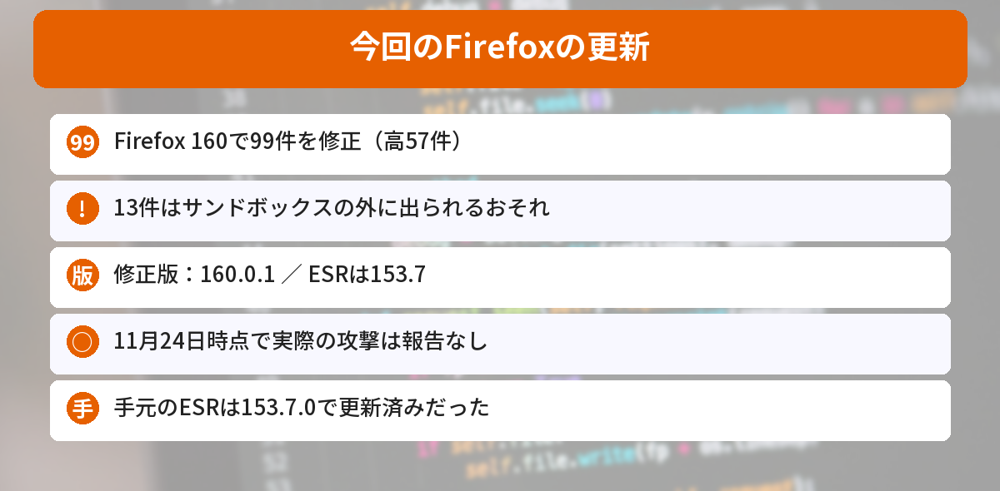
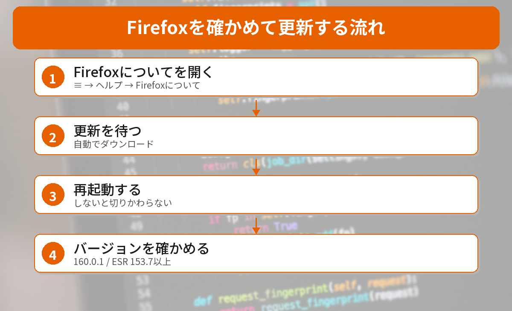

## この記事で分かること

ChromeとEdgeの更新は前に教えてもらったけど、Firefoxも大きな更新が出たって聞いたの。


11月10日のFirefox 160で、99件も直っているんだ。会社でよく使う「ESR版」は番号がちがうから、そこに気をつけよう。このパソコンでも確かめたよ。



こんなことが気になっていませんか？
- 何が直ったの？
- 自分のFirefoxは大丈夫？
- ESR版って何？

この記事は、MozillaのセキュリティアドバイザリーMFSA 2026-125・2026-127・2026-130を伝えた[CyberExpertsの記事](https://cyberexperts.com/2026-11-18-firefox-160-esr-153-7-sandbox-fixes/)と、Mozillaの公開しているバージョン情報をもとにまとめています（2026年11月24日に確認）。

## 何が直ったの？
| 版 | 公開日 | 直った脆弱性 |
|------|------|------|
| **Firefox 160** | 11月10日 | **99件**（高57件・中24件・低18件） |
| **Firefox 160.0.1** | 11月17日 | さらに**2件**（高。1件はAndroid版） |
| **Firefox ESR 153.7** | 11月10日 | **81件**（高51件） |
| Firefox ESR 115.45 | 11月10日 | 28件（すべて高） |

- 99件のうち**13件**は「**サンドボックスの外に出られる**」おそれがあるもの
- いちばん深刻な **CVE-2026-124853**（文字の表示の部分）は深刻度**9.6**
- 11月24日時点で、**実際の攻撃は報告なし**



### サンドボックスって？
ブラウザは、Webページのプログラムを**安全な囲い（サンドボックス）**の中で動かして、パソコンを守っています。今回の13件は、その**囲いの外に出られる**おそれがあるものです。ほかの不具合と組み合わせられると、パソコンを乗っ取られるおそれがあります。

## 手元のFirefoxを確かめてみた
2026年11月24日に、このWindows 11のパソコンで、FirefoxのファイルのバージョンとMozillaが公開している最新版をくらべました。

```powershell
(Get-Item "$env:ProgramFiles\Mozilla Firefox\firefox.exe").VersionInfo.ProductVersion
(Invoke-RestMethod https://product-details.mozilla.org/1.0/firefox_versions.json) |
  Select-Object LATEST_FIREFOX_VERSION, FIREFOX_ESR
```

結果は次の通りです。

```text
153.7.0
LATEST_FIREFOX_VERSION  FIREFOX_ESR
----------------------  -----------
160.0.1                 153.7.0esr
```

- このパソコンのFirefoxは**ESR版**（会社が管理するパソコンなので）
- バージョンは **153.7.0**。ESRの**修正版になっていた**
- ファイルの日付は11月11日で、公開の翌日には自動で入っていたようです


160じゃなくて153でも大丈夫なんだね。


ESR版は、新しい機能を入れずに直しだけを長く届ける版なんだ。だから番号が小さくても、153.7なら直っているよ。


## 確かめ方と更新のしかた


### ステップ1: 「Firefoxについて」を開く
右上の［**≡**］→［**ヘルプ**］→［**Firefoxについて**］を開きます。

### ステップ2: 更新を待つ
開くと、自動で更新を確かめてダウンロードします。

### ステップ3: 再起動する
［**再起動して Firefox を更新**］を押します。**再起動しないと、新しい版になりません**。

### ステップ4: バージョンを確かめる
- ふつうの版：**160.0.1 以上**
- ESR版（「延長サポート版」と書かれている）：**153.7 以上**
- 古いESR：**115.45 以上**

## Thunderbirdやスマホは？
- **Thunderbird**：同じ部品を使っているので、**160または153.7**に更新します
- **Android版Firefox**：Google Playで更新。160.0.1でAndroid向けの不具合も直っています
- **iPhone版Firefox**：App Storeで更新。160.0で3件が直っています

今月はほかのブラウザも更新が続いています。[Chromeの悪用中の脆弱性の記事](/posts/chrome-157-zero-day-2026-11/)もあわせて確かめてください。




Firefoxについてを開いて再起動。ふつうは160.0.1、ESRなら153.7以上、だね！


その通り。Thunderbirdを使っている人は、そっちも忘れずにね。


## まとめ
- Firefox 160（11月10日）で99件、160.0.1（11月17日）でさらに2件の脆弱性が直った
- 13件はサンドボックスの外に出られるおそれ。いちばん深刻なものは深刻度9.6
- ESR版は153.7、古いESRは115.45が修正版
- 11月24日時点で、実際の攻撃は報告されていない
- 手元のFirefox（ESR版）は、すでに153.7.0になっていた

---
### あわせて読みたい
- [【Chrome】今年8件目の悪用中の脆弱性 157.0.8103.50以上か確かめよう（手元は再起動待ちだった）](/posts/chrome-157-zero-day-2026-11/)
- [【OpenSSH】長いパスワードでログインできてしまう「sshole」が悪用中 Alpine・Dockerを使う人は確認を（手元のWindowsは対象外だった）](/posts/openssh-sshole-alpine-2026-11/)
