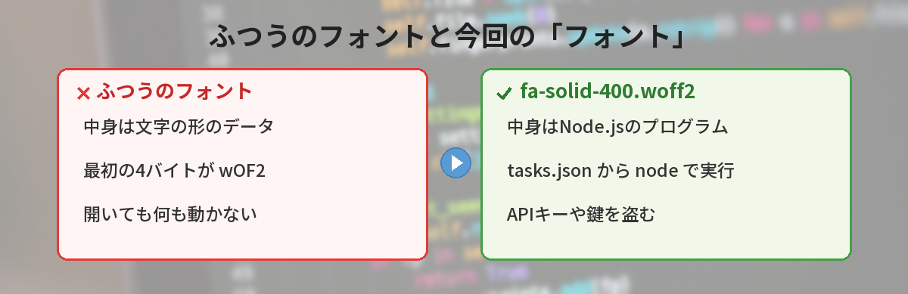
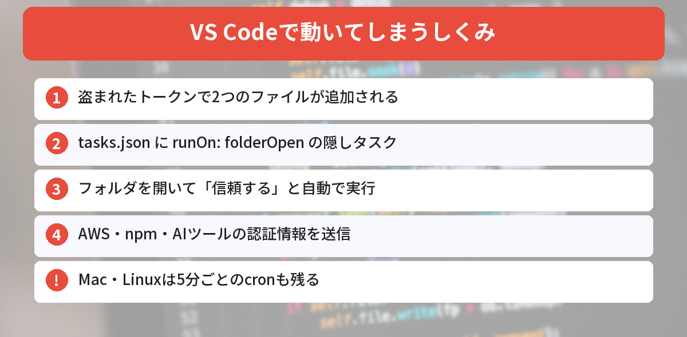
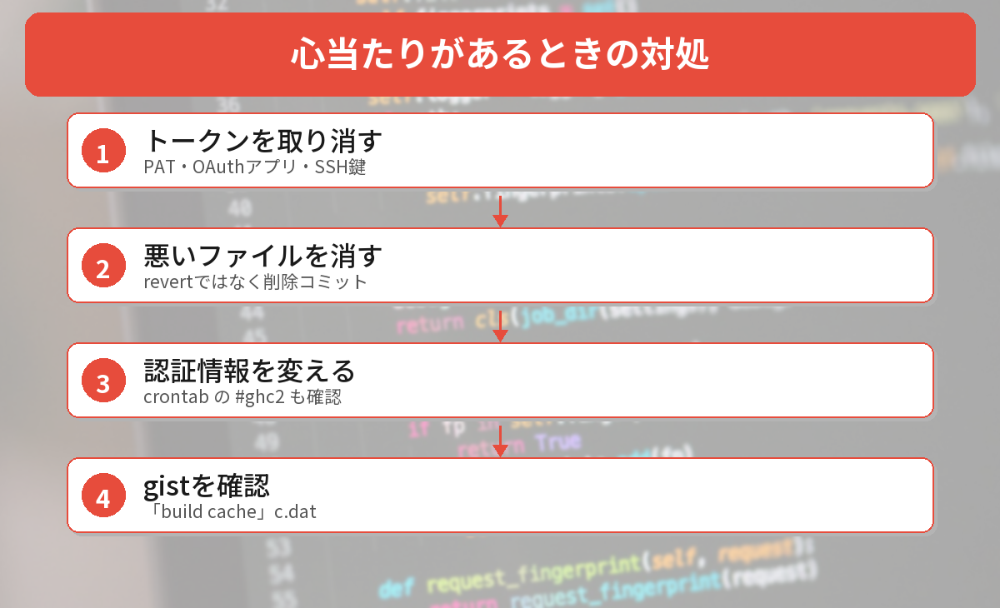

## この記事で分かること

「VS Codeでフォルダを開くだけで、パスワードが盗まれる」ってニュースを見たの。フォントのファイルがあやしいって、どういうこと？


GhostActionっていう攻撃の新しい手口だね。名前はフォントなのに、中身はプログラムになっているファイルがあるんだ。どうやって動くのか、自分のリポジトリやパソコンで何を見ればいいのかを説明するね。



こんなことが気になっていませんか？
- 自分のGitHubのリポジトリに、勝手にファイルが増えていないか
- cloneしたリポジトリをVS Codeで開いても大丈夫か
- もし動いてしまっていたら、何をすればいいか

この記事は、[GitGuardianの調査記事（2026年10月）](https://blog.gitguardian.com/ghostaction-x-polinrider/)をもとにまとめています（2026年10月28日に確認）。

## 何が起きているの？
GhostActionは、**前に盗まれたGitHubのトークン**を使って、他人のリポジトリに悪いファイルを送りこむ攻撃です。

| 項目 | 内容（GitGuardianの集計） |
|------|------|
| 期間 | 2026年10月13日〜21日 |
| コミット数 | 7万2,026件 |
| リポジトリ数 | 2万2,964（うち7,989は新しい被害） |
| 使われたアカウント | 1,792（うち1,382は10月8日の攻撃でも使われた） |

同じトークンが何度も使われているのは、**盗まれたトークンが取り消されていない**からです。



## 開くだけで動く「フォント」のしくみ


攻撃者は、次の2つのファイルを別々のコミットで送りこみます。

| ファイル | コミットのメッセージ | 中身 |
|------|------|------|
| `public/fonts/fa-solid-400.woff2` | Add font assets | フォントではなく、**Node.jsのプログラム** |
| `.vscode/tasks.json` | Add editor task | 隠れたタスク「eslint-check」 |

`tasks.json` のタスクには、次のような設定が入っています。

- `"runOn": "folderOpen"`：**フォルダを開いたときに自動で実行**する
- `"hide": true` と `"reveal": "never"`：**画面に表示しない**
- 実行するのは `node ./public/fonts/fa-solid-400.woff2`

つまり、VS Codeでこのフォルダを開いて**ワークスペースを信頼する**と、「フォント」のプログラムがこっそり動きます。

### 何が盗まれる？
- AWSの認証情報、`.npmrc`、`.pypirc`、`.git-credentials`
- ClaudeやGeminiのログイン情報、`.kube/config`
- SSHの鍵、APIキーが入った環境変数

さらに、Mac・Linuxでは**5分ごとに外から命令を受け取るcron**も仕込まれます。リポジトリをきれいにしても、これは残ります。


GitHub Actionsのワークフローは止めてもらえたのに、こっちは止められないの？


そうなんだ。GitHub上のワークフローはGitHubが止めたけど、VS Codeのタスクは自分のパソコンで動くから、GitHubの仕組みでは止められないんだよ。


## 自分のリポジトリで確かめてみた
2026年10月28日に、このパソコンのブログ用フォルダ（3つのリポジトリを含む）で確かめました。

### 1. 自動で動くタスクがないか探す
PowerShellで、`.vscode\tasks.json` を探して、`folderOpen` が入っているかを見ます。

```powershell
Get-ChildItem -Recurse -Force -Filter tasks.json -ErrorAction SilentlyContinue |
  Where-Object { $_.Directory.Name -eq '.vscode' } |
  ForEach-Object { "$($_.FullName) folderOpen=$((Get-Content $_.FullName -Raw) -match 'folderOpen')" }
```

結果は **0件** でした。

### 2. 「中身がフォントではないフォント」を探す
本物のフォントは、ファイルの最初の4バイトが決まった値（woff2なら `wOF2`）です。そこがちがうファイルを探しました。

結果は、フォントファイル3つのうち、**あやしいものは0件**でした。

### 3. 送りこまれたファイルの履歴がないか見る
Gitの履歴で、問題のファイルが追加されたことがないかを確かめます。

```bash
git log --all --diff-filter=A --name-only --format="" -- .vscode/tasks.json "public/fonts/*" ".github/workflows/*"
```

何も表示されなければ、追加されたことはありません。手元のエンタメブログのリポジトリでは**何も出ませんでした**。

## 心当たりがあるときの対処


### ステップ1: トークンを取り消す
GitHubの［Settings］→［Developer settings］で、**個人用アクセストークン（PAT）**を取り消します。［Applications］のOAuthアプリ、［SSH and GPG keys］のSSH鍵も見直します。取り消さないと、**また書きこまれます**。

### ステップ2: 悪いファイルを消す
すべてのブランチで、問題のファイル（`fa-solid-400.woff2`、`.vscode/tasks.json`、身に覚えのない `.github/workflows/*.yml`）を消すコミットを作ります。**「Update」のコミットを元に戻す（revert）のはNG**です。前の悪いバージョンがよみがえることがあります。

### ステップ3: パスワードやキーを変える
VS Codeで開いてしまったパソコンでは、クラウド、npm・PyPI、AIツール、SSHなどの**認証情報をすべて変更**します。Mac・Linuxでは、`crontab -l` で **`#ghc2`** という行がないか確かめて、あれば消します。

### ステップ4: 知らないgistがないか見る
GitHubのアカウントに、**「build cache」という名前の非公開gist**（中に `c.dat`）ができていないか確かめます。

## これからの予防
- 知らないリポジトリは、VS Codeの「**このフォルダーの作成者を信頼しますか？**」で、まず**信頼しない**（制限モード）で開く
- 開いたら、`.vscode` フォルダの中に `tasks.json` がないか見る
- 使っていないトークンは消し、作るときは**有効期限を短く**する

VS Codeの信頼のボタンについては、[「作成者を信頼しますか？」の記事](/posts/vscode-workspace-trust-update/)でくわしく解説しています。




知らないリポジトリはまず「信頼しない」で開いて、.vscode の中を見る。トークンは使わないなら消す、だね！


その通り。今回の攻撃は、取り消されていない古いトークンが原因だから、トークンの見直しがいちばん効くよ。


## まとめ
- GhostActionは10月13日〜21日に、約2万3,000のリポジトリへ7万件以上のコミットを送りこんだ
- 原因は、前に盗まれて取り消されていないGitHubのトークン
- `fa-solid-400.woff2` はフォントではなくプログラム。`.vscode/tasks.json` のタスクで、フォルダを開くと動く
- 手元のリポジトリでは、自動で動くタスクもあやしいフォントも0件だった
- 心当たりがあれば、トークンの取り消し、ファイルの削除、認証情報の変更を行う

---
### あわせて読みたい
- [【VS Code】「作成者を信頼しますか？」どっちを押す？10月の更新も解説](/posts/vscode-workspace-trust-update/)
- [【Python】LiteLLM 1.107.0に不正コード 入れてしまったか確かめる方法と対処](/posts/litellm-1107-supply-chain/)
