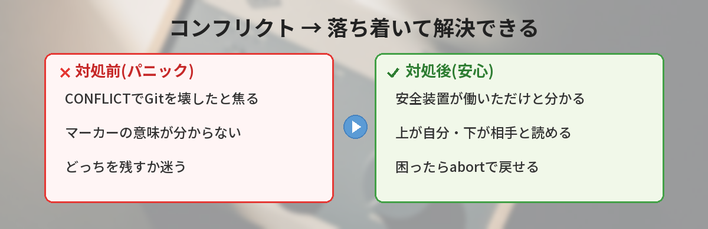
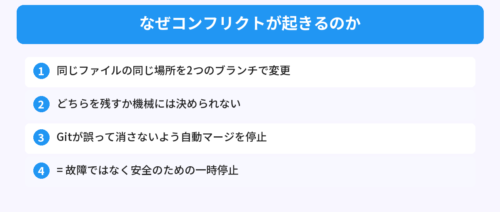
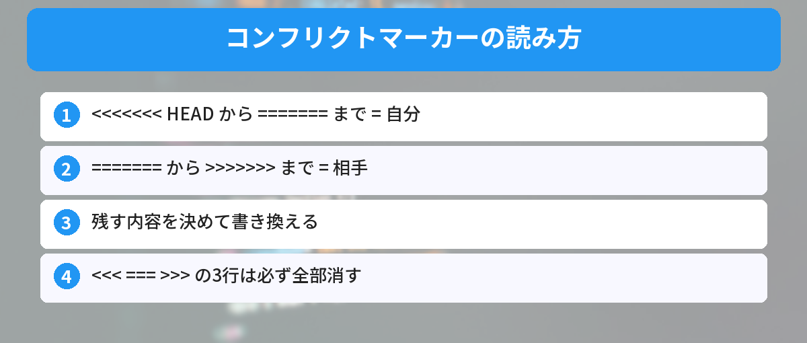
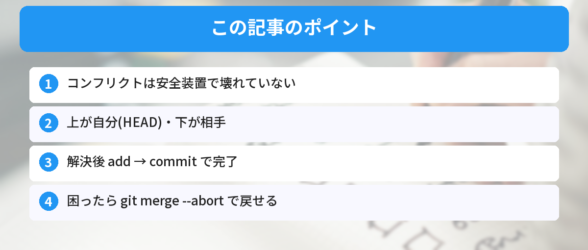

## この記事で分かること


git mergeしたら「CONFLICT」って出た…！私、Git壊しちゃったの…？どうしよう…



落ち着いて、大丈夫！壊れてないよ。むしろGitが「勝手に決めると危ないから、人間に判断してもらおう」って安全のために止まってくれてるんだ。読み方と直し方を知れば全然怖くないよ。




ターミナルにこんな表示が出て、固まっていませんか。

```
CONFLICT (content): Merge conflict in index.html
Automatic merge failed; fix conflicts and then commit the result.
```

「CONFLICT」「failed」の文字に、Gitを壊したかと焦る人は多いです。でも安心してください。これは**故障ではなく、Gitが安全のために一時停止している状態**です。この記事では、なぜ起きるのかという仕組みから、マーカーの読み方、解決手順、そして不安なら元に戻す方法まで解説します。Gitのブランチが初めての人は[Gitのブランチ入門](/posts/git-branch-beginner/)もあわせてどうぞ。



## マージコンフリクトとは

マージコンフリクト（競合）は、**同じファイルの同じ場所を、2つのブランチで別々に書き換えたとき**に起きます。

Gitは普段、2つの変更を自動で合体（マージ）してくれます。でも「同じ行を、片方は赤に、もう片方は青に変えた」のように、どちらを採用すべきか機械には決められない場合があります。

このときGitは、間違って片方を消してしまわないように、**自動マージを止めて「どっちにする？」と人間に聞いてきます**。これがコンフリクトです。つまり、Gitが壊れたのではなく、安全装置が働いただけです。



## 「壊れていない」ことの確認

不安なときは、今の状態を確認しましょう。

```bash
git status
```

「Unmerged paths」としてコンフリクト中のファイルが表示されます。これは「このファイルの解決待ちだよ」という案内で、エラーではありません。落ち着いて次に進めば大丈夫です。

## コンフリクトマーカーの読み方

コンフリクトが起きたファイルを開くと、こんな記号が入っています。この記号を「コンフリクトマーカー」と呼びます。

```
<<<<<<< HEAD
<p>こんにちは、世界</p>
=======
<p>Hello, World</p>
>>>>>>> feature-branch
```

読み方はこうです。

- `<<<<<<< HEAD` から `=======` まで = **今いるブランチの内容**
- `=======` から `>>>>>>> feature-branch` まで = **取り込もうとしているブランチの内容**

つまり「上が自分、下が相手」です。この2つのうち、どちらを残すか（または両方をうまく組み合わせるか）を自分で決めます。



## 解決する手順

### ステップ1: ファイルを開いて、残す内容を決める

マーカーを見て、採用する側を残します。たとえば両方を活かすなら、こう書き換えます。

```html
<p>こんにちは、世界</p>
<p>Hello, World</p>
```

### ステップ2: マーカーを消す

`<<<<<<<`、`=======`、`>>>>>>>` の3行は**必ず全部削除**します。これが残っているとコードが壊れます。

### ステップ3: 解決したことをGitに伝える

```bash
git add index.html
git commit
```

`git add` で「このファイルは解決した」とGitに伝え、`git commit` でマージを完了します。これでコンフリクトは解消です。コミットメッセージの書き方は[分かりやすいコミットメッセージの書き方](/posts/git-commit-message/)も参考になります。

## 不安なときは「元に戻す」でOK

「もうわけが分からない、一旦なかったことにしたい」ときは、マージを中止できます。

```bash
git merge --abort
```

これでマージ前の状態に戻ります。コンフリクトで何かを壊す心配はありません。落ち着いてからやり直せます。この"いつでも戻せる"安心感がGitの良いところです。

## 筆者がハマったポイント

自分が最初にやらかしたのは、**マーカーを消し忘れたままコミット**したことでした。`=======` が本番のコードに残ってしまい、ページが崩れて「なんで？」と悩みました。

教訓は「解決したら、ファイル内に `<<<`・`===`・`>>>` が残っていないか必ず検索する」。エディタの検索で `<<<<<<<` を探して、ゼロ件なら安心です。コンフリクトの前段階、pushでつまずく人は[git pushでrejectedエラーが出たときの対処法](/posts/git-first-push-error/)もどうぞ。

## よくある質問（FAQ）



### Q: コンフリクトが出たらGitが壊れたのですか？
A: いいえ。Gitが安全のために自動マージを止めただけです。手順通りに解決すれば問題ありません。

### Q: 「上」と「下」、どっちが自分の変更ですか？
A: `<<<<<<< HEAD` 側（上）が今いるブランチ=自分の変更、`>>>>>>>` 側（下）が取り込む相手の変更です。

### Q: 両方の変更を残したいときは？
A: マーカーを消して、両方の内容を順番に書けばOKです。どちらか一方を選ぶ必要はありません。

### Q: 間違えて解決してしまいました。やり直せますか？
A: コミット前なら `git merge --abort` でマージ前に戻せます。落ち着いてやり直してください。

### Q: マーカーを消し忘れるとどうなりますか？
A: `<<<`・`===`・`>>>` がコードに残り、動作がおかしくなります。解決後にエディタで検索して残っていないか確認しましょう。


なるほど…！壊れてたんじゃなくて、Gitが「どっちにする？」って聞いてただけなんだ！上が自分、下が相手って覚えればいいんだね！



その通り！「コンフリクト＝安全装置」「上が自分・下が相手」「困ったらabortで戻せる」。この3つを覚えておけば、もう怖くないよ。


## まとめ

- マージコンフリクトは、同じ場所を2つのブランチで別々に変えたときに起きる
- Gitが壊れたのではなく、安全のために自動マージを止めている状態
- マーカーは「上が自分（HEAD）、下が相手」。残す内容を決めてマーカーを消す
- 解決したら `git add` → `git commit` で完了
- 不安なら `git merge --abort` でマージ前に戻せる

---
### あわせて読みたい
- [Gitのブランチ入門 ― 作成から切り替えまで](/posts/git-branch-beginner/)
- [git pushでrejectedエラーが出たときの対処法](/posts/git-first-push-error/)

<!-- affiliate -->
## 関連リソース

GitとGitHubを基礎から学びたい方に、評価の高い入門書をまとめました。

<!-- START MoshimoAffiliateEasyLink -->
<script type="text/javascript">
(function(b,c,f,g,a,d,e){b.MoshimoAffiliateObject=a;b[a]=b[a]||function(){arguments.currentScript=c.currentScript||c.scripts[c.scripts.length-2];(b[a].q=b[a].q||[]).push(arguments)};c.getElementById(a)||(d=c.createElement(f),d.src=g,d.id=a,e=c.getElementsByTagName("body")[0],e.appendChild(d))})(window,document,"script","//dn.msmstatic.com/site/cardlink/bundle.js?20220329","msmaflink");
msmaflink({
  "n":"Git/GitHub入門書",
  "b":"","t":"",
  "d":"https://thumbnail.image.rakuten.co.jp",
  "c_p":"",
  "p":[""],
  "u":{"u":"https://search.rakuten.co.jp/search/mall/Git+GitHub+%E5%85%A5%E9%96%80/","t":"rakuten","r_v":""},
  "v":"2.1",
  "b_l":[
    {"id":1,"u_tx":"楽天市場で見る","u_bc":"#f76956","u_url":"https://search.rakuten.co.jp/search/mall/Git+GitHub+%E5%85%A5%E9%96%80/","a_id":5490814,"p_id":54,"pl_id":27059,"pc_id":54,"s_n":"rakuten","u_so":1},
    {"u_bc":"#f79256","u_tx":"Amazonで見る","u_url":"https://www.amazon.co.jp/s/ref=nb_sb_noss_1?__mk_ja_JP=%E3%82%AB%E3%82%BF%E3%82%AB%E3%83%8A&url=search-alias%3Daps&field-keywords=Git+GitHub+%E5%85%A5%E9%96%80","s_n":"amazon","u_so":2,"a_id":5490817,"p_id":170,"pc_id":185,"pl_id":27060,"id":2}
  ],
  "eid":"gitconflict",
  "s":"s"
});
</script>
<div id="msmaflink-gitconflict">リンク</div>
<!-- MoshimoAffiliateEasyLink END -->
<!-- /affiliate -->
