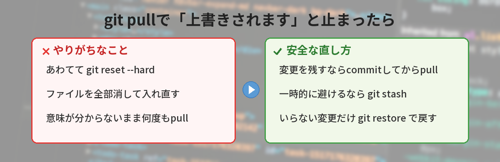
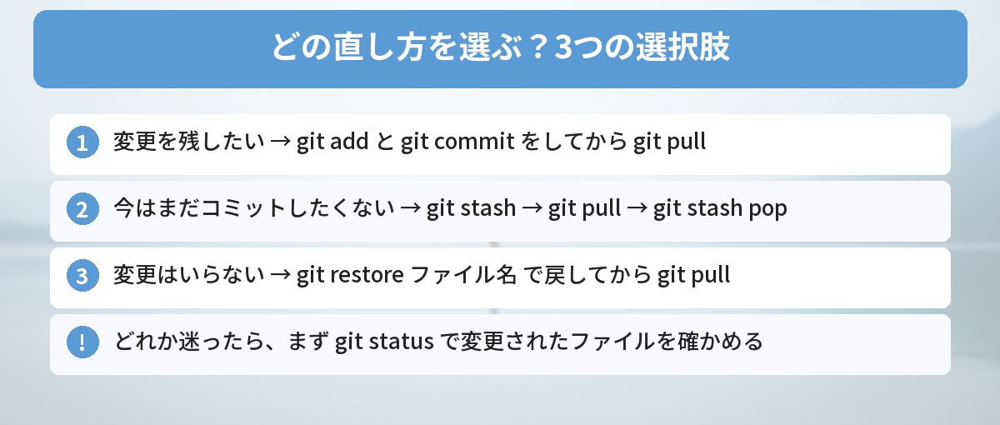

## この記事で分かること

git pullしたら「Your local changes … would be overwritten by merge」って英語が出て止まったの…。上書きって、私が書いたコードが消えちゃうってこと？


安心して。そのメッセージは「このままだと消えちゃうから、いったん止めたよ」っていう意味なんだ。Gitが守ってくれた状態だから、まだ何も消えてないよ。



## こんな場面で困っていませんか？

`git pull` を実行したら、こんなメッセージが出て止まってしまった。

```text
error: Your local changes to the following files would be overwritten by merge:
        index.html
Please commit your changes or stash them before you merge.
Aborting
```

よくある困りごとは、この3つです。

- 「overwritten（上書き）」とあるので、自分の変更が消えたのではと焦る
- ネットで見た `git reset --hard` を打っていいのか分からない
- 何度 `git pull` しても同じメッセージで止まる

結論から言うと、**このエラーが出た時点では、あなたの変更は消えていません**。Gitは「まだ保存（コミット）していない変更があるファイルを、相手側の新しい内容で上書きしてしまう」ので、pullを止めてくれたのです。**変更を残したいならコミットしてから、一時的に避けたいなら `git stash`、いらないなら `git restore`** で片付けてから、もう一度pullします。



## 一言で説明すると

「あなたがまだコミットしていない変更と、リモート（GitHubなど）から届いた変更が、同じファイルでぶつかりそう。勝手に上書きしたくないから止めたよ」というメッセージです。

最後の `Please commit your changes or stash them before you merge.` が、そのまま直し方のヒントになっています。「マージ（取り込み）の前に、変更をコミットするか、stash（一時退避）してね」という意味です。

## なぜ起きるのか（仕組み）

### Gitには「3つの場所」がある

Gitでファイルを扱うときは、次の3つの場所を意識すると分かりやすくなります。

| 場所 | 意味 |
|------|------|
| 作業中のファイル | 今エディタで編集しているもの。まだGitに記録されていない |
| コミット | `git commit` で記録した、ある時点の保存版 |
| リモート | GitHubなど、ほかの人やほかのPCと共有している場所 |

`git pull` は、リモートの新しいコミットを取ってきて、自分の手元に取り込む命令です。このとき、取り込みたいファイルを、自分も「コミットせずに」編集していると、Gitはどちらを残せばいいか決められません。そこで、作業中の変更を守るために止まります。

### よくある原因

- 別のPCやGitHubの画面で直したあと、手元のPCでも同じファイルを編集していた
- チームの誰かが同じファイルを更新していた
- 自動で書き換わるファイル（設定ファイルや、ビルドで作られるファイル）が変わっていた

Gitの基本の流れは、[GitHubとは？最初の使い方ガイド](/posts/github-what-is-it/)や[ブランチが分からない人へ](/posts/git-branch-beginner/)でも解説しています。

## 実際に再現してみた

筆者のWindows PCで、練習用のリポジトリを2つ用意して、次のように再現しました（Git for Windowsで確認）。

1. 片方のリポジトリ（GitHubで直した想定）で `index.html` の1行目を書き換えて、コミットしてpushする
2. 手元のPCで、同じ `index.html` の別の行を編集して、コミットせずに保存する
3. 手元で `git pull` を実行する

結果は、冒頭と同じ `Your local changes to the following files would be overwritten by merge` でした。手元の `index.html` を開くと、自分の編集はそのまま残っていました。

### 気づいたこと

- **エラーが出ても、手元のファイルは何も変わっていない**。pullは途中で中止（Aborting）されている
- **編集した行がちがっても止まる**。Gitは「同じファイルにコミットしていない変更がある」こと自体で止める
- **コミットしてからpullすると、別の行の変更は自動で合わさった**。同じ行を両方で変えていた場合は、コンフリクト（競合）になる

コンフリクトになったときの直し方は、[マージコンフリクトの直し方 怖がらなくて大丈夫](/posts/git-merge-conflict-beginner/)で解説しています。

## 解決方法（3つの選び方）



まず、どのファイルが変更されているかを確かめます。

```bash
git status
```

`modified: index.html` のように表示されたファイルが、まだコミットしていない変更です。ここから、変更をどうしたいかで選びます。

### 方法1: 変更を残したい → コミットしてからpull

いちばんおすすめの方法です。

```bash
git add index.html
git commit -m "見出しの文言を修正"
git pull
```

別の行を変えていただけなら、そのまま自動で合わさります。同じ行を変えていたらコンフリクトになるので、ファイルを開いて残したい内容に直し、もう一度コミットします。

### 方法2: まだコミットしたくない → stashで一時退避

作業の途中で、まだコミットするほどではないときに使います。

```bash
git stash          # 変更を一時的にしまう
git pull           # 新しい内容を取り込む
git stash pop      # しまった変更を戻す
```

`git stash` は、作業中の変更を「引き出しにしまう」ようなコマンドです。`git stash pop` で取り出すと、新しい内容の上に自分の変更が戻ります。ここで同じ行がぶつかると、コンフリクトとして表示されます。

### 方法3: 変更はいらない → restoreで戻してからpull

試しに書き換えただけで、いらない変更なら、そのファイルを元に戻してからpullします。

```bash
git restore index.html
git pull
```

**`git restore` で戻した変更は、元に戻せません**。本当にいらないか、実行前に必ず確認しましょう。


迷ったら、どれを選べばいいの？


迷ったら方法1のコミットか、方法2のstashだね。どっちも変更が消えないから安全なんだ。方法3は「絶対いらない」と分かっているときだけにしよう。


## やってはいけないこと

### いきなり git reset --hard

ネットで「`git reset --hard` で直る」と書かれていることがありますが、これは**コミットしていない変更をすべて消す**コマンドです。エラーは消えますが、自分の作業も消えます。何を消すか分かっていないうちは使わないでください。

### フォルダーを消して入れ直す

リポジトリのフォルダーを丸ごと消して `git clone` し直すと、まだコミットしていない変更はなくなります。どうしても入れ直したいときは、先に変更したファイルを別の場所にコピーしておきましょう。

### 同じコマンドを何度もくり返す

原因を片付けないまま `git pull` を何度実行しても、同じメッセージで止まります。まず `git status` で、何が変わっているかを見るのが近道です。

## ハマりやすいポイント

このエラーは、自分では何も編集していないつもりのときにも出ることがあります。よくあるのが `package-lock.json` です。`npm install` を実行したときに、自動で書き換わっていることがあります。

このように、**自分が直接いじっていないファイルが、ツールによって書き換わっている**ことがあります。`npm install` のあとの `package-lock.json` や、エディタの設定ファイルがよくある例です。自分で変えた覚えがないファイルが出てきたら、変更内容を `git diff ファイル名` で見て、いらなければ方法3で戻すと片付きます。npmの基本は[npmとは？yarnとの違いも含めて5分で解説](/posts/npm-yarn-beginner/)をどうぞ。

## よくある質問（FAQ）

### Q: このエラーが出たら、変更は消えていますか？
A: 消えていません。pullは中止されていて、手元のファイルはそのままです。

### Q: 「untracked working tree files would be overwritten」と出ました。同じですか？
A: 似ていますが、こちらは「Gitで管理していない新しいファイル」がぶつかる場合です。必要なファイルなら別の場所に移すか名前を変えてから、もう一度pullします。

### Q: git stash したあと、pop を忘れたらどうなりますか？
A: 変更はしまわれたまま残っています。`git stash list` で一覧を確認し、`git stash pop` で戻せます。

### Q: VS Codeのボタンでpullしたら、同じエラーが出ました。
A: VS Codeの「プル」も中では `git pull` を実行しているので、直し方は同じです。ソース管理の画面で変更をコミットするか、「stash」してからもう一度プルします。

### Q: git restore と git checkout はちがうものですか？
A: 変更を戻す用途なら同じように使えます。`git restore` は、ファイルを戻すための新しい分かりやすいコマンドです。


このエラーは「消える前に止めてくれた」合図なんだね。まず git status、残したいならコミット、途中ならstash、いらないならrestore！


完璧！`git reset --hard` だけは、意味が分かるまで使わないでね。


## まとめ

- 「Your local changes … would be overwritten by merge」は、コミットしていない変更を守るためにpullが止まったという意味
- エラーが出た時点では、手元の変更は消えていない
- まず `git status` で、変更されたファイルを確かめる
- 残したいならコミットしてからpull、途中なら `git stash` → `git pull` → `git stash pop`、いらないなら `git restore`
- `git reset --hard` やフォルダーの削除は、変更が消えるので使わない

---
### あわせて読みたい
- [【Git】マージコンフリクトの直し方 怖がらなくて大丈夫](/posts/git-merge-conflict-beginner/)
- [【Git】git pushでrejectedエラーが出たときの対処法](/posts/git-first-push-error/)
