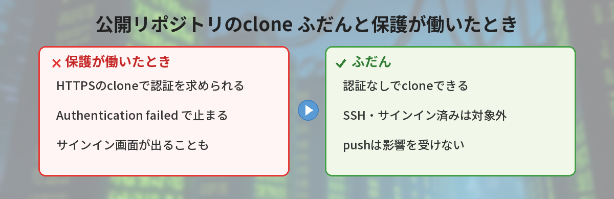
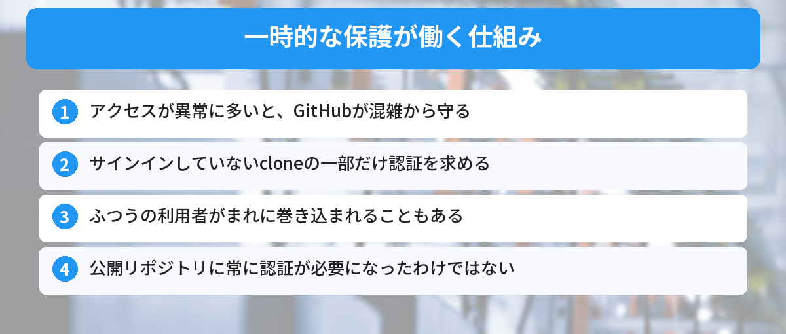
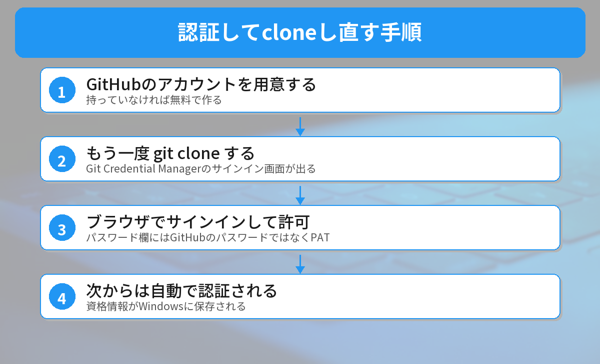

## この記事で分かること

チュートリアルどおりに公開リポジトリを git clone したら「Authentication failed」って出たの…。公開されてるのに、なんでログインが必要なの？


それ、10月19日にGitHubが発表した「一時的な保護」かもしれないね。アクセスが多すぎるときに、一部のcloneで認証を求めることがあるんだ。故障じゃないから安心して。直し方を3つ紹介するよ。


こんな場面で困っていませんか？
- 公開リポジトリを `git clone` したら `fatal: Authentication failed` で止まった
- 何もしていないのに、GitHubへのサインインを求める画面が出てきた
- 昨日まで動いていた自動処理（CI）のcloneが、急に失敗するようになった

## GitHubが発表した「一時的に認証を求める」仕組みとは
GitHubは2026年10月19日の[公式のお知らせ（GitHub Changelog）](https://github.blog/changelog/2026-10-19-some-git-over-https-may-temporarily-require-authentication/)で、次のように案内しました。

- 異常にアクセスが多い時間帯は、**公開リポジトリのHTTPSでのcloneやfetchに、一時的に認証を求めることがある**
- 対象になった操作は、**認証が必要というメッセージで失敗する**
- **公開リポジトリに常に認証が必要になったわけではない**
- github.com上のリポジトリが対象で、プラン（無料・有料）に関係なく適用される

つまり、GitHubが混雑から自分のサービスを守るために、「サインインしていない人からのダウンロード」を一時的に制限することがある、ということです。

### 影響を受けない操作
お知らせでは、次の操作は影響を受けないとされています。

- サインイン（認証）したうえでのHTTPSの操作
- SSHでの操作
- push（アップロード）
- GitHubのWeb画面やAPIへのアクセス



## なぜ「公開」なのに認証を求められるのか（仕組み）
cloneは、GitHubのサーバーからリポジトリのデータを丸ごとダウンロードする操作です。プログラムが大量にcloneをくり返すと、サーバーが混み合って、ほかの利用者まで使いにくくなります。

そこでGitHubは、怪しいアクセスに共通する特徴（シグナル）を見て、**サインインしていないアクセスの一部にだけ**「先にサインインしてください」と返すようにしています。

ただし、ふつうの利用者のアクセスが、たまたま同じ特徴を持っていることもあります。GitHub自身も「正しい操作がまれに巻き込まれることがある」と認めています。**あなたの設定が壊れたわけではない**、というのが大事なポイントです。



## 実際に確かめてみた
2026年10月20日に、Windows 11（Git 2.53.0）で次の3つを試しました。

### 1. 認証を求められたときのメッセージ
本物のGitHubで保護を起こすことはできないので、手元に「認証が必要です」とだけ返すテスト用のサーバーを立てて、`git clone` してみました。資格情報（ログイン情報）を保存しておらず、入力もできない状態だと、次のように表示されて止まりました。

```text
Cloning into 'Hello-World'...
fatal: Authentication failed for 'http://127.0.0.1:8765/octocat/Hello-World.git/'
```

ふだんのWindowsのGitは、「Git Credential Manager」という資格情報の管理ツールが入っています。この場合は、エラーの代わりにGitHubへのサインイン画面が出ることがあります。

### 2. 本物のGitHubでのふつうのclone
同じ日に、GitHub公式の練習用リポジトリ `octocat/Hello-World` をHTTPSでcloneしたところ、認証なしで問題なく完了しました。保護は常に働いているわけではない、ということが分かります。

### 3. SSHのURLでのclone（鍵を登録していない場合）
SSHは保護の対象外ですが、GitHubにSSHの鍵を登録していない状態で試すと、次のエラーで失敗しました。

```text
git@github.com: Permission denied (publickey).
fatal: Could not read from remote repository.
```

**「SSHにすれば直る」は、鍵の準備ができている人だけ**の話です。ここは間違えやすいので注意してください。


SSHならいいって聞いて切り替えたら、別のエラーが出るところだったんだ…！


そうなんだ。慣れていないうちは、まず「待つ」か「サインイン」で十分だよ。



## 対処法1: しばらく待ってからやり直す
急ぎでなければ、いちばん手軽な方法です。保護は一時的なものなので、時間をおけば認証なしでcloneできるようになります。GitHubは解除までの時間を公表していないため、数十分〜数時間おいてから、同じコマンドをもう一度実行してみてください。

```bash
git clone https://github.com/ユーザー名/リポジトリ名.git
```

## 対処法2: GitHubにサインインしてからやり直す
すぐにcloneしたいときは、認証してからやり直すのが確実です。



### ステップ1: GitHubのアカウントを用意する
アカウントを持っていない場合は、無料のアカウントを作ります。作ったあとの使い方は[GitHubの最初の使い方ガイド](/posts/github-what-is-it/)で紹介しています。

### ステップ2: もう一度 git clone する
Windowsでふつうに入れたGitなら、cloneしたときにGit Credential Managerのサインイン画面が出ます。「Sign in with your browser（ブラウザでサインイン）」を選び、開いたブラウザでGitHubにログインして許可します。

### ステップ3: 次からは自動で認証される
一度サインインすると、資格情報がWindowsに保存され、次からは自動で使われます。

### パスワードの入力欄が出たときは
ターミナルに `Username` や `Password` の入力欄が出ることもあります。ここに**GitHubのパスワードを入れても通りません**。GitHubは2021年8月から、Gitの操作でのパスワード認証をやめているからです。代わりに、GitHubの設定画面で作る**個人用アクセストークン（PAT）**をパスワード欄に入れます。

## 対処法3: SSHの鍵がある人はSSHのURLを使う
すでにGitHubにSSHの鍵を登録している人は、SSHのURLでcloneすると、この保護の影響を受けません。

```bash
git clone git@github.com:ユーザー名/リポジトリ名.git
```

前の章で試したとおり、鍵がない状態では失敗します。鍵の作り方から始めるなら、まずは対処法2のサインインで進めるほうが早いです。

## 自動処理（CI）でcloneしている人へ
GitHub Actionsなど、人が操作しない仕組みでcloneしている場合は、待っても毎回失敗することがあります。GitHubは次の方法をすすめています。

- **GitHub Actions**: 組み込みの `GITHUB_TOKEN` で認証する（`actions/checkout` は標準でこれを使います）
- **ほかのCIサービス**: GitHub Appのトークンを使う。個人用アクセストークンでもよい
- **どうしても認証できない処理**: 保護が解除されてから、やり直す

GitHub Actionsの基本は[初心者向けGitHub Actions入門](/posts/github-actions-beginner/)で解説しています。

## やってはいけないこと
### トークンをURLに直接書く
`https://トークン@github.com/...` のようにURLにトークンを書くと、`.git/config` やコマンドの履歴に残ります。人に見られたり、うっかりpushしたりする危険があります。

### 証明書の確認をオフにする
ネットには `http.sslVerify false` で通信の安全確認をオフにする方法が出てくることがありますが、今回の問題とは関係ありません。安全性が下がるだけなので、使わないでください。

### 何度も連続でcloneし直す
失敗のたびに連続でやり直すと、かえって怪しいアクセスに見えてしまうことがあります。少し時間をおきましょう。

pushで別のエラーが出たときは[git pushでrejectedエラーが出たときの対処法](/posts/git-first-push-error/)も参考にしてください。




公開リポジトリでも、混んでいるときは「先にサインインしてね」って言われることがあるんだね。急がないなら待つ、急ぐならサインイン！


その通り。パスワード欄にGitHubのパスワードを入れても通らない、ということも覚えておくと迷わないよ。


## まとめ
- GitHubは2026年10月19日から、混雑時に公開リポジトリのHTTPSのcloneやfetchで、一時的に認証を求めることがある
- 公開リポジトリに常に認証が必要になったわけではない。設定が壊れたわけでもない
- 急がないなら、時間をおいてやり直す
- 急ぐなら、Git Credential ManagerやPATでGitHubに認証してからやり直す
- SSHは対象外だが、鍵を登録していないと別のエラーになる

---
### あわせて読みたい
- [【Git】git pullで「Your local changes would be overwritten」の直し方](/posts/git-pull-local-changes-overwritten/)
- [【Git】git pushでrejectedエラーが出たときの対処法](/posts/git-first-push-error/)
