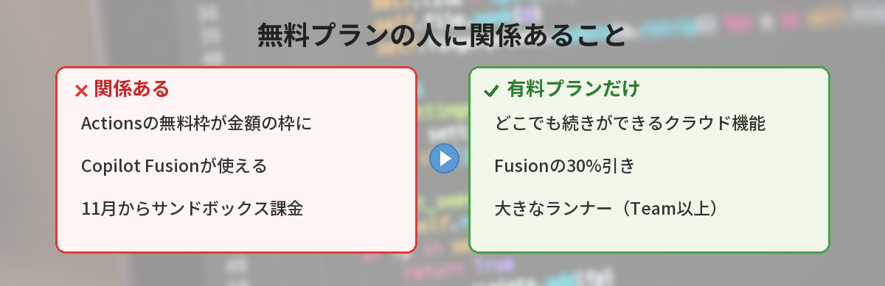
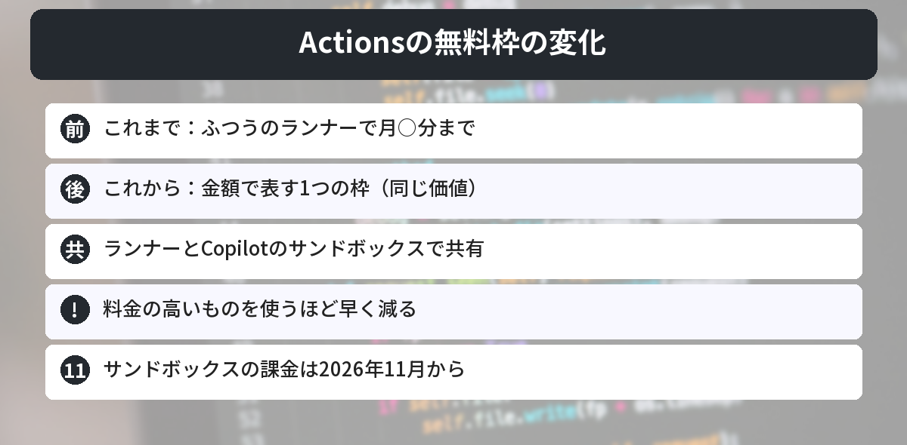
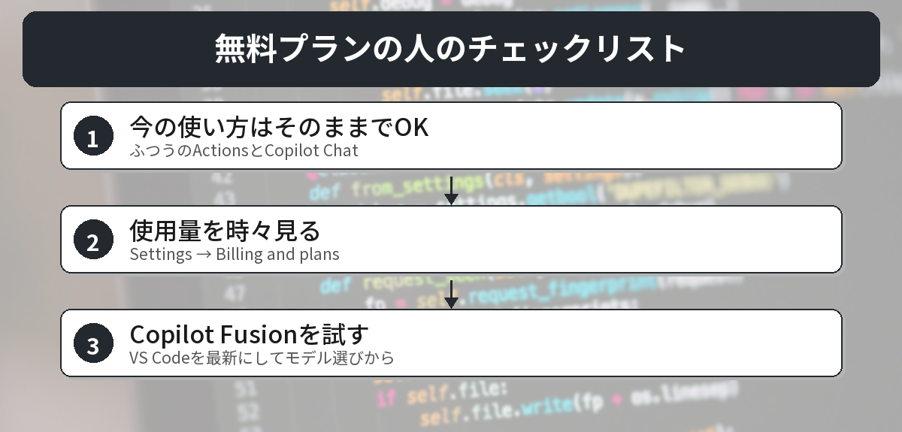

## この記事で分かること

GitHub Universeっていうイベントで、新しい発表がいっぱい出たみたい。私は無料プランで使ってるだけなんだけど、何か変わるの？


発表は会社向けのものが多いんだけど、無料プランの人にも関係あるのが2つあるよ。GitHub Actionsの無料枠の数え方と、モデルを自動で選んでくれる「Copilot Fusion」だね。そこにしぼって説明するね。


こんなことが気になっていませんか？
- GitHub Actionsの無料枠は減るの？
- 新しいCopilotの機能は無料で使えるの？
- 何か設定を変えないといけないの？

この記事は、GitHubの公式チェンジログ「[Copilot cloud experience](https://github.blog/changelog/2026-10-28-work-from-anywhere-with-a-new-connected-copilot-cloud-experience/)」「[Copilot Fusion](https://github.blog/changelog/2026-10-28-route-and-orchestrate-models-with-github-copilot-fusion/)」（2026年10月29日に確認）をもとにまとめています。

## GitHub Universe 2026で何が発表された？
GitHub Universeは、GitHubが毎年開く大きな発表イベントです。2026年は10月28日（米国時間）に、Copilotのクラウド機能、モデルを自動で選ぶCopilot Fusion、GitHub Actionsでエージェントを動かす「Agentic Workflows」の正式提供など、たくさんの発表がありました。

ここでは、**無料プランで使っている人に関係があるもの**を中心に見ていきます。



## 1. GitHub Actionsの無料枠が「金額」の枠に

### これまで
GitHub Actionsの無料枠は、「ふつうのランナーで月○分まで」という**分数**で決まっていました。

### これから
無料枠が、**金額で表す1つの枠**になります。GitHubは「同じ価値」と説明しています。この1つの枠から、次のものを使います。

- ふつうのGitHubホストのランナー（今までどおりのActions）
- Copilotが作業する**クラウドサンドボックス**
- 大きなランナー（TeamとEnterprise Cloudだけ）

それぞれ決まった料金で枠から引かれるので、**料金の高いものを使うほど早く減ります**。枠は請求の期間ごとにリセットされます。

### 対象のプラン
GitHub Free、Pro、Free for organizations、Team、Enterprise Cloudが対象です。クラウドサンドボックスの課金は**2026年11月から**始まり、この枠から引かれます。


私はpushしたらテストが動くだけの使い方なんだけど、何か変わる？


ふつうのランナーだけなら、使い方を変える必要はないよ。気をつけたいのは、同じ枠からCopilotのクラウド作業も使うようになった人だね。そのぶん枠が早く減るんだ。


Actionsの基本は[GitHub Actions入門](/posts/github-actions-beginner/)で解説しています。

## 2. Copilot Fusionが無料プランでも使える
### Copilot Fusionとは
これまでは、Copilotを使うときに「どのAIモデルを使うか」を自分で選んでいました。**Copilot Fusion**を選ぶと、**作業ごとにCopilotがモデルを選び、組み合わせて**くれます。

組み合わせ方は、たとえば次のとおりです。

- **Single**：1つのモデルで答える
- **Cascade**：軽いモデルが下書きし、足りなければ強いモデルに回す
- **Critique**：1つのモデルが書いて、別のモデルが見直す

### 力の入れ具合を選ぶ
| 選択肢 | 向いている作業 |
|------|------|
| Fusion Standard | ふだんのコーディング |
| Fusion High | むずかしい作業 |
| Fusion Max | いちばん重い作業 |

### 使える場所とプラン
**すべてのCopilotプラン**で、VS Code、GitHub Copilotアプリ、Copilot CLI、JetBrainsのIDEで使えます。使うには、アプリを最新にして、モデル選びで「Copilot Fusion」を選び、力の入れ具合を選びます。

### 料金の数え方
Fusionが使った**各モデルのふつうの料金**で数えられます。有料プランでは期間限定で、Fusion利用時のモデル料金が**30%引き**です。Copilotの料金のしくみは[Copilotの使用量ベースの課金の記事](/posts/github-copilot-usage-billing/)にまとめています。

## 無料プランでは使えないもの
### 新しいCopilotのクラウド機能
github.com、GitHub Mobile、Copilot CLI、VS Code、Slack、Teamsのどこから始めても、**同じ作業の続きができる**新しいCopilotのクラウド機能が始まりました。スマホから声で頼んで、パソコンで仕上げる、といった使い方ができます。

ただし、これは**有料のCopilotプランだけ**です。無料プランでも、github.comやGitHub MobileのCopilot Chatはこれまでどおり使えます。

## 何をすればいい？

1. **今の使い方をそのまま続けてOK**：ふつうのActionsとCopilot Chatだけなら、急いで変えることはありません
2. **Actionsの使用量を時々見る**：GitHubの［Settings］→［Billing and plans］で確かめられます
3. **Copilot Fusionを試す**：VS Codeを最新にして、モデル選びから選んでみる

無料のCopilotの使い方は、[GitHub Copilotの無料プランの記事](/posts/github-copilot-free/)で解説しています。




Actionsは数え方が金額になるだけで、ふつうに使うなら大丈夫。Fusionは無料でも試せる、だね！


その通り。11月からクラウドサンドボックスの課金が始まるから、Copilotのクラウド作業を使う人は、使用量の画面を一度見ておくと安心だよ。


## まとめ
- GitHubは2026年10月28日（米国時間）、GitHub Universe 2026でたくさんの新機能を発表
- GitHub Actionsの無料枠が、分数から金額の1つの枠に変わる（Freeも対象）
- クラウドサンドボックスの課金は2026年11月から、同じ枠から引かれる
- モデルを自動で選ぶCopilot Fusionは、すべてのCopilotプランで使える
- どこからでも続きができる新しいCopilotのクラウド機能は、有料プランだけ

---
### あわせて読みたい
- [【GitHub Copilot】無料プランでAIにコードを書いてもらう方法](/posts/github-copilot-free/)
- [【GitHub Actions】pushしたら自動テスト！初心者向けCI/CD入門](/posts/github-actions-beginner/)
