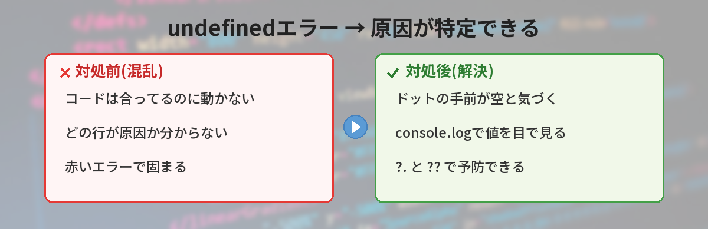
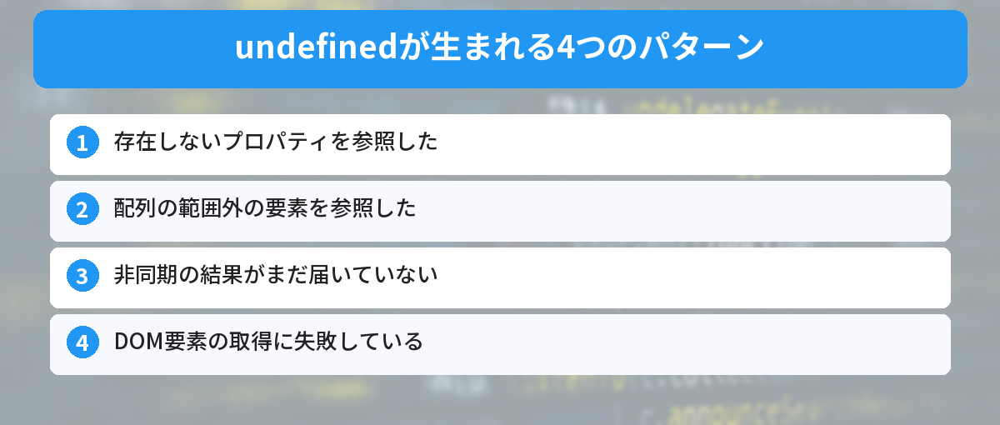
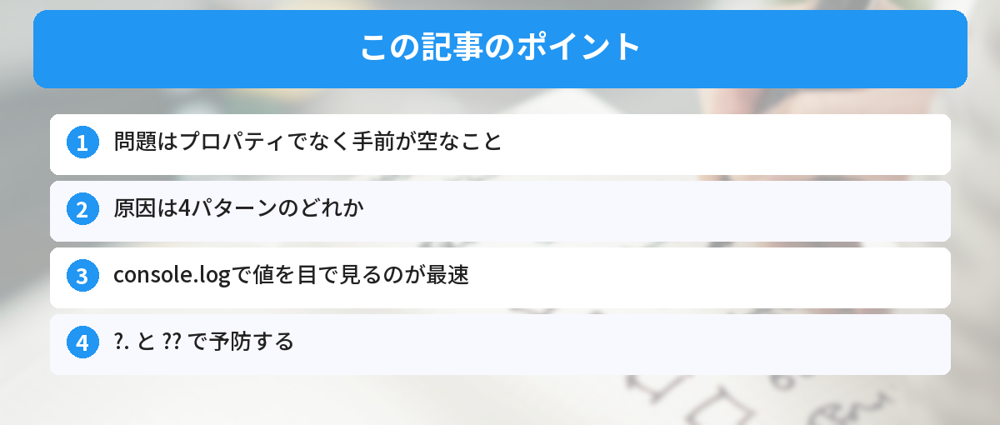

## この記事で分かること


「Cannot read properties of undefined」ってエラーが出たの…コードは合ってるように見えるのに、どこが悪いの？



JavaScriptで一番よく見るエラーのひとつだね。「空っぽ(undefined)のものから、中身を取り出そうとした」ときに出るんだ。自分も最初はこれで何度もハマったよ。原因のパターンが決まってるから、順番に見ていこう。




ブラウザのコンソールに、こんな赤いエラーが出た。

```
Uncaught TypeError: Cannot read properties of undefined (reading 'name')
```

コードは一見正しそうなのに、なぜか動かない。初心者がJavaScriptで最初にぶつかる定番のエラーです。でも大丈夫、このエラーは**原因のパターンが決まっている**ので、順番に確認すれば必ず特定できます。ターミナルやコンソールの操作に不安がある人は、先に[コマンドラインが怖い人へ](/posts/command-line-scary/)も読んでおくとスムーズです。



## このエラーが言っていること

まずエラー文を日本語で読み解きます。

```
Cannot read properties of undefined (reading 'name')
= undefined のプロパティ 'name' を読み取れません
```

これは「`何か.name` と書いたけど、その"何か"が `undefined`(空っぽ)だった」という意味です。`undefined.name` は存在しないので、JavaScriptが「読み取れない」とエラーを出します。

つまり問題は `name` ではなく、**その手前の"何か"が undefined になっていること**です。ここを突き止めるのがゴールです。

## なぜ undefined になるのか（原因パターン）

undefinedが生まれる場所は、だいたい次の4パターンです。



### パターン1: オブジェクトに存在しないプロパティ

```javascript
const user = { name: "さとう" };
console.log(user.profile.age); // user.profile が undefined → エラー
```

`user` に `profile` が無いので `user.profile` は undefined。その先の `.age` でエラーになります。

### パターン2: 配列の存在しない要素

```javascript
const list = ["a", "b"];
console.log(list[5].toUpperCase()); // list[5] が undefined → エラー
```

要素数を超えた位置を参照すると undefined になります。[配列の操作メソッド](/posts/javascript-array-methods/)を使うときも、空配列に注意が必要です。

### パターン3: APIやfetchの結果がまだ来ていない

```javascript
let data;
fetch("/api/user").then(res => res.json()).then(json => data = json);
console.log(data.name); // この時点で data はまだ undefined → エラー
```

非同期処理の結果を待たずにアクセスすると起きます。この仕組みは[fetch APIの使い方](/posts/javascript-fetch-api/)や[async/awaitの基本](/posts/javascript-async-await/)で詳しく解説しています。

### パターン4: DOM要素の取得に失敗している

```javascript
const btn = document.querySelector(".button");
btn.addEventListener("click", ...); // 要素が見つからないと btn は null → 似たエラー
```

セレクタのタイプミスや、要素がまだ描画されていないと取得に失敗します。

## 原因を特定する手順

### ステップ1: エラーの「手前」を疑う

`a.b.c` でエラーなら、`a` と `a.b` のどちらが undefined かを確認します。

```javascript
console.log(user);          // userの中身を確認
console.log(user.profile);  // どこで undefined になるか切り分け
```

### ステップ2: console.logで途中の値を見る

エラーが出る行の手前で `console.log` を入れて、値がどこで空になるか追います。これが一番確実な方法です。

### ステップ3: 非同期なら「待てているか」を確認

APIやfetchが絡むなら、データが届く前にアクセスしていないかを確認します。`await` や `.then()` の中で使えているかが鍵です。

## 予防する書き方

### オプショナルチェーン（?.）を使う

```javascript
// user.profile が無くてもエラーにならず undefined を返す
console.log(user.profile?.age);
```

`?.` は「手前が undefined/null ならそこで止めて undefined を返す」書き方です。詳しくは[オプショナルチェーンの使い方](/posts/javascript-optional-chaining/)で解説しています。

### デフォルト値を用意する

```javascript
const age = user.profile?.age ?? "未設定";
```

`??` で「undefinedなら代わりの値」を指定できます。

## 筆者がハマったポイント

実際に自分がハマったのは、パターン3(非同期)でした。`fetch` の結果を使おうとして、データが届く前に `console.log(data.name)` を書いていた。コードの見た目は正しいのに動かず、30分悩みました。

解決のきっかけは「エラーが出る1行手前で `console.log(data)` して、`undefined` だと気づいた」こと。**値を目で見るのが最速の近道**でした。

## よくある質問（FAQ）



### Q: undefined と null は同じですか？
A: 似ていますが別物です。undefinedは「値が設定されていない」、nullは「意図的に空を入れた」状態です。どちらもプロパティ参照でエラーになります。

### Q: エラーの「reading 'name'」の name は何ですか？
A: 読み取ろうとしたプロパティ名です。その手前のオブジェクトが undefined だったことを示しています。

### Q: オプショナルチェーン（?.）を付ければ全部解決しますか？
A: エラーは止められますが、根本原因（なぜ undefined になるか）は別途確認が必要です。隠すだけでなく原因も直しましょう。

### Q: どの行が原因か分かりません。
A: エラーメッセージの行番号を見て、その行の「ドットの手前」の値を console.log で確認してください。

### Q: Reactなど他のライブラリでも同じですか？
A: はい、JavaScriptのエラーなのでReactやVueでも同じ考え方で特定できます。


なるほど…！`name` じゃなくて、その手前が空っぽだったんだ！console.logで中身を見ればいいんだね！



そういうこと！「ドットの手前を疑う」「値を目で見る」。この2つを覚えておけば、このエラーはもう怖くないよ。


## まとめ

- 「Cannot read properties of undefined」は、空っぽのものから中身を取り出そうとして出る
- 問題は読み取ろうとしたプロパティではなく、その手前が undefined なこと
- 原因は「存在しないプロパティ / 配列範囲外 / 非同期の未完了 / DOM取得失敗」のどれか
- 特定のコツは、エラーの手前を console.log で目で見ること
- 予防にはオプショナルチェーン（?.）とデフォルト値（??）が有効

---
### あわせて読みたい
- [オプショナルチェーン（?.）の使い方 ― undefinedエラーを防ぐ](/posts/javascript-optional-chaining/)
- [fetch APIの使い方 ― 非同期でデータを取得する](/posts/javascript-fetch-api/)

<!-- affiliate -->
## 関連リソース

JavaScriptを基礎から体系的に学びたい方に、評価の高い入門書をまとめました。

<!-- START MoshimoAffiliateEasyLink -->
<script type="text/javascript">
(function(b,c,f,g,a,d,e){b.MoshimoAffiliateObject=a;b[a]=b[a]||function(){arguments.currentScript=c.currentScript||c.scripts[c.scripts.length-2];(b[a].q=b[a].q||[]).push(arguments)};c.getElementById(a)||(d=c.createElement(f),d.src=g,d.id=a,e=c.getElementsByTagName("body")[0],e.appendChild(d))})(window,document,"script","//dn.msmstatic.com/site/cardlink/bundle.js?20220329","msmaflink");
msmaflink({
  "n":"JavaScript入門書",
  "b":"","t":"",
  "d":"https://thumbnail.image.rakuten.co.jp",
  "c_p":"",
  "p":[""],
  "u":{"u":"https://search.rakuten.co.jp/search/mall/JavaScript+%E5%85%A5%E9%96%80/","t":"rakuten","r_v":""},
  "v":"2.1",
  "b_l":[
    {"id":1,"u_tx":"楽天市場で見る","u_bc":"#f76956","u_url":"https://search.rakuten.co.jp/search/mall/JavaScript+%E5%85%A5%E9%96%80/","a_id":5490814,"p_id":54,"pl_id":27059,"pc_id":54,"s_n":"rakuten","u_so":1},
    {"u_bc":"#f79256","u_tx":"Amazonで見る","u_url":"https://www.amazon.co.jp/s/ref=nb_sb_noss_1?__mk_ja_JP=%E3%82%AB%E3%82%BF%E3%82%AB%E3%83%8A&url=search-alias%3Daps&field-keywords=JavaScript+%E5%85%A5%E9%96%80","s_n":"amazon","u_so":2,"a_id":5490817,"p_id":170,"pc_id":185,"pl_id":27060,"id":2}
  ],
  "eid":"jsundefined",
  "s":"s"
});
</script>
<div id="msmaflink-jsundefined">リンク</div>
<!-- MoshimoAffiliateEasyLink END -->
<!-- /affiliate -->
