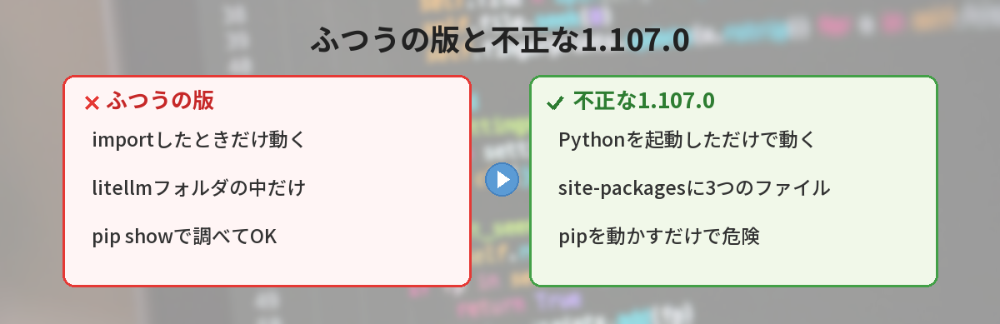
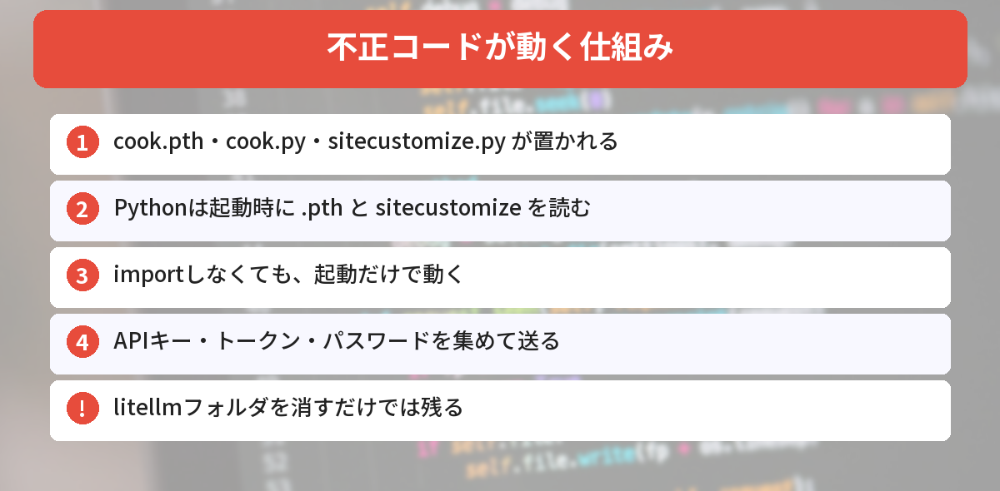
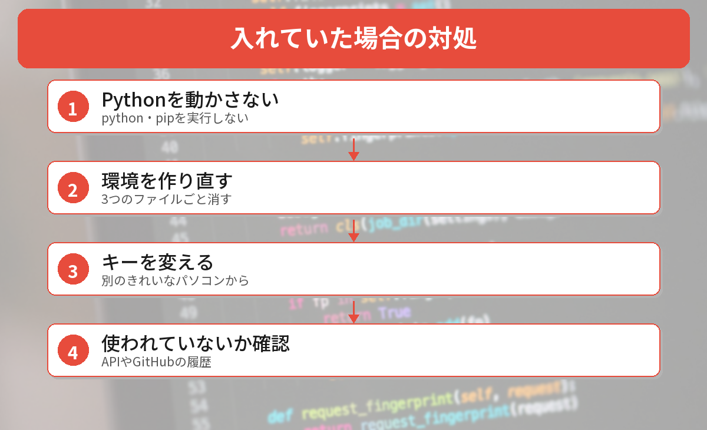

## この記事で分かること

AIのAPIを試すのに「LiteLLM」を入れたことがあるの。そしたら「不正なコードが入っていた」ってニュースが出てて…。私のパソコン、大丈夫かな？


問題があったのは10月21日に出た「1.107.0」だけだよ。ただ、確かめ方に1つ大事な注意があるんだ。「pipで調べる」のはNG。理由と、安全な確かめ方を説明するね。



こんなことで困っていませんか？
- LiteLLMを入れたことがあるけど、どの版か分からない
- `pip show` で調べていいのか分からない
- 入れていたら、何をすればいいのか知りたい

この記事は、[Microsoftのセキュリティブログ（10月23日）](https://www.microsoft.com/en-us/security/blog/2026/10/23/inside-the-litellm-1-107-0-supply-chain-compromise-credential-theft-through-python-startup-hooks/)と[Datadog Security Labsの解説](https://securitylabs.datadoghq.com/articles/litellm-compromised-pypi-docker/)（2026年10月26日に確認）をもとにまとめています。

## 何が起きたの？
LiteLLMは、ChatGPTやClaude、Geminiなど、いろいろなAIのAPIを同じ書き方で呼べるPythonのライブラリです。1週間に約2,300万回ダウンロードされている人気のライブラリです。

2026年10月21日、このLiteLLMの**1.107.0**が、不正なコード入りで公開されました。

| 項目 | 内容 |
|------|------|
| 問題の版 | **litellm 1.107.0**（PyPI） |
| Dockerイメージ | v1.107.0、latest、main-latest、main-stable のタグ（当時） |
| 公開されていた時間 | PyPIで約2時間（日本時間 10月21日 20時39分〜22時20分ごろ） |
| 今の状態 | PyPIから削除済み。Dockerイメージも削除・差しかえ済み |

開発者のGitHubのトークンが盗まれ、公開の流れ（リリース用のワークフロー）が、名前がそっくりなニセのリポジトリ（`Berri-AI/litellm`、本物は`BerriAI/litellm`）に向けられていたと説明されています。



## なぜ危ないの？（仕組み）


不正な版を入れると、次の3つのファイルが`site-packages`フォルダに置かれます。

- `cook.pth`
- `cook.py`
- `sitecustomize.py`

Pythonには、**起動するたびに`.pth`ファイルと`sitecustomize.py`を自動で読みこむ**しくみがあります。そのため、

- LiteLLMを`import`していなくても
- **その環境でPythonを起動しただけで**

不正コードが動きます。Microsoftの調査では、Windowsで**別のライブラリを入れようとしてpipを動かしただけ**で、盗むプログラムが動いた例も確認されています。

### 何が盗まれる？
調査では、次のようなものをねらうと説明されています。

- AIサービスのAPIキー、ClaudeやCopilotなどAIコーディングツールのログイン情報
- GitHub、npm、PyPIのトークン、`.env`ファイル、SSHの鍵
- AWS・Azure・Google Cloudの認証情報
- ブラウザに保存したパスワードやクッキー


起動しただけで動くなんて…。だから「pipで調べちゃだめ」なんだね。


そういうこと。pipもPythonで動くから、`pip show litellm`を打った時点でアウトになりうるんだ。だから、ファイルを直接探すよ。


## Pythonを動かさずに確かめる（実際にやってみた）
2026年10月26日に、Windows 11のこのパソコンで確かめました。PowerShellで、ユーザーフォルダの中から**問題のファイルと、1.107.0のインストール記録**を探します。

```powershell
Get-ChildItem -Path $env:USERPROFILE -Recurse -Force -ErrorAction SilentlyContinue -Include "cook.pth", "litellm-1.107.0*"
```

- 何も表示されなければ、ユーザーフォルダの中には見つからなかった、ということです
- `cook.pth` や `litellm-1.107.0.dist-info` が出てきたら、その環境は**入れてしまっている**可能性があります

このパソコンでは、Pythonのインストール先とブログ用のフォルダを探して、**どちらも0件**でした。フォルダの量によっては数分かかります。

### PyPIの今の状態も確かめた
PyPIの公開情報（JSON）を、PowerShellで取得しました。これはPythonを使わないので安全です。

```powershell
(Invoke-RestMethod "https://pypi.org/pypi/litellm/json").info.version
```

結果は **1.106.4** でした。版の一覧を見ると、**1.107.0は消えていて**、1.107.0rc1 などの試験版だけが残っていました。

### Macの場合
ターミナルで、次のように探せます。

```bash
find ~ -name "cook.pth" -o -name "litellm-1.107.0*" 2>/dev/null
```

## 入れていた場合の対処


### ステップ1: その環境でPythonを動かさない
該当する仮想環境では、`python`も`pip`も実行しないでください。動いているPythonのプログラムがあれば止めます。

### ステップ2: 不正なファイルを消して、環境を作り直す
- `site-packages` にある `cook.pth`・`cook.py`・`sitecustomize.py` を消す
- **litellmのフォルダを消すだけでは足りません**（不正なファイルはその外にあるため）
- いちばん確実なのは、**仮想環境のフォルダごと消して作り直す**ことです

作り直すときは、`litellm==1.107.0` を指定しないようにします。Datadogは、安全な版として1.106.2への戻しを案内しています。

```bash
python -m pip install "litellm!=1.107.0"
```

### ステップ3: 別のきれいなパソコンからパスワードやキーを変える
その環境から読めた可能性のある、次のものを変更します。

- AIサービス（OpenAI、Anthropic、Googleなど）のAPIキー
- GitHubのトークン、SSHの鍵
- クラウドの認証情報
- ブラウザに保存していたパスワード（ログイン中のセッションも切る）

変更は、**問題のパソコンではなく、別のきれいなパソコンやスマホ**から行います。

### ステップ4: 使われていないか確かめる
APIキーの利用履歴や、GitHubのセキュリティログに、心当たりのない使われ方がないかを見ます。

## これからの予防
- `requirements.txt` などで、**バージョンを固定**しておく（`litellm==1.106.4` のように）
- 出たばかりの版を、すぐに入れない
- APIキーは `.env` に入れっぱなしにせず、使わないキーは消しておく

仮想環境の基本は[仮想環境入門](/posts/python-venv-beginner/)で、最近のPythonの更新は[Python 3.15.1の記事](/posts/python-3151-security-release/)で解説しています。




pipで調べずにファイルを探す。見つかったら、環境を作り直して、別のパソコンからキーを変える。だね！


その通り。今回はPHPやNode.jsの更新も続いた週だから、使っているライブラリのバージョンをまとめて見直すいい機会だよ。


## まとめ
- 2026年10月21日、LiteLLM 1.107.0に、APIキーやパスワードを盗むコードが入って公開された
- PyPIには約2時間公開され、今は削除済み（10月26日時点の最新は1.106.4）
- 不正コードはPythonを起動しただけで動く。確かめるときにpythonやpipを使わない
- PowerShellやターミナルで `cook.pth` と `litellm-1.107.0` を探す
- 入れていたら、環境を作り直し、別のきれいなパソコンからキーやパスワードを変える

---
### あわせて読みたい
- [【Python】3.15.1・3.14.9・3.13.17が緊急公開 入れ直すべき人は？](/posts/python-3151-security-release/)
- [【Python】certifiの更新が必要？認証局の鍵漏えいで今やること](/posts/python-certifi-emudhra-update/)
