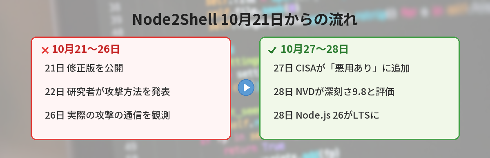
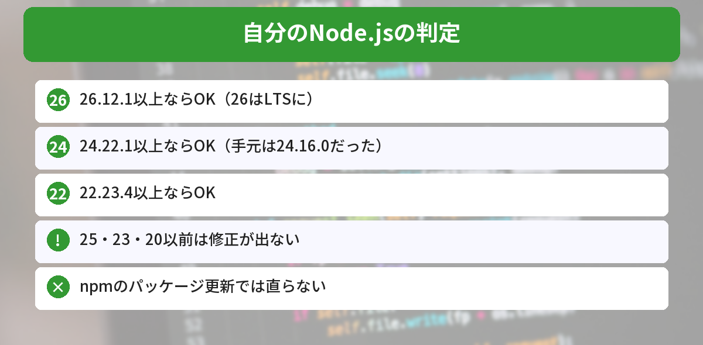
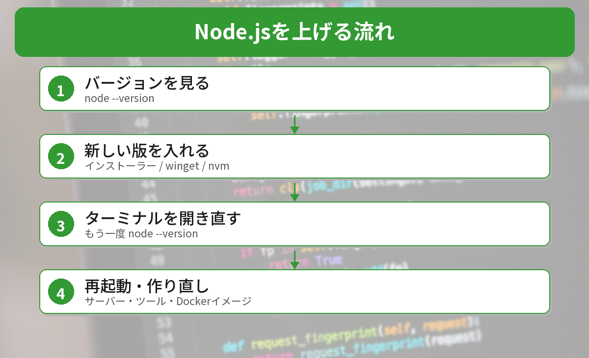

## この記事で分かること

先週「Node.jsを更新しよう」って記事を読んだのに、まだやってなかった…。今度は「実際に悪用された」ってニュースが出てて、ちょっとあせってる。


10月27日に、アメリカの政府機関が「実際に攻撃に使われている」と認めたんだ。実は、このパソコンのNode.jsも古いままだったよ。確かめ方と上げ方を一緒に見ていこう。



こんなことが気になっていませんか？
- 自分のNode.jsは対象なの？
- どのバージョンに上げればいいの？
- 「26がLTSになった」ってどういうこと？

修正版が出たときの記事は[10/21のNode.jsのセキュリティ更新の記事](/posts/nodejs-security-release-2026-10-21/)、PythonやPowerShellへの影響は[Brotli脆弱性の確かめ方の記事](/posts/brotli-node2shell-python-dotnet/)にまとめています。この記事は、その続報です。

## 何が起きたの？
| 日付 | できごと |
|------|------|
| 10月21日 | Node.jsが修正版（22.23.4・24.22.1・26.12.1）を公開 |
| 10月26日 | セキュリティ会社ELLIOが、実際の攻撃の通信を観測したと発表 |
| **10月27日** | **CISAが「実際に悪用された脆弱性（KEV）」の一覧に追加** |
| 10月28日 | NVDが深刻さを **9.8（緊急）** と評価。**Node.js 26がLTSに** |

CISAの「KEV」は、**実際に攻撃に使われた証拠がある脆弱性**の一覧です。ここに入ったということは、「いつか狙われるかも」ではなく、**もう狙われている**という意味です。アメリカの政府機関には、11月10日までに直すよう求めています。



## どんなときに危ないの？
問題は、圧縮形式「Brotli」のデータを**展開する部分**にあります。外から来た細工した圧縮データを展開すると、プログラムが落ちたり、乗っ取られたりするおそれがあります。

報告されている危ない使い方の例は次のとおりです。

- Node.jsの `fetch()` で、知らないサーバーからBrotliで圧縮された返事を受け取る
- Express 5 や body-parser 2 で、Brotliで圧縮されたリクエストを受け取る

**npmのパッケージを更新しても直りません**。直すには、Node.js本体を上げる必要があります。

## 自分のNode.jsを確かめてみた
2026年10月30日に、このWindows 11のパソコンで確かめました。

```bash
node --version
```

結果は **v24.16.0** でした。修正済みの **24.22.1より古い**ので、上げる必要があります。


記事を書いてる側のパソコンも古かったんだ…！


そうなんだ。一度入れたら、なかなか見直さないものなんだよね。だからこそ、こういうニュースのときに確かめるのが大事だよ。


### 判定表


| 今のバージョン | 判定 | やること |
|------|------|------|
| 26.12.1 以上 | 修正済み | そのままでOK |
| 26.0〜26.12.0 | **危ない** | 26.12.1以上に上げる |
| 24.22.1 以上 | 修正済み | そのままでOK |
| 24.0〜24.22.0 | **危ない** | 24.22.1以上に上げる |
| 22.23.4 以上 | 修正済み | そのままでOK |
| 22.0〜22.23.3 | **危ない** | 22.23.4以上に上げる |
| 25・23・20以前 | **修正が出ない** | 22・24・26に移る |

### いまの最新版（確かめた結果）
nodejs.orgの公開情報を10月30日に確かめると、各系列の最新は次のとおりでした。

| 系列 | 最新 | 状態 |
|------|------|------|
| 26 | 26.13.0（10月28日） | LTS（Lithium） |
| 24 | 24.22.2（10月27日） | LTS（メンテナンス期） |
| 22 | 22.23.4（10月20日） | LTS（メンテナンス期） |

## 「26がLTSになった」とは？
LTS（Long Term Support）は、**長い期間、修正が出続ける安定版**のことです。10月28日に **Node.js 26がLTS** になり、24は**メンテナンス期**（重要な修正だけが出る時期）に入りました。

- これから新しく入れるなら、**26（LTS）** も選べます
- 今24を使っているなら、まず**24.22.1以上**に上げるのが手軽です
- Node.jsは27から、**年に1回の新バージョン**の流れに変わります

## 上げ方（Windows）


### ステップ1: 今のバージョンを確かめる
```bash
node --version
```

### ステップ2: 新しい版を入れる
入れ方に合わせて選びます。

- **公式インストーラーで入れた場合**：[nodejs.orgのダウンロードページ](https://nodejs.org/ja/download)から、LTSのインストーラーを入れて上書きする
- **wingetを使う場合**：

```powershell
winget upgrade OpenJS.NodeJS.LTS
```

- **nvm for Windowsを使う場合**：

```powershell
nvm install 24.22.2
nvm use 24.22.2
```

### ステップ3: ターミナルを開き直して確かめる
```bash
node --version
```

`v24.22.1` 以上（または `v26.12.1` 以上、`v22.23.4` 以上）になっていれば完了です。動いているサーバーやツールは、**再起動**しないと古いまま動きます。

### 気をつけたいこと
- **Docker**を使っている人は、ベースのイメージを新しくして作り直す
- アプリやツールの中に、**別のNode.jsが入っている**こともある（その場合はアプリ側の更新を待つ）
- 古いプロジェクトでは、上げたあと `npm test` などで動きを確かめる




node --versionで見て、24なら24.22.1以上に上げる。npmの更新じゃ直らない、だね！


その通り。もう実際に狙われているから、今日のうちに確かめておこう。


## まとめ
- CISAは2026年10月27日、Node.jsのBrotliの脆弱性（CVE-2026-111497）を「実際に悪用された脆弱性」の一覧に追加
- 修正版は 22.23.4・24.22.1・26.12.1 以降。npmのパッケージ更新では直らない
- 手元のパソコンのNode.jsは24.16.0で、古いままだった
- 10月28日にNode.js 26がLTSに。24はメンテナンス期へ
- 20以前・23・25は修正が出ない。22・24・26に移る

---
### あわせて読みたい
- [【Node.js】10/21のセキュリティ更新が公開 24.22.1などへの上げ方](/posts/nodejs-security-release-2026-10-21/)
- [【Brotli脆弱性】PythonやPowerShell・.NETも更新が必要？自分のPCで確かめる方法](/posts/brotli-node2shell-python-dotnet/)
