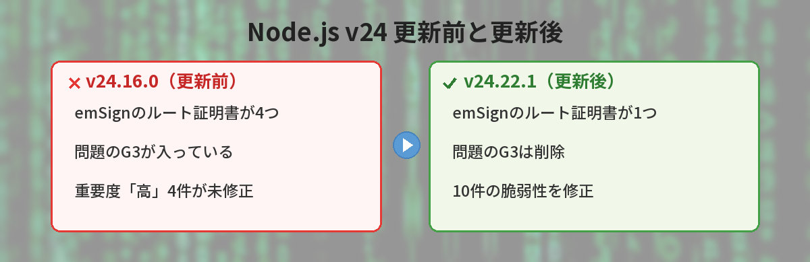
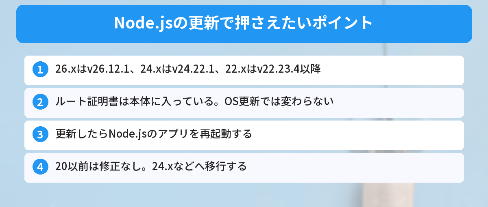
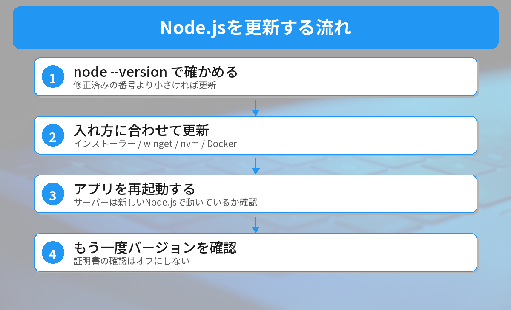

## この記事で分かること

この前「Node.jsが10月21日にセキュリティ更新を出す」って記事を読んだんだけど、本当に出たの？私は何番に上げればいいの？


予告どおり10月21日に出たよ。26.x・24.x・22.xそれぞれに新しい番号が出ているんだ。今回は、この前話題になった認証局eMudhraの証明書の対策も入っているよ。実際に新旧のNode.jsを比べてみたから、その結果も見せるね。



こんな場面で困っていませんか？
- セキュリティ更新が出たと聞いたけれど、自分のNode.jsが対象か分からない
- どの番号に上げればいいのか分からない
- 認証局の鍵漏えいの件で、Node.jsはどうなったのか気になっている

予告の段階の情報は、[10月17日の記事（予告編）](/posts/nodejs-security-release-2026-10/)でまとめました。この記事は、実際に公開された内容の続報です。

## 何が直ったのか？
[Node.jsの公式ブログ](https://nodejs.org/en/blog/vulnerability/october-2026-security-releases)によると、今回の更新では10件の脆弱性が直りました。重要度は「高」が4件、「中」が3件で、残りは「低」などです。

### 重要度「高」の4件
- **Brotliの展開処理の範囲外書き込み（CVE-2026-111497）**：圧縮データを展開するときに、決められた範囲の外にデータを書き込んでしまい、外からプログラムを実行される（RCE）おそれがある
- **TLSのホスト名確認のすり抜け（CVE-2026-105483、CVE-2026-106069）**：IPアドレスの書き方を工夫されると、証明書が本当にそのサーバーのものかの確認をすり抜けられる
- **dns.resolve が名前を途中で切ってしまう（CVE-2026-105482）**：特別な文字を含む名前で、DNSの問い合わせ結果がずれる

### 一緒に更新された部品
Node.jsが中に持っている部品も更新されました。

- **ルート証明書の一覧（eMudhraの中間認証局の鍵漏えいへの対応）**：26.x・24.x・22.x
- c-ares、Undici：26.x・24.x・22.x
- OpenSSL：24.x・22.x
- SQLite：22.x

認証局eMudhraの件は、[Pythonのcertifiの記事](/posts/python-certifi-emudhra-update/)でくわしく解説しています。Node.jsは**ルート証明書の一覧を本体に組み込んでいる**ので、OSを更新しても変わらず、Node.js自体の更新を待つ必要がありました。



## 自分のNode.jsは対象？上げる先の番号
| 使っている系列 | 修正済みのバージョン |
|------|------|
| Node.js 26.x | **v26.12.1** 以降 |
| Node.js 24.x（LTS） | **v24.22.1** 以降 |
| Node.js 22.x | **v22.23.4** 以降 |
| Node.js 20.x 以前 | 修正なし（サポート終了。移行が必要） |



今のバージョンは、ターミナルで次のコマンドを実行すると分かります。

```bash
node --version
```

Node.js 20 のサポート終了については[Node.js 20 サポート終了の記事](/posts/nodejs20-end-of-life/)を見てください。

## 実際に確かめてみた
2026年10月22日に、Windows 11で、ふだん入れているNode.js **v24.16.0** と、公式サイトから取ってきた修正版 **v24.22.1**（インストール不要のzip版）を比べました。Node.jsが中に持っているルート証明書の一覧から、eMudhraの「emSign」という名前の証明書を数えています。

| | v24.16.0（更新前） | v24.22.1（更新後） |
|------|------|------|
| emSignのルート証明書 | 4つ | 1つ |
| emSign ECC Root CA - G3（問題の証明書に署名したルート） | 入っている | **なくなった** |
| ルート証明書の総数 | 145 | 118 |

**問題のルート証明書（emSign ECC Root CA - G3）が消えている**ことを確認できました。ルート証明書の総数も145から118に減っていて、ほかの証明書の入れ替えもまとめて行われたことが分かります。

確認に使ったコマンドはこちらです。

```bash
node -e "const {X509Certificate}=require('node:crypto'); for (const p of require('node:tls').rootCertificates) { const s=new X509Certificate(p).subject; if (/emSign/i.test(s)) console.log(s.split('\n').find(x=>x.startsWith('CN='))); }"
```


更新するだけで、危ない証明書が中から消えてるんだね。数字で見ると分かりやすい！


そうなんだ。逆にいうと、更新しない限りNode.jsは古い一覧のままってこと。だから更新が大事なんだよ。


## 更新のしかた


### 公式サイトのインストーラーで入れた場合
[nodejs.org](https://nodejs.org/)から、使っている系列の最新版（24.xなら v24.22.1 以降）のインストーラーをダウンロードして、上書きでインストールします。

### wingetで入れた場合（Windows）
```bash
winget upgrade OpenJS.NodeJS.LTS
```

### nvmなどのバージョン管理ツールを使っている場合
```bash
nvm install 24.22.1
nvm use 24.22.1
```

### Dockerを使っている場合
Dockerfileのタグを修正済みの番号以降にして、イメージを取り直してから作り直します。

```bash
docker compose build --pull
docker compose up -d
```

### 更新できたか確かめる
```bash
node --version
```

番号が上の表の修正済みのバージョン以降になっていれば完了です。サーバーで動かしている場合は、**Node.jsのアプリを再起動**して、新しいNode.jsで動いているかも確かめましょう。

## 注意したいこと
### emSignの証明書を使うサイトにつながらなくなることがある
ルート証明書が一覧から外れたので、**emSign ECC Root CA - G3 につながる正規の証明書を使っているサイト**には、更新後のNode.jsからは接続できなくなる可能性があります。多くのサイトは関係ありませんが、もし特定のサイトだけ急に `certificate` のエラーが出るようになったら、この影響を疑ってください。

### 証明書の確認をオフにしない
エラーが出たからといって `NODE_TLS_REJECT_UNAUTHORIZED=0` で確認を止めるのはやめましょう。偽の証明書でも信じてしまう、いちばん危ない状態になります。

今週はほかにも大きなセキュリティ更新が続いています。PHPは[PHPの緊急の脆弱性の記事](/posts/php-critical-rce-2026-10/)で解説しています。




24.xなら v24.22.1 以降、26.xなら v26.12.1 以降、22.xなら v22.23.4 以降だね！さっそく node --version で見てみる。


完璧。20以前を使っていたら、これを機に24へ上げようね。


## まとめ
- Node.jsは2026年10月21日に v26.12.1・v24.22.1・v22.23.4 のセキュリティ更新を公開
- 重要度「高」の脆弱性4件と、eMudhraの件のルート証明書の削除が入っている
- 試すと、v24.16.0で4つあったemSignのルート証明書が、v24.22.1では1つに減り、問題のG3は消えていた
- 自分の系列の修正済みの番号以降に更新し、アプリを再起動する
- Node.js 20以前は修正がないので、24.xなどへ移行する

---
### あわせて読みたい
- [【Python】certifiの更新が必要？認証局の鍵漏えいで今やること](/posts/python-certifi-emudhra-update/)
- [【PHP緊急】重大な脆弱性の修正版が公開 今すぐやる更新方法まとめ](/posts/php-critical-rce-2026-10/)
