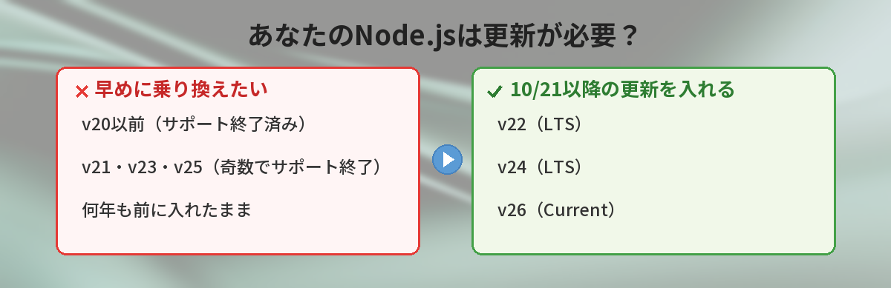
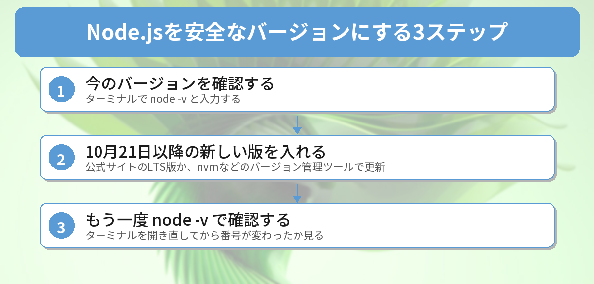

## この記事で分かること

「Node.jsが10月21日にセキュリティ更新」ってニュースを見たの。私のパソコンのNode.jsも何かしないといけない？そもそも、どのバージョンを入れたか覚えてない…


大丈夫、確かめ方は1行のコマンドだけだよ。自分のバージョンが対象かどうかと、更新のやり方を順番に説明するね。



こんなことで困っていませんか？

- Node.jsのセキュリティ更新のニュースを見たけど、自分に関係あるのか分からない
- 授業や教材のために入れたNode.jsが、いつのバージョンか覚えていない
- 更新したら、今まで動いていたものが動かなくならないか不安

結論から言うと、**ターミナルで `node -v` を打てば、自分のバージョンが分かります**。v22・v24・v26なら、10月21日以降に出る新しい版に更新すればOK。**v20以前や、v21・v23・v25のような奇数のバージョンは、すでにサポートが終わっている**ので、この機会にLTS版へ乗り換えましょう。

## 10月21日に何が出る？公式の予告

Node.jsの公式サイトは、次のようなお知らせを出しています。

- 2026年10月21日（水）か、その少しあとに、**v26・v24・v22**の新しいバージョンを出す
- 目的は、セキュリティの脆弱性（弱点）を直すこと
- 直す問題のうち、いちばん深刻なものの重要度は「HIGH（高）」
- **サポートが終わったバージョン（EOL）は、セキュリティ更新があるたびに必ず影響を受ける**

最後の1行が大事です。サポートが終わったバージョンには、もう修正版が出ません。つまり、古いNode.jsを使い続けると、見つかった弱点がずっと残ったままになります。


「サポートが終わった」って、どういうこと？


「もう直してもらえない」ってこと。お店の保証期間が切れた家電みたいなものだね。だから、サポート中のバージョンを使うのが基本なんだ。


## Node.jsのバージョンの仕組み

Node.jsには「LTS」と「Current」という2種類の状態があります。

| 状態 | 意味 | 初心者におすすめ？ |
|------|------|------|
| LTS（長期サポート） | 長い期間、バグやセキュリティの修正が続く安定版 | おすすめ |
| Current（最新版） | 新しい機能が入った最新版。LTSになる前の段階 | 新機能を試したい人向け |
| EOL（サポート終了） | 修正がもう出ない | 使わない |

公式の一覧（10月17日時点）では、次のようになっています。

| バージョン | 状態 |
|------|------|
| v26 | Current |
| v24 | LTS |
| v22 | LTS |
| v25・v23・v21 | EOL（サポート終了） |
| v20以前 | EOL（サポート終了） |

Node.js 26までは、**偶数のバージョンがLTSになり、奇数のバージョンは6か月でサポートが終わる**というルールでした。v26は、10月下旬にLTSへ移る予定です。

v20のサポート終了については、[Node.js v20のサポートが終了 ― 今すぐ確認すべきことと移行手順](/posts/nodejs20-end-of-life/)でくわしく解説しています。

## 自分のバージョンを確かめる

ターミナル（WindowsならPowerShell、Macならターミナル）を開いて、次のように入力します。

```bash
node -v
```

`v24.22.0` のように表示されれば、それが今のバージョンです。最初の数字（この例なら24）を見て、上の表と比べてみてください。

- `v22`・`v24`・`v26` → 10月21日以降の更新を入れる
- `v20` 以前、`v21`・`v23`・`v25` → LTS版への乗り換えがおすすめ
- 「認識されていません」「command not found」と出る → Node.jsが入っていない（またはパスが通っていない）

ターミナルの操作に慣れていない人は、[コマンドラインが怖い人へ ― 覚えるコマンド5つだけ](/posts/command-line-scary/)も参考にしてください。

## 更新のやり方



更新のしかたは、Node.jsをどうやって入れたかで変わります。

### 公式サイトのインストーラーで入れた人

1. 10月21日以降に、公式サイト（nodejs.org）のダウンロードページを開く
2. LTS版のインストーラーをダウンロードする
3. そのままインストールすると、上から新しいバージョンに入れ替わる

### nvmなどのバージョン管理ツールで入れた人

Macなどで使われるnvmなら、次のように新しいLTS版を入れて切り替えます。

```bash
nvm install --lts
nvm use --lts
```

Windows向けのnvm-windowsなら、`nvm install lts` のあと、表示された番号で `nvm use 番号` と入力します。

### 更新できたか確認する

ターミナルを一度閉じて開き直し、もう一度 `node -v` で番号が変わったか確かめましょう。開いたままのターミナルでは、古い情報が残っていることがあります。


更新したら、今まで作ったものが動かなくなったりしない？


同じv24の中での更新（v24.〇〇→v24.△△）なら、基本的にそのまま動くよ。v20からv24みたいに大きく上げるときは、動かして確かめてね。うまくいかないときは、一度 `node_modules` を消して `npm install` し直すと直ることが多いよ。


## 筆者が公式の予告を読んで気づいたこと

公式の予告を読んで気づいたのは、**「どんな脆弱性か」は、修正版が出るまで公開されない**ことです。悪用を防ぐため、くわしい内容は修正版と同時に発表されるのがふつうです。

そのため、10月17日時点で分かっているのは「重要度HIGHの問題が、v22・v24・v26で直される」ということだけ。「自分は関係ないかも」と様子を見るより、**10月21日以降に更新する予定を先に決めておく**のが確実です。

もうひとつ、予告にははっきりと「EOLのバージョンは必ず影響を受ける」と書かれていました。昔の教材で入れたv18やv20を使っている人こそ、この機会に乗り換えるのがおすすめです。

開発ツールのセキュリティ更新は、10月はNode.jsだけではありません。VS Codeも10月13日に重大な脆弱性を直す更新を出しています（[VS Codeの「作成者を信頼しますか？」どっちを押す？](/posts/vscode-workspace-trust-update/)）。npmのパッケージ乗っ取り対策については、[npm staged publishingとは？](/posts/npm-staged-publishing/)で解説しています。

## よくある質問（FAQ）

### Q: 10月21日より前に更新しても意味はありますか？
A: 今回の脆弱性を直す版は、10月21日（またはその少しあと）に出ます。それより前の更新では今回の修正は入らないので、21日以降にもう一度更新しましょう。

### Q: v24を使っています。v26に上げるべきですか？
A: 急いで上げる必要はありません。v24はLTSなので、同じv24の新しい版に更新すれば大丈夫です。

### Q: v20を使っています。どうすればいいですか？
A: v20はすでにサポートが終わっているので、今回の修正版は出ません。v22かv24のLTS版に乗り換えましょう。

### Q: どの脆弱性が直されるのか知りたいです。
A: くわしい内容は、修正版の公開と同時にNode.jsの公式ブログで発表される予定です。

### Q: 「node は認識されていません」と出ました。
A: Node.jsが入っていないか、パスが通っていない可能性があります。公式サイトからLTS版を入れ直すのがかんたんです。


`node -v` で確かめて、偶数のLTSなら21日以降に更新、古いのならLTSに乗り換え。カレンダーに入れておく！


完璧！更新したらターミナルを開き直して、もう一度 `node -v` で確かめるのを忘れずにね。


## まとめ

- Node.jsは2026年10月21日（またはその少しあと）に、v26・v24・v22のセキュリティ更新を出す予定
- 直す問題の重要度はHIGH。サポートが終わった版（EOL）には修正が出ない
- 自分のバージョンは `node -v` で確認できる
- v22・v24・v26なら、21日以降に同じ系統の新しい版へ更新する
- v20以前や奇数のバージョンは、LTS版（v22・v24）への乗り換えがおすすめ

確認日：2026年10月17日（出典：Node.js公式「Wednesday, October 21, 2026 Security Releases」、Node.js Releases）

---
### あわせて読みたい
- [【Node.js】v20のサポートが終了 ― 今すぐ確認すべきことと移行手順](/posts/nodejs20-end-of-life/)
- [【初心者向け】npmとは？yarn との違いも含めて5分で解説](/posts/npm-yarn-beginner/)
