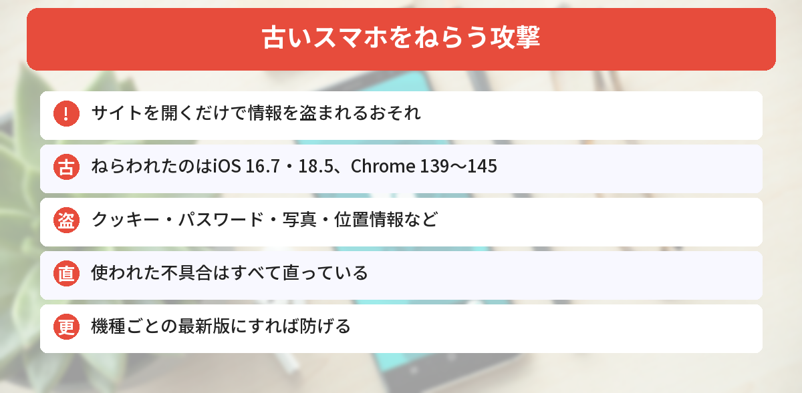
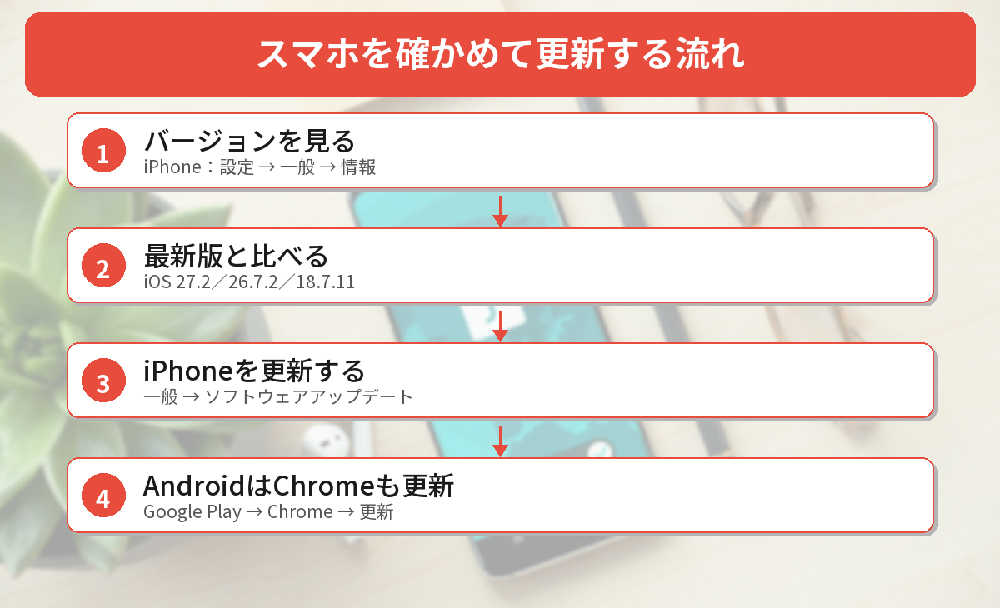

## この記事で分かること

「サイトを見ただけでスマホの写真やパスワードが盗まれる」ってニュースを見たの。わたし、iPhoneの更新をずっと「あとで」にしてるんだけど…。


今回ねらわれたのは、まさに「更新していないスマホ」なんだ。使われた不具合はもう直っているから、更新すれば防げるよ。確かめ方を説明するね。


こんなことが気になっていませんか？
- どんな攻撃なの？
- 自分のスマホは大丈夫？
- 何を更新すればいいの？

この記事は、[BleepingComputerの記事](https://www.bleepingcomputer.com/news/security/hackers-use-n-day-exploits-in-zero-click-attacks-on-ios-android-devices/)、[The Hacker Newsの記事](https://thehackernews.com/2026/11/hackers-exploit-patched-apple-flaw-to.html)（2026年11月5日）と、[Appleのセキュリティアップデート一覧](https://support.apple.com/en-us/100100)をもとにまとめています（2026年11月9日に確認）。筆者の手元にはいまiPhone・Androidの実機がないため、画面の名前はAppleとGoogleの案内をもとにしています。

## どんな攻撃なの？
| 項目 | 内容 |
|------|------|
| 見つけた会社 | Sekoia（フランスのセキュリティ会社） |
| 攻撃したとされる集団 | ロシアと関係があるとされる「APT29」 |
| ねらわれた端末 | **更新していない古いiPhone・Android** |
| 入り口 | 乗っ取られたサイト、にせサイト、多くのサイトで使われる分析ツール |
| 利用者の操作 | **サイトを開くだけ**（タップなどは不要） |
| 盗まれるもの | クッキー、パスワード、写真、位置情報、メッセージアプリのデータなど |
| 直っているか | **AppleとGoogleがすべて直している** |



### サイトを見ただけで、なぜ？
攻撃者は、サイトに**こっそりプログラムを仕込み**ました。そのサイトを開くと、まず**スマホの種類やブラウザの版**を調べます。古い版だと分かると、それに合わせた攻撃を送りこみます。

ねらわれたのは、ウクライナのガス会社や、アメリカの業界団体などのサイトです。また、ウクライナの**アクセス分析ツール「Plerdy」**が2026年8月27日〜9月3日に乗っ取られ、このツールを使っている**数千のサイト**からも攻撃が届くようになっていました。

### ねらわれた古い版
| 端末 | ねらわれた版 | 盗まれるもの |
|------|------|------|
| iPhone | **iOS 16.7** | Safariのクッキー |
| iPhone | **iOS 18.5** | WhatsApp・Telegramのデータ、キーチェーンのパスワード、位置情報、写真 |
| Android | **Chrome 139〜145**（143をのぞく） | Chromeのクッキー、ログイン情報、閲覧履歴、Wi-Fiのパスワード |

このうち、iPhoneの不具合 **CVE-2024-27834** は、アメリカのCISAが**2026年11月4日**に「実際に悪用されている脆弱性」の一覧に加えました。


直った不具合なのに、まだねらわれるんだね…。


そうなんだ。更新していない人がいる限り、古い不具合は使われ続けるんだよ。だから「あとで」にしないのが大事なんだ。


## iPhoneを確かめて更新する

### ステップ1: バージョンを見る
［**設定**］→［**一般**］→［**情報**］を開いて、「iOSバージョン」を見ます。

### ステップ2: 最新の版と比べる
Appleが2026年10月26日に出した、いまの最新版は次の通りです。

| 版 | 対象 |
|------|------|
| **iOS 27.2** | iPhone 11 以降 |
| **iOS 26.7.2** | iPhone 11 以降（iOS 26を使い続ける人） |
| **iOS 18.7.11** | iPhone XS、XS Max、XR |

### ステップ3: 更新する
［**設定**］→［**一般**］→［**ソフトウェアアップデート**］を開いて、出てきた版を入れます。充電しながら、Wi-Fiにつないで行いましょう。

## Androidを確かめて更新する
### ステップ1: Chromeを更新する
今回Androidでねらわれたのは、**Chromeアプリの古い版**です。**Google Playストア**で［Chrome］を開き、［**更新**］があれば押します。

Chromeの版は、Chromeの右上の［︙］→［設定］→［**Chromeについて**］で確かめられます。

### ステップ2: システムアップデートも確かめる
［設定］→［システム］→［システムアップデート］も開いて、更新があれば入れます。11月のAndroidの更新については、[Androidの11月のセキュリティ更新の記事](/posts/android-security-update-2026-11/)で解説しています。

## もしものときは
- 報告によると、今回のプログラムは**スマホに居すわらない**ため、**再起動すると止まります**
- ただ、同じサイトを開くとまたねらわれるので、**更新がいちばんの対策**です
- 更新できない古い機種は、**買いかえ**も考えておくと安心です




iPhoneはソフトウェアアップデート、AndroidはChromeとシステムアップデート。今日やっちゃう！


えらい！家族のスマホも、古いままになっていないか見てあげてね。


## まとめ
- 更新していない古いiPhone・Androidをねらい、サイトを見ただけで情報を盗む攻撃が見つかった
- ねらわれたのはiOS 16.7・18.5や、Android版Chrome 139〜145。使われた不具合はすべて直っている
- CISAは2026年11月4日に、このうちiPhoneの1件を「実際に悪用されている」一覧に加えた
- iPhoneはiOS 27.2／26.7.2／18.7.11など、機種ごとの最新版に更新する
- AndroidはGoogle PlayでChromeを更新し、システムアップデートも確かめる

---
### あわせて読みたい
- [【Android】11月のセキュリティ更新 タップしなくても乗っ取られるおそれ 「2026-11-01」以降か確かめよう](/posts/android-security-update-2026-11/)
- [【Chrome】52件の脆弱性を修正 156.0.8078.73以上か確かめよう（手元は古いままだった）](/posts/chrome-156-security-update-2026-10/)
