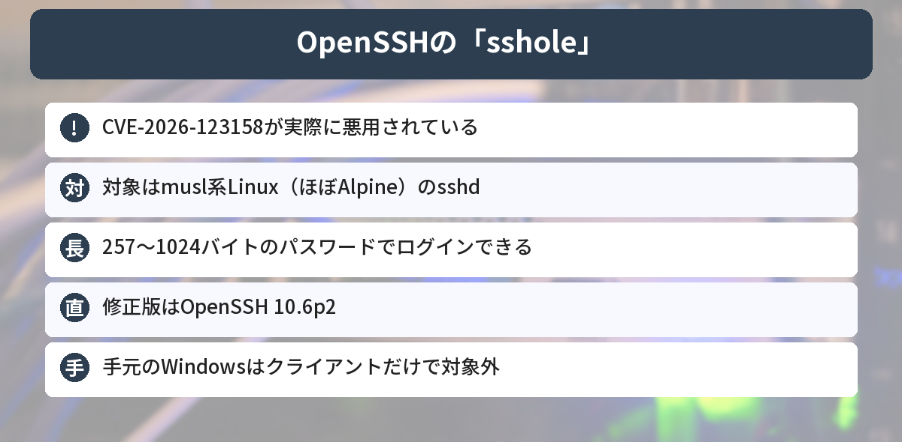
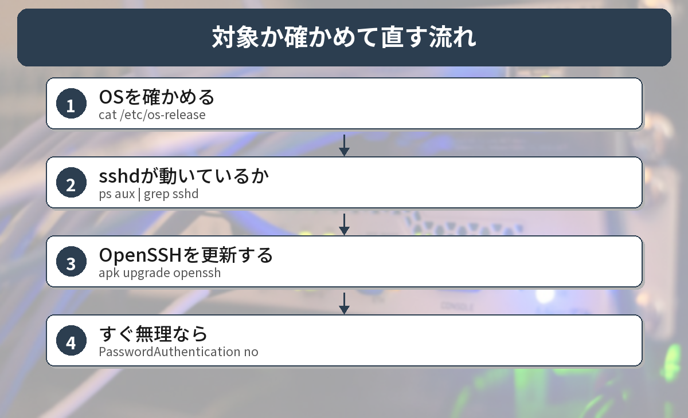

## この記事で分かること

「長いパスワードを打つだけでSSHにログインできる」ってニュースを見たの。そんなことってあるの？わたしもSSH使ってるんだけど…。


ある条件のLinuxサーバーだけで起きる不具合なんだ。WindowsからSSHでつなぐだけなら関係ないよ。このパソコンでも確かめたから、だれが気をつければいいか説明するね。



こんなことが気になっていませんか？
- どんな不具合なの？
- 自分は対象なの？
- どうやって直すの？

この記事は、[Hackadayの週間セキュリティまとめ](https://hackaday.com/2026/11/13/this-week-in-security-four-digit-patch-tuesday-ssh-exploited-gitbook-breach-android-ghostmap/)（2026年11月13日）、[Ostorlabの解説](https://blog.ostorlab.co/es/openssh-musl-password-bypass-cve-2026-123158.html)などをもとにまとめています（2026年11月16日に確認）。

## 何が起きたの？
| 項目 | 内容 |
|------|------|
| 脆弱性 | **CVE-2026-123158**（通称 sshole、深刻度8.1） |
| 対象 | **muslを使うLinux**（ほぼAlpine Linux）で、**PAMなし**でsshdを動かしている場合 |
| 起きること | パスワードのないアカウントに、**257〜1024バイト**のパスワードでログインできる |
| 対象外 | Debian、Ubuntu、SUSE、Red Hat、CentOS など |
| 修正版 | **OpenSSH 10.6p2**（11月5日）。Alpineは同じ日に3.16〜edgeの全ブランチで修正 |
| 実際の攻撃 | **あり**（CISAが11月9日に一覧に追加） |



### ことばの説明
- **sshd**：SSHで「つながれる側」のサーバーのプログラム
- **musl（マスル）**：Linuxの土台になる部品の1つ。Alpine Linuxが使っている。Ubuntuなどはglibcというちがうものを使う
- **PAM**：Linuxでログインのしかたをまとめて管理するしくみ
- **パスワードのないアカウント**：鍵だけでログインする設定のアカウントなど

### どんな攻撃が出ている？
報告によると、すでに次のような攻撃が見つかっています。

- 東南アジアのおとりのサーバーに入られ、**裏口のプログラム**を入れられた
- **ボットネット**や**仮想通貨の採掘**に使われた
- おとりのAlpineサーバーで、**管理者（root）の権限**まで取られた
- 9か国・13のIPアドレスから攻撃の試みがあった


長いパスワードを送るだけで入れちゃうなんて、こわいね…。


2016年からずっとあった不具合なんだって。Dockerの小さいイメージでよく使われるAlpineが中心だから、サーバーやコンテナを自分で立てている人は確かめておこう。


## 手元のパソコンを確かめてみた
2026年11月16日に、このWindows 11のパソコンで、SSHの版と、SSHサーバーやWSL（Windowsの中のLinux）があるかを確かめました。

```powershell
ssh -V
Get-Service sshd
Get-ChildItem "HKCU:\Software\Microsoft\Windows\CurrentVersion\Lxss"
```

結果は次の通りです。

```text
OpenSSH_for_Windows_9.5p2, LibreSSL 3.8.2
sshd service: なし
WSLのLinux: なし
```

- 入っているのは**Windows版OpenSSHのクライアント**（つなぐ側）だけ
- **SSHサーバー（sshd）は動いていない**
- **WSLのLinuxも入っていない**
- なので、このパソコンは**対象外**でした

## 対象か確かめる方法


### ステップ1: OSを確かめる
サーバーやコンテナの中で、次のコマンドを打ちます。

```bash
cat /etc/os-release
```

「Alpine Linux」と出たら、対象の可能性があります。

### ステップ2: sshdが動いているか確かめる
```bash
ps aux | grep sshd
```

sshdが動いていなければ、対象外です。

### ステップ3: OpenSSHを更新する
Alpineなら、次のコマンドで更新して、sshdを再起動します。

```bash
apk update && apk upgrade openssh
rc-service sshd restart
```

Dockerなら、**新しいAlpineのイメージを取り直して**、コンテナを作り直します。

### ステップ4: すぐ更新できないときは
sshdの設定ファイル（`/etc/ssh/sshd_config`）に次の1行を入れ、sshdを再起動します。パスワードでのログインを止めると、この攻撃は防げます。

```text
PasswordAuthentication no
```

## ほかに気をつけたいこと
- OpenWrtは、ふつうはOpenSSHではなく**Dropbear**を使うので対象外。ただし、OpenSSHを入れている場合は確かめる
- **Buildroot・Yocto**など、muslを使う組み込み向けのLinuxも確かめる
- OpenSSHの開発チームは、AIで見つかった不具合を別の人も見つけることが増えたため、**修正をまとめずにこまめに出していく**としています

今月はChromeやWindowsの更新も出ています。[Chromeの悪用中の脆弱性の記事](/posts/chrome-157-zero-day-2026-11/)、[11月のWindows更新の記事](/posts/patch-tuesday-2026-11-outlook-zero-day/)もあわせて確かめてください。




WindowsからつなぐだけならOK。AlpineでSSHサーバーを動かしてたら、10.6p2に更新、だね！


その通り。更新できないときは、パスワードログインを止めるだけでも守れるよ。


## まとめ
- OpenSSHの脆弱性CVE-2026-123158（sshole）が、実際に悪用されている
- 対象はmuslを使うLinux（ほぼAlpine）で、PAMなしでsshdを動かしている場合
- パスワードのないアカウントに、257〜1024バイトのパスワードでログインできてしまう
- 修正版はOpenSSH 10.6p2。すぐ直せないならPasswordAuthentication noにする
- 手元のWindowsは、クライアントだけでSSHサーバーもWSLもなく、対象外だった

---
### あわせて読みたい
- [【Chrome】今年8件目の悪用中の脆弱性 157.0.8103.50以上か確かめよう（手元は再起動待ちだった）](/posts/chrome-157-zero-day-2026-11/)
- [【11月のWindows更新】Outlookの脆弱性が悪用中 Windows Updateだけでは直らない（手元はOfficeが古いままだった）](/posts/patch-tuesday-2026-11-outlook-zero-day/)
