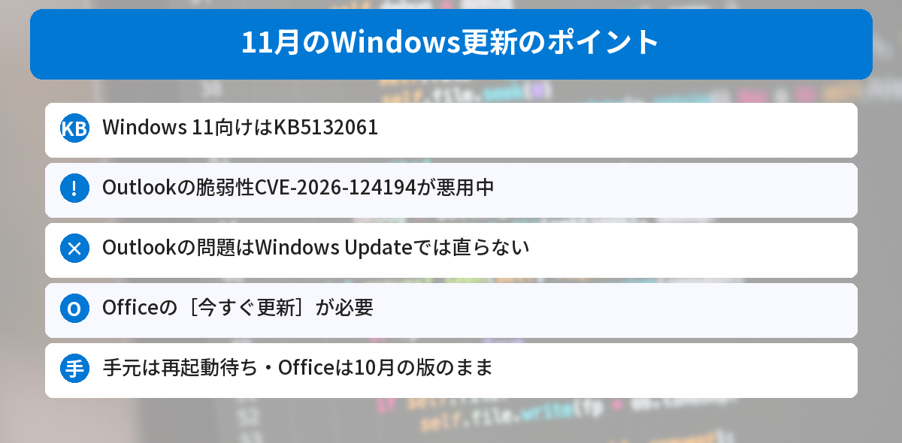
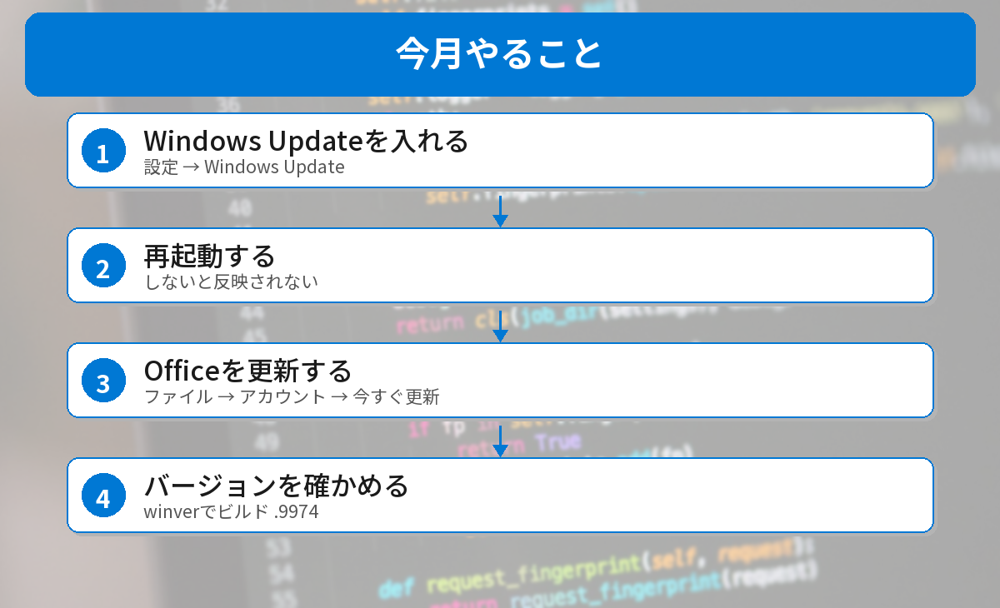

## この記事で分かること

今月のWindows Update、もう来てたから入れたよ！これで全部大丈夫だよね？


それが今月はちがうんだ。悪用されているのはOutlookの脆弱性で、Windows Updateでは直らないんだよ。このパソコンで確かめたら、Officeは古いままだった。確かめ方を説明するね。



こんなことが気になっていませんか？
- 今月の更新で何が直ったの？
- Outlookの脆弱性って何？
- 何を更新すればいいの？

この記事は、[BleepingComputerの記事](https://www.bleepingcomputer.com/news/microsoft/microsoft-november-2026-patch-tuesday-fixes-1-235-flaws-outlook-zero-day/)、[Windows Modeの記事](https://www.windowsmode.com/windows-11-10-november-2026-patch-tuesday/)と、Microsoftの[11月のセキュリティ更新情報](https://msrc.microsoft.com/update-guide/releaseNote/2026-Nov)をもとにまとめています（2026年11月11日に確認）。

## 今月の更新
| 項目 | 内容 |
|------|------|
| 公開 | 2026年11月10日（日本時間11日） |
| Windows 11（24H2〜26H2） | **KB5132061** |
| 直った脆弱性 | 1,000件以上（数え方によって1,094件〜1,235件） |
| 実際に悪用されているもの | **Outlookの CVE-2026-124194** の1件 |
| Outlookの直し方 | **Office（Microsoft 365）の更新**。Windows Updateでは直らない |



### Windows 11のバージョンごとの更新
| バージョン | 更新 | 新しいビルド |
|------|------|------|
| 26H2 | KB5132061 | 26300.9974 |
| 25H2 | KB5132061 | 26200.9974 |
| 24H2（Enterprise・Education） | KB5132061 | 26100.9974 |
| 23H2 | KB5131087 | 22631.7711（**Enterprise・Educationは最後の更新**） |

24H2のHome・Proは、10月で更新が終わっているので、今月の更新は届きません。くわしくは[24H2の更新終了の記事](/posts/windows11-24h2-end-26h2-update/)をご覧ください。

## Outlookの脆弱性（CVE-2026-124194）
- **細工したメッセージファイル**を、Outlookで開くと起きる
- ふつうは出る**外のサーバーにつなぐときの警告**が出ないまま、攻撃者のサーバーにつながる
- そのとき、Windowsが自動でログインしようとして、**ログイン情報（NTLMv2ハッシュ）が盗まれる**おそれがある
- 盗まれた情報から、会社のアカウントなどに入られるおそれがある
- **プレビューウィンドウで見るだけでは起きない**とされている


メールの添付を開くだけで、パスワードの元になる情報が取られちゃうかもしれないんだね…。


そうなんだ。とくに会社のパソコンでOutlookを使っている人は気をつけたい。知らない人からのファイルは開かないのがいちばんだよ。


## 手元のパソコンを確かめてみた
2026年11月11日の昼に、このWindows 11（会社が管理するEnterprise版）のパソコンで確かめました。

```powershell
Get-HotFix | Sort-Object InstalledOn -Descending | Select-Object -First 2 HotFixID, InstalledOn
$r = Get-ItemProperty 'HKLM:\SOFTWARE\Microsoft\Windows NT\CurrentVersion'
"$($r.DisplayVersion) build $($r.CurrentBuild).$($r.UBR)"
(Get-ItemProperty 'HKLM:\SOFTWARE\Microsoft\Office\ClickToRun\Configuration').VersionToReport
```

結果は次の通りです。

```text
HotFixID  InstalledOn
--------  -----------
KB5132061 2026/11/11
KB5132688 2026/11/11
25H2 build 26200.9711
16.0.20430.20180
```

- **KB5132061は今日入っていた**。でも、ビルドは**26200.9711のまま**。まだ**再起動していない**ので、新しい版（26200.9974）になっていない
- Officeは**16.0.20430.20180**。これは**10月13日に出た版**（月次エンタープライズ チャネル）で、11月の修正はまだ入っていない
- 会社のパソコンなので、Officeの更新は会社のルールで配られるのを待つ


Windowsの更新は入ってても、再起動しないと意味がないんだね。


そう。しかもOutlookは別に更新が要る。今月は「再起動」と「Officeの更新」の2つを忘れないでね。


## 更新のしかた


### ステップ1: Windows Updateを入れる
［設定］→［**Windows Update**］→［**更新プログラムのチェック**］を押して、KB5132061などを入れます。

### ステップ2: 再起動する
［**今すぐ再起動**］を押します。再起動しないと、更新は反映されません。

### ステップ3: Officeを更新する
WordやOutlookを開き、［**ファイル**］→［**アカウント**］→［**更新オプション**］→［**今すぐ更新**］を押します。

### ステップ4: バージョンを確かめる
- Windows：［Windows］＋［R］→ `winver` で、ビルドが **.9974** になっているか（25H2なら26200.9974）
- Office：［ファイル］→［アカウント］で、バージョンとビルドが新しくなったか

### 会社のパソコンは
会社のパソコンは、情報システム部門がOfficeの更新を配る時期を決めていることがあります。自分で［今すぐ更新］を押してよいか、社内の案内を確かめてください。

## 12月はプレビュー更新なし
Microsoftは、**2026年12月の試験的な更新（プレビュー）は出さない**としています。次の月例更新は**12月8日（日本時間9日）**です。

Windowsのペイントの脆弱性は、[ペイントの記事](/posts/windows-paint-cve-2026-83844/)で解説しています。




Windows Updateを入れて再起動。それとは別に、Officeも［今すぐ更新］、だね！


その通り。知らない人から届いたファイルは、更新が終わるまでとくに開かないようにしよう。


## まとめ
- Microsoftは11月10日（日本時間11日）に月例更新を出した。Windows 11向けはKB5132061
- 実際に悪用されているのは、Outlookの脆弱性CVE-2026-124194の1件
- 細工したファイルを開くと、警告なしで外につながり、ログイン情報が盗まれるおそれ
- Outlookの問題はWindows Updateでは直らない。Officeの［今すぐ更新］が必要
- 手元のパソコンは、KB5132061が再起動待ち、Officeは10月の版のままだった

---
### あわせて読みたい
- [【ペイント】Windowsのペイントに脆弱性 11.2609.401.0以上か確かめよう（手元は更新済みだった）](/posts/windows-paint-cve-2026-83844/)
- [【Windows 11】24H2のHome・Proは更新終了 26H2に上げよう（バージョンの確かめ方つき）](/posts/windows11-24h2-end-26h2-update/)
