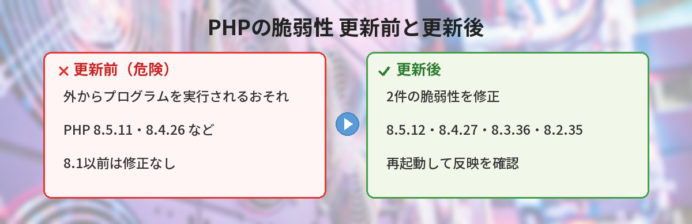
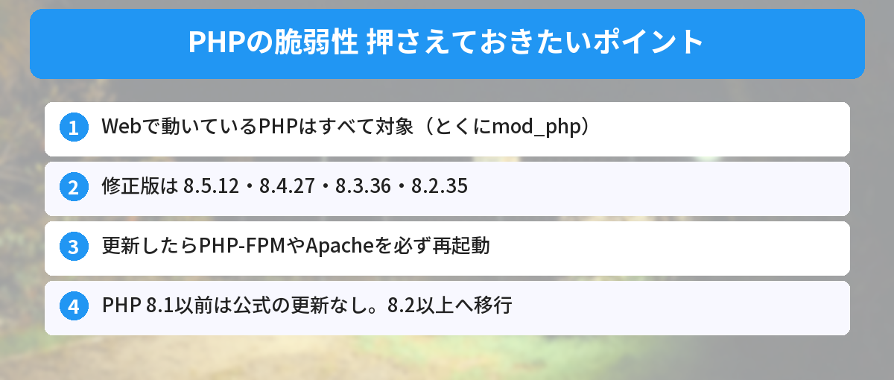
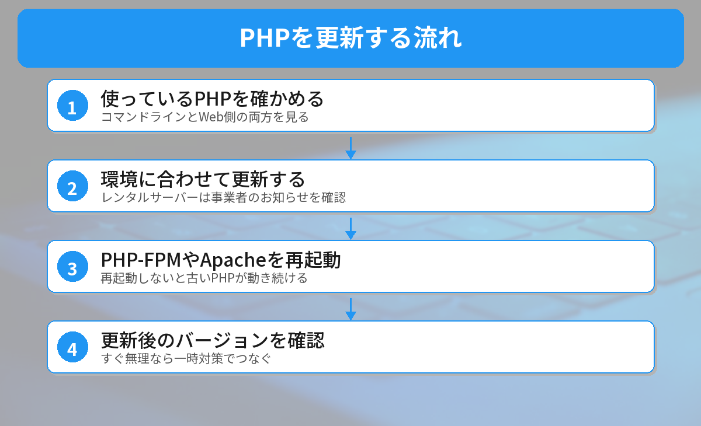

## この記事で分かること

ニュースで「PHPに重大な脆弱性」「市のホームページが緊急停止」って見たの…。私のWordPressのブログもPHPで動いてるんだけど、大丈夫？


今夜23時に修正版が出たよ。Webで動いているPHPは全部対象だから、更新が必要なんだ。レンタルサーバーなら事業者が更新してくれることが多いけど、自分で管理しているサーバーは自分で直す必要がある。やり方を環境ごとにまとめるね。



こんなことで困っていませんか？
- 自分のサイトやアプリのPHPが対象なのか分からない
- 更新したいけれど、レンタルサーバー・VPS・Dockerで何をすればいいのか分からない
- 今すぐ更新できない事情があって、とりあえずの対策を知りたい

この記事は、[PHP公式サイト（php.net）のセキュリティ情報](https://www.php.net/)をもとに、2026年10月21日23時台に書いています。新しい情報が出たら追記します。

## 何が起きたのか？
PHPの開発チームは10月20日に「重大な脆弱性2件を直すセキュリティ更新を、10月21日14時（世界時。日本時間23時）に出す」と予告しました。ところが、公開前に詳しい情報が外に漏れてしまい、すでに攻撃に使えるコードが出回っていると報じられています。

日本でも、自治体や大学、レンタルサーバー各社が、緊急メンテナンスやサイトの一時停止を発表しました。

### 2つの脆弱性
どちらも深刻度は**CVSS v4.0で9.2（緊急）**です。

- **CVE-2026-109618**：メモリが足りなくなったときの処理で、作りかけのデータを正しいデータとして扱ってしまう
- **CVE-2026-109619**：前のリクエストで使い終わったはずの内部データが残り、次のリクエストで使われてしまう

どちらも、**ログインしていない攻撃者が、外からサーバー上でプログラムを実行できる（RCE）**おそれがあります。サイトの改ざんや、データを盗まれることにつながります。



## 自分のPHPは対象？
### 対象になるもの
公式発表では「**Webのリクエストを処理しているすべてのPHP**」が危険とされています。

- PHP-FPM
- Apacheのmod_php（**いちばん危険**。アプリのコードが動く前に攻撃できることが示されている）
- php-cgi
- FrankenPHP
- LiteSpeed

WordPressやLaravelなど、PHPで作られたサイトやアプリはすべて当てはまります。

### 修正済みのバージョン
| 系列 | 修正済みのバージョン |
|------|------|
| PHP 8.5 | **8.5.12** 以降 |
| PHP 8.4 | **8.4.27** 以降 |
| PHP 8.3 | **8.3.36** 以降 |
| PHP 8.2 | **8.2.35** 以降 |
| PHP 8.1以前 | 公式の更新なし（移行が必要） |



### バージョンの確かめ方
サーバーに入れる場合は、次のコマンドで確かめます。

```bash
php -v
```

ただし、**コマンドラインのPHPと、Webで動いているPHPが別のものになっていることがあります**。Webのほうは、管理画面のPHP設定や、PHP-FPMのバージョン（例：`php-fpm8.3 -v`）でも確かめてください。WordPressなら、管理画面の「ツール」→「サイトヘルス」→「情報」→「サーバー」で、Webで使っているPHPのバージョンを見られます。

## 修正方法：環境別の更新手順


### 1. レンタルサーバーを使っている場合
多くのレンタルサーバーでは、**事業者がPHPを順次更新**します。たとえばKAGOYAは、PHP 8.2〜8.5を使っているレンタルサーバープランを、修正版の公開を確認したあと順次更新すると案内しています。

やることは次の3つです。
1. 契約しているサーバーの「お知らせ」「障害・メンテナンス情報」を確認する
2. 管理画面でPHPのバージョンを選べる場合、**8.1以前なら8.2以上に切り替える**
3. メンテナンス中は、サイトが一時的に見られなくなることがある

### 2. Ubuntu・Debianのサーバー（VPSなど）
PHPの公式発表によると、Linuxのディストリビューションには**修正が前もって渡されています**。OSのパッケージを更新します。

```bash
sudo apt update
sudo apt upgrade
```

更新したら、**PHPを使っているサービスを必ず再起動**します（バージョン番号は自分の環境に合わせてください）。

```bash
# PHP-FPMを使っている場合
sudo systemctl restart php8.3-fpm
# Apacheのmod_phpを使っている場合
sudo systemctl restart apache2
```

ディストリビューションのPHPは、**番号を変えずに修正だけを取り込む**ことがあります。`php -v` の番号が上の表と同じでなくても、修正済みのことがあるので、ディストリビューションのセキュリティ情報で確認してください。

### 3. RHEL・AlmaLinux・Rocky Linuxなど
```bash
sudo dnf upgrade 'php*'
sudo systemctl restart php-fpm
sudo systemctl restart httpd
```

**Remiのリポジトリ（rpms.remirepo.net）を使っている人は注意**が必要です。PHPの公式発表では、このリポジトリは**今日は更新が出ない**とされていて、ディストリビューションのパッケージに切り替えるか、ソースからビルドするようすすめています。

### 4. Dockerの公式イメージを使っている場合
修正版のイメージが公開されたら、取り直してコンテナを作り直します。

```bash
docker compose build --pull
docker compose up -d
```

`php:8.4.26-fpm` のように**細かいバージョンまで固定している場合は、Dockerfileの番号を `8.4.27` などに書き換えます**。なお、この記事を書いた10月21日23時台の時点では、Docker Hubの公式イメージに `8.4.27-fpm` などの修正版のタグはまだありませんでした。公開されしだい更新しましょう。

### 5. Windows（XAMPPなど）で動かしている場合
Windows用のPHPは、php.netのダウンロードページに修正版が出ています。XAMPPなどのパッケージを使っている場合は、配布元の更新を待つか、PHPだけを入れ替えます。自分のPCで開発用に動かしているだけで、外から接続できないなら危険は小さいですが、更新はしておきましょう。

### 6. 最後に：更新できたか確かめる
- `php -v`（コマンドライン）と、Webで動いているPHPのバージョンの**両方**を確かめる
- PHP-FPMやApacheを**再起動したか**を確かめる。再起動しないと、古いPHPが動き続けます


更新したのに再起動を忘れたら、意味がないんだね…！


そう、そこがいちばん忘れやすいポイント。とくにPHP-FPMは、ワーカーと呼ばれる処理役が古いまま残るから、必ず再起動しよう。


## すぐに更新できないときの一時対策
PHPの公式発表では、すぐに更新できない場合の対策も書かれています。ただし「**更新だけが完全な対策で、これをしても安全にはならない**」とはっきり書かれています。あくまで更新までのつなぎです。

### CVE-2026-109619 への対策
- `php.ini`（またはPHP-FPMのプール設定）で **`session.upload_progress.enabled=0`** にして、**すべてのワーカーを再起動**する。`ini_set()` や `.user.ini` では効きません
- PHP 8.5を使っている場合は **`fatal_error_backtraces=0`** にして再起動する

### CVE-2026-109618 への対策
- アップロードがいらないアプリなら **`post_max_size = 8M`**、アップロードが必要なら **`32M`** のように小さくする。`upload_max_filesize` はそれより小さくする
- `memory_limit=-1` にする（アプリから上書きできないように、PHP-FPMのプールの `php_admin_value` などで設定）
- Webサーバーやプロキシで、リクエストの大きさや項目数に上限をかける

設定を変えたあとは、それぞれの設定が本当に効いているかを `phpinfo()` などで確かめてください。

## やってはいけないこと
### 「うちは小さいサイトだから」と後回しにする
今回の攻撃は、サイトの大きさに関係なく、PHPで動いているサーバーを自動で探して狙うことができます。小さな個人ブログでも対象です。

### 古いPHPのまま放置する
PHP 8.1以前は公式の更新がありません。今回は特例として最小限の修正が出ましたが、次からはありません。これを機に8.2以上へ移行しましょう。

PHPのほかにも、今週はセキュリティの更新が続いています。Pythonの証明書の問題は[certifiの更新の記事](/posts/python-certifi-emudhra-update/)で、Node.jsは[Node.jsのセキュリティ更新の記事](/posts/nodejs-security-release-2026-10/)で解説しています。




レンタルサーバーならお知らせを確認、自分のサーバーなら更新して再起動。すぐ無理なら一時対策でつなぐ、だね！


完璧。一時対策は「安全になったわけじゃない」ってことだけ忘れないでね。


## まとめ
- 2026年10月21日、PHPが重大な脆弱性2件（CVE-2026-109618、CVE-2026-109619）を修正
- 修正済みはPHP 8.5.12・8.4.27・8.3.36・8.2.35。Webで動いているPHPはすべて対象
- レンタルサーバーは事業者のお知らせを確認。8.1以前なら8.2以上に切り替える
- 自分で管理しているサーバーは、パッケージを更新して**PHP-FPMやApacheを再起動**
- すぐ更新できないときの一時対策はあるが、安全にはならない。できるだけ早く更新する

---
### あわせて読みたい
- [【Python】certifiの更新が必要？認証局の鍵漏えいで今やること](/posts/python-certifi-emudhra-update/)
- [【Node.js】10月21日にセキュリティ更新！自分のバージョンは対象？](/posts/nodejs-security-release-2026-10/)
