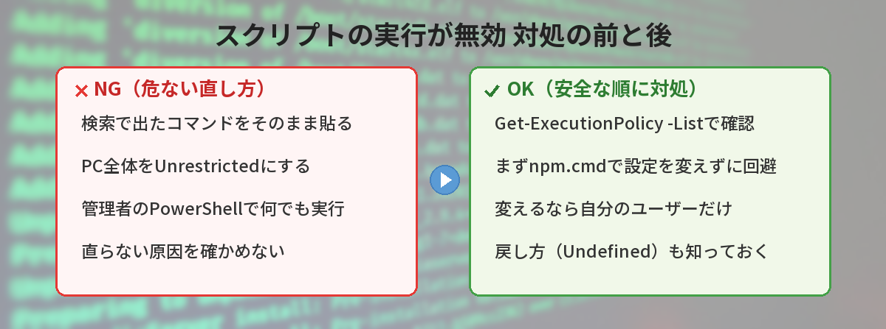
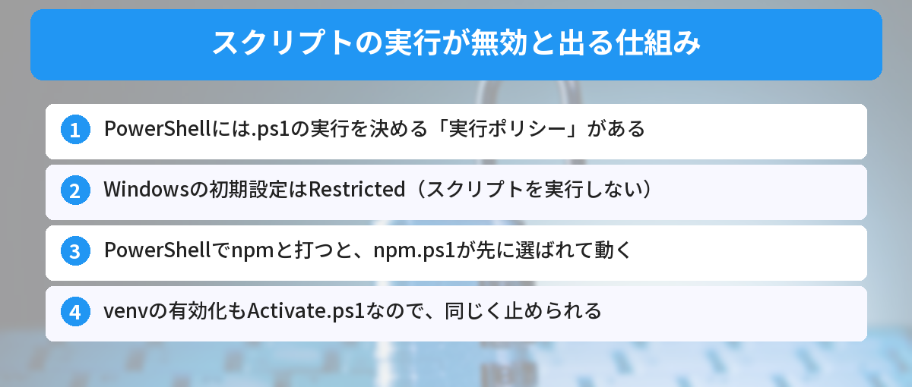
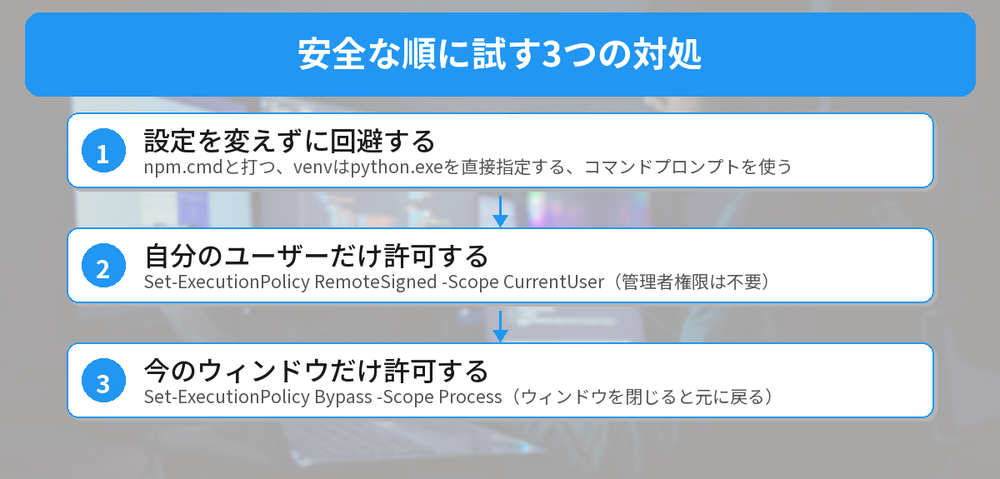
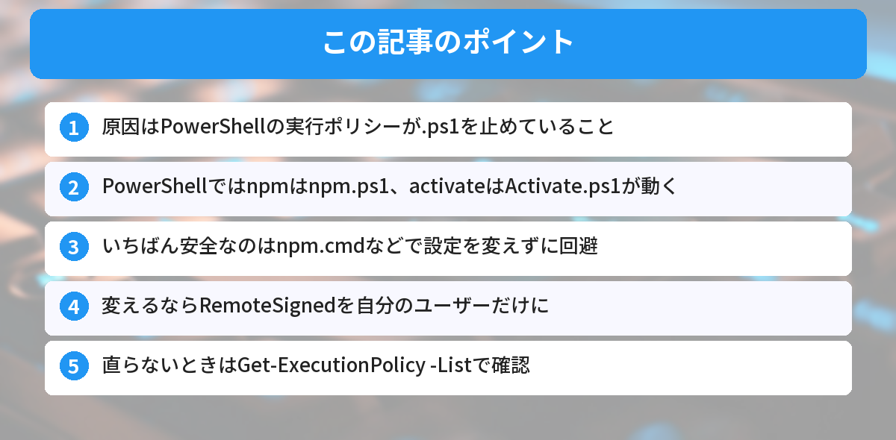

## この記事で分かること


VS Codeで npm install したら、赤い文字で「このシステムではスクリプトの実行が無効になっているため…」って出たの…。私のパソコン、壊れちゃった？



壊れてないよ。WindowsのPowerShellが「スクリプトは勝手に動かさない」という安全のための設定で止めているだけなんだ。仕組みが分かれば、安全な順に直していけるよ。




## こんな場面で困っていませんか？

本やネットの手順どおりに `npm install` を実行したら、こんなエラーが出た。

```text
npm : このシステムではスクリプトの実行が無効になっているため、ファイル C:\Program Files\nodejs\npm.ps1 を読み込むことができません。詳細については、「about_Execution_Policies」(https://go.microsoft.com/fwlink/?LinkID=135170) を参照してください。
```

Pythonの仮想環境を有効にしようとして `.venv\Scripts\activate` を実行したときも、`Activate.ps1` について同じエラーが出ることがあります。

よくある困りごとは、この3つです。

- 本のとおりに `npm install` したのに、自分のPCだけ動かない
- 仮想環境（venv）を有効にできない
- ネットで見つけたコマンドを貼っていいのか不安で、手が止まる

結論から言うと、原因はPowerShellの**実行ポリシー**という設定です。安全な順に、①設定を変えずに回避する、②自分のユーザーだけ許可する、③今のウィンドウだけ許可する、の3つの直し方があります。元に戻す方法もあるので、安心して進めてください。



## 一言で説明すると

PowerShellには「`.ps1` というスクリプトファイルを実行していいか」を決めるルールがあり、そのルールが `npm.ps1` や `Activate.ps1` を止めている状態です。このルールを**実行ポリシー**と呼びます。

エラー文の「スクリプトの実行が無効」は、「このPCでは、今の設定だと `.ps1` を動かせません」という意味です。npmやPythonが壊れているわけではありません。

## なぜ起きるのか（仕組み）

### Windowsの初期設定は「スクリプトを実行しない」

Windowsに最初から入っているPowerShell（バージョン5.1）は、パソコン向けのWindowsだと、実行ポリシーの初期設定が `Restricted` です。`Restricted` は、`.ps1` のスクリプトを一切実行しない設定です。

Microsoftの説明では、実行ポリシーは「うっかり危ないスクリプトを動かさないための仕組み」で、セキュリティの壁そのものではありません。だからこそ、仕組みを知ったうえで、必要な分だけ許可するのが大切です。

### npmと打つと、実はnpm.ps1が動いている

筆者のPC（Node.js v24）で、PowerShellに `npm` と打ったときに何が動くのかを確かめました。

```powershell
Get-Command npm -All | Select-Object CommandType, Name, Source
```

```text
   CommandType Name    Source
   ----------- ----    ------
ExternalScript npm.ps1 C:\Program Files\nodejs\npm.ps1
   Application npm.cmd C:\Program Files\nodejs\npm.cmd
   Application npm     C:\Program Files\nodejs\npm
```

一番上の `npm.ps1` が、PowerShellで実際に動くファイルです。同じフォルダに `npm.cmd` もありますが、PowerShellでは `.ps1` が先に選ばれます。だから実行ポリシーで止められてしまうのです。`npx` も同じで、`npx.ps1` が先に選ばれていました。npmそのものについては、[npmとは？yarnとの違い](/posts/npm-yarn-beginner/)で解説しています。

### venvの有効化もActivate.ps1

Pythonの仮想環境を有効にする `.venv\Scripts\activate` も、PowerShellでは `Activate.ps1` というスクリプトが動きます。そのため、npmと同じ理由で止められます。仮想環境の基本は、[ModuleNotFoundErrorの原因と仮想環境入門](/posts/python-venv-beginner/)を見てください。

### VS CodeのターミナルもPowerShell

WindowsのVS Codeでは、ターミナルの初期設定がPowerShellです。そのため、VS Codeで開発を始めたタイミングで、このエラーに初めて出会う人が多くなります。




npmって打ってたのに、裏ではnpm.ps1っていうスクリプトが動いてたんだ…！



そうなんだ。だから同じnpmでも、コマンドプロンプトなら動くのに、PowerShellだと止まる、なんてことが起きるんだよ。


## 解決方法（安全な順に3つ）

### ステップ0: まず今の設定を確認する

最初に、今の実行ポリシーを確認します。

```powershell
Get-ExecutionPolicy -List
```

自宅のPCなどで何も設定していなければ、次のようにすべて `Undefined`（未設定）になっています。

```text
        Scope ExecutionPolicy
        ----- ---------------
MachinePolicy       Undefined
   UserPolicy       Undefined
      Process       Undefined
  CurrentUser       Undefined
 LocalMachine       Undefined
```

すべて未設定のときは、初期設定の `Restricted` が使われます。上の行ほど優先され、`MachinePolicy` と `UserPolicy` は、会社や学校の管理者が決める設定です。ここに値が入っている場合は、後半の「筆者がハマったポイント」を先に読んでください。

### 方法1: 設定を変えずに回避する（いちばん安全）

npmなら、`npm` の代わりに `npm.cmd` と打てば、`.ps1` を通らずに実行できます。実行ポリシーの設定は一切変わりません。

```powershell
npm.cmd install
npm.cmd run dev
npx.cmd create-vite@latest
```

npxの役割は、[npxとは？npmとの違い](/posts/npx-what-is-it/)で解説しています。

仮想環境は、有効化しなくても、仮想環境の中の `python.exe` を直接指定すれば使えます。

```powershell
.venv\Scripts\python.exe -m pip install requests
.venv\Scripts\python.exe main.py
```

毎回打つのが面倒なら、VS Codeのターミナルをコマンドプロンプトに切り替える方法もあります。コマンドパレット（`Ctrl + Shift + P`）で「Terminal: Select Default Profile」（日本語表示では「ターミナル: 既定のプロファイルの選択」）を選び、「Command Prompt」を選びます。コマンドプロンプトなら、`.venv\Scripts\activate` で `activate.bat` が動きます。VS Codeの基本操作は、[VS Codeで最初に覚えるべき設定とショートカット](/posts/vscode-shortcuts-beginner/)でまとめています。

### 方法2: 自分のユーザーだけ許可する（おすすめ）

毎回の回避が面倒なら、自分のユーザーだけ、実行ポリシーを `RemoteSigned` に変えます。管理者権限はいりません。

```powershell
Set-ExecutionPolicy -ExecutionPolicy RemoteSigned -Scope CurrentUser
```

確認を求められたら `Y` を入力します。`RemoteSigned` は、「自分のPCで作ったスクリプトは実行できる。インターネットから取ってきたスクリプトは、署名がないと実行しない」という設定です。Pythonの公式ドキュメントも、venvを使うためにこの設定を案内しています。

### 方法3: 今のウィンドウだけ許可する（一時的）

設定を残したくないときは、今開いているPowerShellのウィンドウだけ許可できます。

```powershell
Set-ExecutionPolicy -ExecutionPolicy Bypass -Scope Process
```

ウィンドウを閉じると、元の設定に戻ります。人と共用のPCで、一時的に作業したいときに向いています。



### 「デジタル署名されていません」と出た場合

`RemoteSigned` にしたのに、「デジタル署名されていません」と出ることがあります。これは、インターネットからダウンロードしたスクリプトだと判断されているためです。中身を確認して問題がなければ、ブロックを解除できます。

```powershell
Unblock-File -Path .\スクリプト名.ps1
```

出どころが分からないスクリプトは、解除せず、実行しないでください。

### 元に戻したいとき

方法2の設定を元に戻すには、`Undefined`（未設定）にします。

```powershell
Set-ExecutionPolicy -ExecutionPolicy Undefined -Scope CurrentUser
```


戻し方まで分かってると安心！まずは npm.cmd で試して、ずっと使うなら CurrentUser だけ変えればいいんだね。



その順番がおすすめだよ。ポイントは、パソコン全体じゃなくて「自分のユーザーだけ」を変えること。それなら管理者権限もいらないんだ。


## やってはいけないこと

### パソコン全体をUnrestrictedやBypassにする

検索すると、次のようなコマンドが出てくることがあります。

```powershell
# NG例: パソコン全体で、どんなスクリプトでも動くようにしてしまう
Set-ExecutionPolicy -ExecutionPolicy Unrestricted -Scope LocalMachine
```

これを管理者として実行すると、パソコン全体で、インターネット由来の署名のないスクリプトまで動くようになります。必要なのは自分のユーザーだけなので、方法2の `CurrentUser` で十分です。

### 意味が分からないまま、管理者のPowerShellに貼り付ける

管理者権限のPowerShellは、パソコン全体の設定を変えられます。この記事の方法1〜3は、どれも管理者権限なしでできます。「管理者として実行」は、本当に必要なときだけにしましょう。

### 会社のPCで、管理者の設定を無理に変えようとする

会社や学校のPCは、管理者が実行ポリシーを決めていることがあります。無理に変えようとすると、社内のルールに反するおそれがあります。困ったときは、方法1の `npm.cmd` やコマンドプロンプトを使うか、管理者に相談してください。

## 筆者がハマったポイント（会社のPCは設定が上書きされる）

筆者の仕事用PCで `Get-ExecutionPolicy -List` を実行すると、`MachinePolicy` に値が入っていました。これは、会社の管理者がグループポリシー（組織でPCの設定をまとめて管理する仕組み）で決めた設定です。

試しに、今のウィンドウだけ設定を変えるコマンドを実行してみました。

```powershell
Set-ExecutionPolicy -ExecutionPolicy RemoteSigned -Scope Process
```

すると、次のエラーが出て、設定は反映されませんでした（筆者の環境では英語で表示されました）。

```text
Windows PowerShell updated your execution policy successfully, but the setting is overridden by a policy defined at a more specific scope.
```

「設定は更新したけど、もっと優先される設定に上書きされたよ」という意味です。日本語の環境では、「オーバーライドされます」という言葉を含むメッセージになります。

`MachinePolicy` や `UserPolicy` に値があると、方法2や方法3で設定を変えても、その設定が優先されます。教訓は、「直らないときは、まず `-List` で誰の設定が効いているかを見る」でした。会社の設定で止められているなら、方法1の `npm.cmd` やコマンドプロンプトで作業するか、管理者に相談するのが正解です。

## よくある質問（FAQ）



### Q: RemoteSignedにしても、セキュリティは大丈夫ですか？
A: `CurrentUser` に設定すれば、影響は自分のユーザーだけです。インターネットから取ってきた署名のないスクリプトは、引き続き止まります。Pythonの公式ドキュメントも案内している設定です。ただし、実行ポリシーはセキュリティの壁ではないので、出どころの分からないスクリプトは実行しないでください。

### Q: 管理者権限がないと変更できませんか？
A: `CurrentUser`（自分のユーザー）と `Process`（今のウィンドウ）は、管理者権限なしで変更できます。管理者権限が必要なのは、パソコン全体に効く `LocalMachine` です。

### Q: Macでも同じエラーが出ますか？
A: 出ません。MacやLinuxでは、PowerShellの実行ポリシーは強制されません。Macで `npm` が動かない場合は、別の原因を疑いましょう。

### Q: PowerShell 7を入れたら直りますか？
A: PowerShell 7は、Windowsに最初から入っている5.1とは、設定が別に管理されています。7を入れても、VS Codeのターミナルが5.1のままなら同じエラーが出ます。どちらのPowerShellを使っているか確認してから設定してください。

### Q: 設定を変えたのに、まだ同じエラーが出ます。
A: `Get-ExecutionPolicy -List` で、`MachinePolicy` や `UserPolicy` に値が入っていないか確認してください。入っている場合は会社などの設定が優先されているので、方法1で回避するか、管理者に相談しましょう。


壊れてたんじゃなくて、PowerShellの安全装置だったんだ！困ったら、まず Get-ExecutionPolicy -List で今の設定を見るようにする！



完璧だね。「確認する → 設定を変えずに回避 → 必要なら自分のユーザーだけ許可」の順番を覚えておけば、会社のPCでも落ち着いて対処できるよ。


## まとめ

- 「スクリプトの実行が無効」は、PowerShellの実行ポリシーが `.ps1` を止めているのが原因
- PowerShellでは、`npm` と打つと `npm.ps1` が、venvの有効化では `Activate.ps1` が動く
- いちばん安全なのは、`npm.cmd` やコマンドプロンプトで、設定を変えずに回避する方法
- ずっと使うなら `Set-ExecutionPolicy -ExecutionPolicy RemoteSigned -Scope CurrentUser`（管理者権限不要）
- 直らないときは `Get-ExecutionPolicy -List` で、会社などの設定が優先されていないか確認する

---
### あわせて読みたい
- [【初心者向け】コマンドラインが怖い人へ ― 覚えるコマンド5つだけ](/posts/command-line-scary/)
- [【Python】ModuleNotFoundErrorの原因と解決方法 ― 仮想環境入門](/posts/python-venv-beginner/)

<!-- affiliate -->
## 関連リソース

PowerShellやコマンド操作の基礎を固めたい方向けに、評価の高い2冊を選びました。

**コマンドラインの黒い画面が怖いんです。 新人エンジニアのためのコマンドが使いこなせる本**（翔泳社）<br>
Windows環境を前提に、コマンドプロンプトやPowerShellの基本操作から、黒い画面との付き合い方をやさしく解説した入門書です。

- <a href="https://af.moshimo.com/af/c/click?a_id=5490814&amp;p_id=54&amp;pc_id=54&amp;pl_id=27059&amp;url=https%3A%2F%2Fitem.rakuten.co.jp%2Fbook%2F17803298%2F" rel="nofollow sponsored noopener" referrerpolicy="no-referrer-when-downgrade" target="_blank">コマンドラインの黒い画面が怖いんです。（楽天市場）</a>
- <a href="https://af.moshimo.com/af/c/click?a_id=5490817&amp;p_id=170&amp;pc_id=185&amp;pl_id=27060&amp;url=https%3A%2F%2Fwww.amazon.co.jp%2Fdp%2F479818229X" rel="nofollow sponsored noopener" referrerpolicy="no-referrer-when-downgrade" target="_blank">コマンドラインの黒い画面が怖いんです。（Amazon）</a>

**動くサンプルで学べる Windows PowerShell コマンド&スクリプティングガイド**（ソシム）<br>
PowerShell 4.0の時代の本ですが、スクリプトの実行ポリシーと署名の考え方を、章を立てて解説しています。

- <a href="https://af.moshimo.com/af/c/click?a_id=5490814&amp;p_id=54&amp;pc_id=54&amp;pl_id=27059&amp;url=https%3A%2F%2Fitem.rakuten.co.jp%2Fbook%2F13168977%2F" rel="nofollow sponsored noopener" referrerpolicy="no-referrer-when-downgrade" target="_blank">Windows PowerShell コマンド&amp;スクリプティングガイド（楽天市場）</a>
- <a href="https://af.moshimo.com/af/c/click?a_id=5490817&amp;p_id=170&amp;pc_id=185&amp;pl_id=27060&amp;url=https%3A%2F%2Fwww.amazon.co.jp%2Fdp%2F4883379744" rel="nofollow sponsored noopener" referrerpolicy="no-referrer-when-downgrade" target="_blank">Windows PowerShell コマンド&amp;スクリプティングガイド（Amazon）</a>
<!-- /affiliate -->
