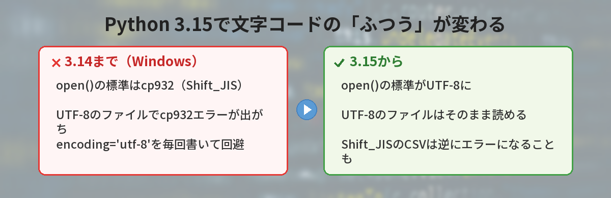
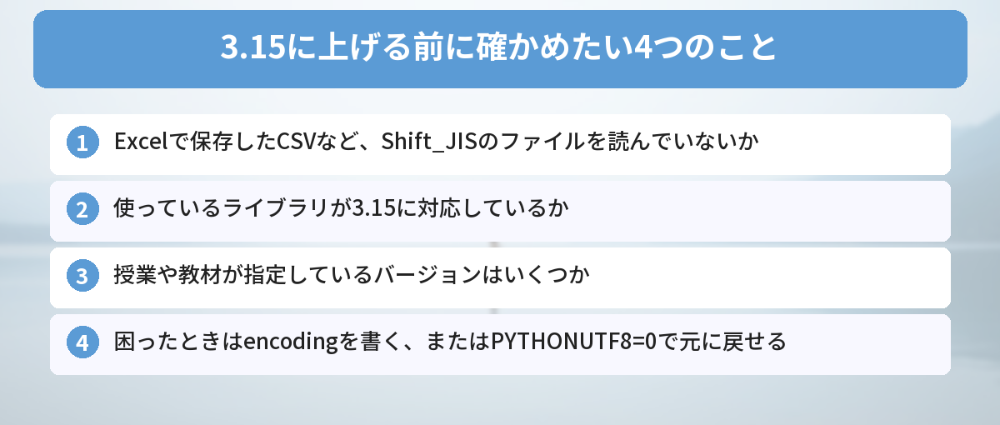

## この記事で分かること

WindowsでCSVを読むと、いつも「UnicodeDecodeError: 'cp932'…」って出て困ってたの。Python 3.15でこのエラーが出なくなるって本当？


本当だよ。3.15から、ファイルを開くときの標準の文字コードがUTF-8になったんだ。ただ、逆にエラーになるファイルもあるから、上げる前に知っておきたいことをまとめるね。



こんなことで迷っていませんか？

- Python 3.15が出たらしいけど、今すぐ入れ替えたほうがいいのか分からない
- WindowsでよくあったUnicodeDecodeError（cp932）が、本当に出なくなるのか知りたい
- 3.15に上げたら、今まで動いていたコードが動かなくならないか不安

結論から言うと、Python 3.15では**`open()` でファイルを開くときの標準の文字コードが、Windowsでも UTF-8 になりました**。UTF-8のファイルを読んで出ていたcp932エラーは出なくなります。その代わり、**Excelで保存したCSVなど、Shift_JIS（cp932）のファイルは、何も指定しないとエラーになる**ことがあります。

## Python 3.15が正式リリース

python.orgによると、Python 3.15.0は2026年10月9日に正式リリースされました。3.14からの大きな変更として、次のようなものが挙げられています。

| 変更 | ひとことで |
|------|------|
| PEP 686 | **UTF-8が標準の文字コードに** |
| PEP 810 | 必要になるまで読み込まない「遅延インポート」で起動を速く |
| PEP 814 | 書き換えられない辞書 `frozendict` が組み込みに |
| PEP 798 | 内包表記の中で `*` を使った展開ができる |
| エラーメッセージ | さらに分かりやすく改善 |

3.15のベータ版で注目された機能は、[Python 3.15 beta1リリース！初心者が知っておくべき新機能5つ](/posts/python-315-beta1-features/)でも紹介しました。今回は、初心者にいちばん影響が大きいUTF-8の変更にしぼって解説します。

## なぜWindowsだけcp932エラーが出ていたのか

これまでのPythonは、ファイルを開くときに文字コードを指定しないと、**パソコンの「地域の設定」に合わせた文字コード**を使っていました。日本語のWindowsでは、それがcp932（Shift_JISの一種）です。

ところが、今どきのファイルやプログラムの多くはUTF-8で保存されています。そのため、日本語のWindowsでUTF-8のファイルを何も指定せずに開くと、Pythonはcp932として読もうとして、次のようなエラーになっていました。

```text
UnicodeDecodeError: 'cp932' codec can't decode byte 0x82 in position 12: illegal multibyte sequence
```

このエラーの原因と、3.14までの直し方は、[UnicodeDecodeError cp932の原因と直し方](/posts/python-unicodedecodeerror-cp932/)でくわしく解説しています。


MacやLinuxの人は、このエラーで困ってなかったってこと？


そうなんだ。MacやLinuxは、もともとUTF-8が標準のことが多かったからね。「Windowsだけ動かない」の大きな原因のひとつだったんだよ。


## 3.15で何が変わる？

PEP 686によって、3.15からは「UTF-8モード」が最初からオンになります。これにより、Windowsでも次のようになります。

- `open()` で `encoding` を書かなくても、UTF-8で読み書きする
- 画面への出力や入力も、UTF-8で扱われる

つまり、次のコードは3.14までの日本語Windowsではエラーになることがありましたが、3.15ではUTF-8のファイルならそのまま読めます。

```python
# 3.15からは、UTF-8のファイルなら encoding を書かなくても読める
with open("memo.txt") as f:
    print(f.read())
```

## 逆にエラーになるケースに注意

便利になる一方で、気をつけたいのが**Shift_JIS（cp932）で保存されたファイル**です。3.14までは何も書かなくても読めていたファイルが、3.15では読めなくなることがあります。

よくあるのが、日本語版のExcelで「CSV（コンマ区切り）」を選んで保存したファイルです。このCSVはShift_JISで保存されるため、3.15で何も指定せずに開くと、今度はUTF-8として読もうとしてエラーになります。

```text
UnicodeDecodeError: 'utf-8' codec can't decode byte 0x83 in position 0: invalid start byte
```

### 直し方1: 文字コードをはっきり書く

いちばん確実なのは、ファイルの文字コードを `encoding` で書くことです。この書き方なら、3.14でも3.15でも同じように動きます。

```python
# Shift_JISのCSVを読むとき
with open("data.csv", encoding="cp932") as f:
    print(f.read())

# UTF-8のファイルを読むとき（どのバージョンでも安心）
with open("memo.txt", encoding="utf-8") as f:
    print(f.read())
```

### 直し方2: ExcelでUTF-8のCSVとして保存する

Excelの保存の種類で「CSV UTF-8（コンマ区切り）」を選べば、UTF-8で保存できます。これからCSVを作るなら、こちらがおすすめです。

### 直し方3: 古いふるまいに戻す

どうしても今までのふるまいに戻したいときは、環境変数 `PYTHONUTF8` を `0` にするか、`python -X utf8=0` で起動すると、UTF-8モードをオフにできます。ただし、これは一時的な逃げ道と考えて、`encoding` を書く方法に直していくのがおすすめです。



## 今すぐ3.15に上げるべき？

### 上げてもいい人

- 新しく勉強を始める人
- UTF-8のファイルばかり扱っていて、cp932エラーに困っていた人
- 自分の練習用のコードで、新しい機能を試したい人

### 少し待ったほうがいい人

- Excelで作ったShift_JISのCSVをたくさん読んでいる人
- 授業や教材でバージョンが指定されている人
- 使っているライブラリが、まだ3.15に対応していない人

新しいメジャーバージョンが出た直後は、ライブラリの対応が追いついていないことがあります。`pip install` でエラーが出たら、[pip installでエラーが出たときの対処法まとめ](/posts/python-pip-install-error/)も参考にしてください。


私は授業でExcelのCSVを使うから、しばらく3.14のままにして、encodingを書くクセをつけておこうかな。


それがいちばん安全だね。`encoding` を書いておけば、3.15に上げたときもそのまま動くよ。


## 筆者がリリース情報を読んで気づいたこと

python.orgのリリースページや変更点を読んで気づいたのは、**今回の変更は「エラーがなくなる」のではなく「エラーが出る場所が変わる」**ということです。

3.14まではUTF-8のファイルでつまずき、3.15ではShift_JISのファイルでつまずきます。どちらのバージョンでも困らない書き方は、結局「`encoding` をはっきり書くこと」でした。ネットの古い記事には `encoding` を書かないサンプルコードも多いので、コピーして使うときは気をつけましょう。

また、Windowsで3.15を入れるときは、2026年のPythonの入れ方の変化にも注意が必要です。Python Install Managerを使っている人は、`py install 3.15` で追加できます。「python が認識されない」などで困ったら、[「認識されていません」？Storeが開く原因と直し方](/posts/python-not-recognized-windows/)を見てください。

## よくある質問（FAQ）

### Q: Python 3.15はいつ出ましたか？
A: 2026年10月9日に正式リリースされました。

### Q: 3.15にすれば、cp932のUnicodeDecodeErrorはもう出ませんか？
A: UTF-8のファイルを開くときのcp932エラーは出なくなります。ただし、Shift_JISで保存されたファイルを `encoding` なしで開くと、今度は 'utf-8' のエラーになります。

### Q: どのバージョンでも動く書き方はありますか？
A: `open("ファイル名", encoding="utf-8")` のように、文字コードをはっきり書く方法です。Shift_JISのファイルなら `encoding="cp932"` と書きます。

### Q: 3.14までのふるまいに戻せますか？
A: 環境変数 `PYTHONUTF8=0` を設定するか、`python -X utf8=0` で起動すると、UTF-8モードをオフにできます。

### Q: 3.14と3.15を両方入れておけますか？
A: 入れておけます。Windowsでは `py` コマンドでバージョンを選んで実行できます。プロジェクトごとに仮想環境を作ると管理しやすくなります（[仮想環境入門](/posts/python-venv-beginner/)）。


3.15でUTF-8が標準になったけど、Shift_JISのファイルは逆にエラーになる。だから `encoding` を書くのがいちばん安心、だね！


完璧！上げるかどうかは、自分が扱うファイルと授業の指定を見て決めればいいよ。


## まとめ

- Python 3.15.0は2026年10月9日に正式リリース
- PEP 686で、`open()` などの標準の文字コードがWindowsでもUTF-8になった
- UTF-8のファイルで出ていたcp932エラーは出なくなる
- 逆に、ExcelのCSVなどShift_JISのファイルは `encoding="cp932"` を書かないとエラーになることがある
- どのバージョンでも安心なのは、`encoding` をはっきり書くこと

確認日：2026年10月18日（出典：python.org「Python Release Python 3.15.0」、PEP 686）

---
### あわせて読みたい
- [【Python】UnicodeDecodeError cp932の原因と直し方](/posts/python-unicodedecodeerror-cp932/)
- [【Python】「認識されていません」？Storeが開く原因と直し方](/posts/python-not-recognized-windows/)

<!-- affiliate -->
## 関連リソース
Pythonを基礎から学び直したい方向けに、評価の高い入門書を選びました。
**独習Python 第2版**（翔泳社）<br>
変数や制御構文から、標準ライブラリを使ったファイル操作まで、Pythonの文法を順を追って学べる独習用の教科書です。
- <a href="https://af.moshimo.com/af/c/click?a_id=5490814&amp;p_id=54&amp;pc_id=54&amp;pl_id=27059&amp;url=https%3A%2F%2Fitem.rakuten.co.jp%2Fbook%2F18185991%2F" rel="nofollow sponsored noopener" referrerpolicy="no-referrer-when-downgrade" target="_blank">独習Python 第2版（楽天市場）</a>
- <a href="https://af.moshimo.com/af/c/click?a_id=5490817&amp;p_id=170&amp;pc_id=185&amp;pl_id=27060&amp;url=https%3A%2F%2Fwww.amazon.co.jp%2Fdp%2F4798189499" rel="nofollow sponsored noopener" referrerpolicy="no-referrer-when-downgrade" target="_blank">独習Python 第2版（Amazon）</a>
<!-- /affiliate -->
