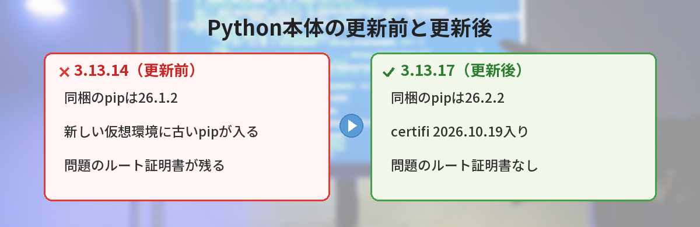
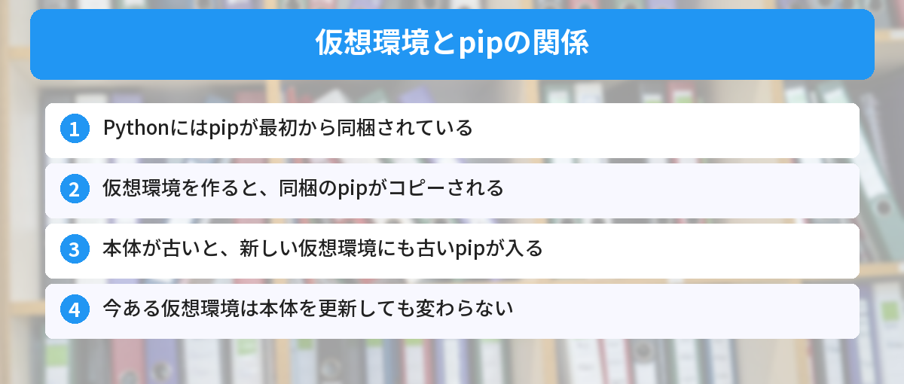
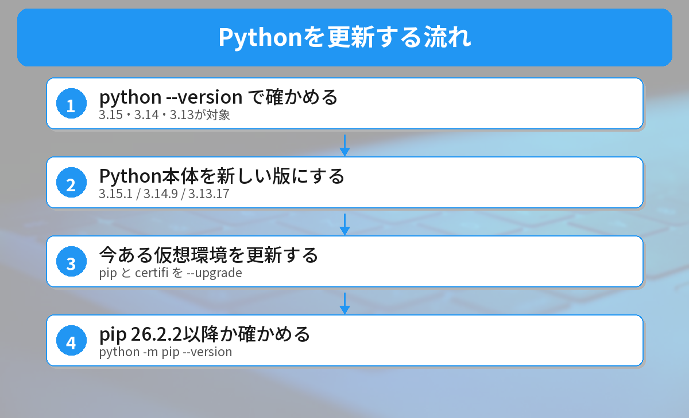

## この記事で分かること

この前certifiとpipを更新したばかりなのに、今度は「Python 3.15.1が緊急公開」って出てきたの。Pythonごと入れ直さないとだめ？


今回の更新は、Pythonに最初から入っている「pip」を新しくするためのものなんだ。今ある仮想環境はこの前の手順で大丈夫。でも、これから仮想環境を作るなら本体の更新が楽だよ。手元で確かめた結果と一緒に説明するね。



こんなことで迷っていませんか？
- 緊急リリースと聞いたけど、自分は入れ直すべきなのか分からない
- この前pipとcertifiを更新したけれど、それで足りているのか知りたい
- 3.12など、対象外のバージョンを使っている

前回の内容は[certifiの更新の記事](/posts/python-certifi-emudhra-update/)にまとめています。この記事はその続報です。

## 何が公開されたのか？
Pythonの開発チームは2026年10月21日、次の3つを急いで公開しました（[公式の案内](https://discuss.python.org/t/python-3-15-1-3-14-9-and-3-13-17-are-out/109595)）。

| 系列 | 新しいバージョン |
|------|------|
| Python 3.15 | **3.15.1** |
| Python 3.14 | **3.14.9** |
| Python 3.13 | **3.13.17** |

どれも、Pythonに同梱されている **pip を 26.2.2 に入れ替える**のが目的です。pip 26.2.2 には、問題のルート証明書（emSign ECC Root CA - G3）を取り除いた **certifi 2026.10.19** が入っています。

### 3.13は「特別なリリース」
3.13は、すでにセキュリティ修正だけを出す時期に入っています。開発チームは「ふだんはこの時期にpipを更新しない」としたうえで、3.13はその時期に入ったばかりなので、**インストーラーつきの特別なリリース**を出したと説明しています。



## なぜ「本体の更新」が必要なのか（仕組み）
Pythonには、**pipが最初から同梱**されています。仮想環境（venv）を作ると、この同梱のpipがコピーされます。



- Python本体が古い → 同梱のpipも古い → **新しく作る仮想環境にも古いpipが入る**
- 今ある仮想環境 → 作った時点のpipのまま。**本体を更新しても変わらない**

つまり、本体の更新は「**これから作る仮想環境**」のための対策で、今ある仮想環境は自分で更新する必要があります。

## 実際に確かめてみた
2026年10月23日に、Windows 11のPython **3.13.14**（更新前）で確かめました。

### 1. Python本体に同梱されているpip
```bash
python -c "import ensurepip; print(ensurepip.version())"
```

結果は **26.1.2** でした。修正済みの26.2.2より古いバージョンです。

### 2. 新しく作った仮想環境のpip
前回の検証（10月21日）で、この本体から新しく仮想環境を作ると **pip 26.1.2** が入り、その中のcertifi（2026.02.25）には**問題のルート証明書が残っている**ことを確認しています。

| | pipのバージョン | pipの中のcertifi | 問題のルート証明書 |
|------|------|------|------|
| Python 3.13.14 で作った仮想環境 | 26.1.2 | 2026.02.25 | 残っている |
| pipを更新したあと | 26.2.2 | 2026.10.19 | なくなった |

**本体が古いままだと、仮想環境を作るたびに更新し直す必要がある**ことが分かります。


新しく作るたびにpipを更新しなきゃいけないのは、忘れそう…。


だから本体を新しくしておくと楽なんだ。本体の更新と、今ある環境の更新。2つセットで考えよう。


## 入れ直すべき人・そうでない人
### Python本体を更新したほうがいい人
- 3.15・3.14・3.13を使っていて、**これからも仮想環境を作る人**
- 仮想環境を使わず、**本体に直接パッケージを入れている人**

### 本体の更新は急がなくていい人
- 今ある仮想環境だけで作業していて、**それぞれpipとcertifiを更新済みの人**
- Pythonを内蔵したアプリを使っているだけの人（アプリ側の更新を待つ）

## 更新の手順


### ステップ1: 今のバージョンを確かめる
```bash
python --version
```

### ステップ2: Python本体を更新する
- **python.orgのインストーラーで入れた場合**：[python.orgのダウンロードページ](https://www.python.org/downloads/)から、使っている系列の新しい版（3.13なら3.13.17）を入れます
- **Python Install Manager（`py`）を使っている場合**：`py install 3.13` などで新しい版を入れ直します
- **Microsoft Store版の場合**：ストアのアップデートを待ちます

### ステップ3: 今ある仮想環境も更新する
本体を更新しても、今ある仮想環境は変わりません。それぞれの仮想環境を有効にして、次を実行します。

```bash
python -m pip install --upgrade pip
python -m pip install --upgrade certifi
```

公式の案内では、より安全な方法として、ハッシュ値つきのURLを指定してpip 26.2.2を入れる方法も紹介されています。

### ステップ4: 確かめる
```bash
python -m pip --version
```

`pip 26.2.2` 以降になっていれば完了です。certifiの確かめ方は[前回の記事](/posts/python-certifi-emudhra-update/)を見てください。

仮想環境の基本は[仮想環境入門](/posts/python-venv-beginner/)で、Pythonが見つからないエラーは[pythonが認識されない時の対処](/posts/python-not-recognized-windows/)で解説しています。




本体を新しくして、今ある仮想環境はpipとcertifiを更新する。2つセットだね！


その通り。今週はPHPやNode.jsの更新も続いているから、まとめて見直すいい機会だよ。


## まとめ
- Pythonは2026年10月21日に3.15.1・3.14.9・3.13.17を緊急公開
- 目的は、certifi 2026.10.19入りのpip 26.2.2を同梱すること
- 手元の3.13.14では、同梱のpipは26.1.2。新しい仮想環境に古いpipが入る
- これから仮想環境を作るなら、本体を更新すると楽
- 今ある仮想環境は、本体を更新しても変わらない。それぞれpipとcertifiを更新する

---
### あわせて読みたい
- [【Python】certifiの更新が必要？認証局の鍵漏えいで今やること](/posts/python-certifi-emudhra-update/)
- [【Node.js】10/21のセキュリティ更新が公開 24.22.1などへの上げ方](/posts/nodejs-security-release-2026-10-21/)
