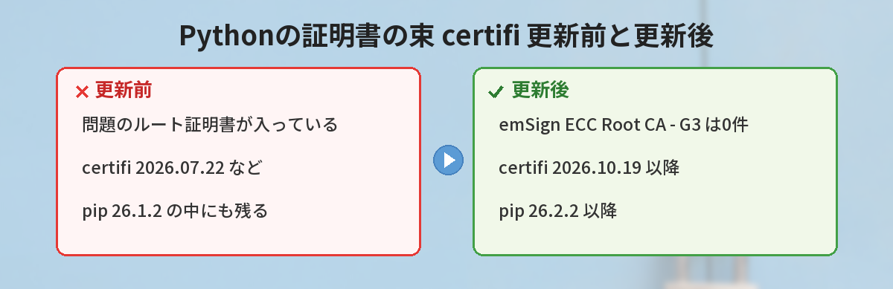
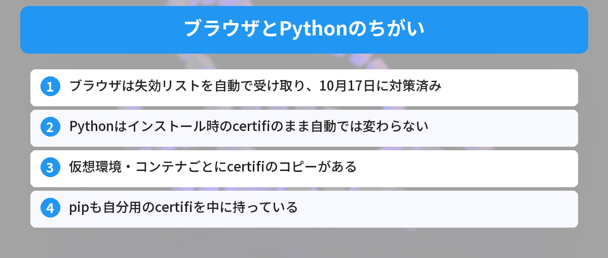
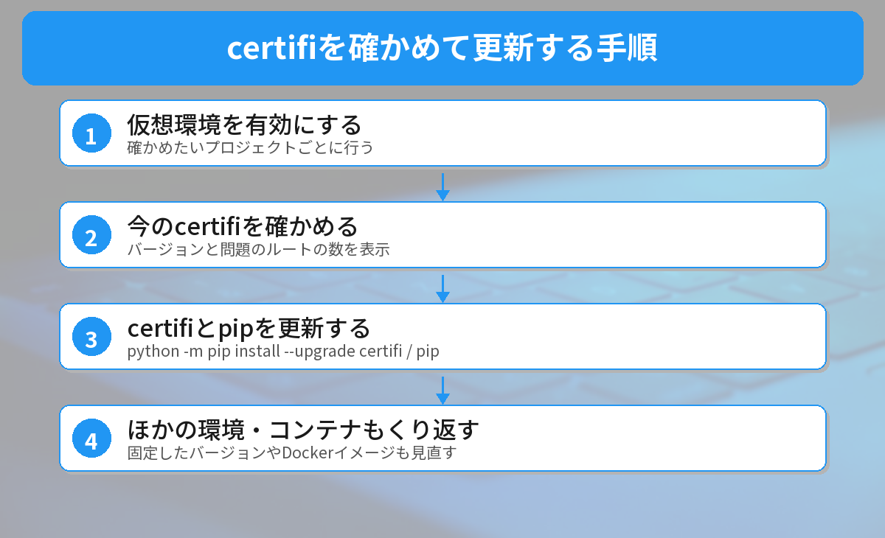

## この記事で分かること

SNSで「Pythonの人は certifi を今すぐ更新して」って流れてきたの。certifiって何？私のパソコンも危ないの？


certifiは、Pythonが「このサイトは本物か」を確かめるために使う証明書の束なんだ。10月17日に、ある認証局の鍵が漏れていたことが分かって、certifiも急いで更新されたよ。自分の環境が古いままか、確かめ方から説明するね。


こんな場面で困っていませんか？
- 「certifi」「CA証明書」「ルート証明書」という言葉がよく分からない
- ブラウザは大丈夫と聞いたけど、自分で書いたPythonのプログラムはどうなのか知りたい
- 仮想環境やDockerがいくつもあって、どれを直せばいいのか分からない

## 何が起きたのか（10月17日〜20日）
インドの認証局（ウェブサイトの身分証明書を発行する会社）**eMudhra**の、**中間証明書8つの秘密鍵が漏れていた**ことが分かりました。

[Googleのセキュリティブログ](https://blog.google/security/protecting-chrome-and-android-users-from-compromised-emudhra-intermediate-ca-certificates/)によると、流れは次のとおりです。

- **10月17日（世界時18時5分）**：Chromeのルート証明書の担当チームに、セキュリティ研究者から報告が届く
- **同じ日の19時45分**：Chromeが、該当する中間証明書を失効リスト（CRLSet）でブロック。アップデートや再起動なしで利用者を保護
- **その後**：問題の中間証明書に署名したルート証明書「**emSign ECC Root CA - G3**」を、Chromeの信頼リストから外すと発表（すべての端末への反映は10月27日の予定）

鍵は「十分にランダムでない方法」で作られていて、だれでも推測できる状態でした。この鍵があれば、**どんなサイトにでもなりすませる偽の証明書**を作れてしまいます。



## なぜPythonは自分で更新が必要なのか（仕組み）
HTTPSのサイトにつなぐとき、プログラムは「サイトの証明書 → 中間証明書 → ルート証明書」とたどって、最後のルート証明書が**信頼リストに入っているか**を確かめます。



### ブラウザは自動で守られた
ChromeやFirefoxは、失効リストを自分でダウンロードしています。そのため、利用者が何もしなくても、報告からわずか数時間で守られました。

### Pythonは「証明書の束」を持ち歩いている
Pythonの `requests` などのライブラリは、**certifi**という証明書の束（信頼リスト）を使います。この束は、**インストールした時点のまま固まっていて、自動では更新されません**。仮想環境（venv）やDockerのコンテナを作るたびに、そのときのcertifiがコピーされます。

さらに、**pip自身もcertifiを中に持っています**。パッケージをダウンロードするときは、pipに入っているほうのcertifiが使われます。

## 実際に確かめてみた
2026年10月21日に、Windows 11・Python 3.13.14で、使い捨ての仮想環境を作って試しました。certifiのファイルの中に「emSign ECC Root CA - G3」という名前が何回出てくるかを数えています（0なら削除済み）。

| 対象 | バージョン | emSign ECC Root CA - G3 |
|------|------|------|
| certifi（更新前） | 2026.07.22 | 見つかった（3か所） |
| certifi（更新後） | 2026.10.19 | 0 |
| pipに入っているcertifi（pip 26.1.2） | 2026.02.25 | 見つかった（3か所） |
| pipに入っているcertifi（pip 26.2.2） | 2026.10.19 | 0 |

**certifiとpipの両方を更新して、はじめて両方からこのルートが消える**ことが分かりました。「3か所」は、証明書の名前・発行者・ラベルの行に1回ずつ書かれているためです。

## 自分の環境を確かめて更新する手順


### ステップ1: 仮想環境を有効にする
確かめたいプロジェクトの仮想環境を有効にします。仮想環境の基本は[仮想環境入門](/posts/python-venv-beginner/)で解説しています。

### ステップ2: 今のcertifiを確かめる
次のコマンドで、certifiのバージョンと、問題のルートが入っているかを表示します。

```bash
python -c "import certifi,io; t=io.open(certifi.where(),encoding='utf-8').read(); print(certifi.__version__, t.count('emSign ECC Root CA - G3'))"
```

`2026.10.19 0` のように、**バージョンが2026.10.19以降で、2つ目の数字が0**なら対応済みです。

### ステップ3: certifiとpipを更新する
```bash
python -m pip install --upgrade certifi
python -m pip install --upgrade pip
```

更新したら、ステップ2のコマンドをもう一度実行して、0になったことを確かめます。

### ステップ4: ほかの仮想環境・コンテナもくり返す
**仮想環境ごとに**同じ作業が必要です。`requirements.txt` で `certifi` のバージョンを固定している場合は、その行も `2026.10.19` 以降に書き換えます。Dockerを使っている場合は、イメージを作り直します。

pipでエラーが出るときは[pip installのエラーの直し方](/posts/python-pip-install-error/)も参考にしてください。


pipの中にもcertifiが入っていたなんて知らなかった…。certifiだけ更新して安心するところだったよ。


そこがいちばんの落とし穴だね。「certifiとpipをセットで更新」と覚えておこう。


## uv・Node.jsなど、ほかのツールは？
- **uv**：2026年10月20日の[0.13.4](https://github.com/astral-sh/uv/releases)で、同梱のルート証明書を更新しました。`uv self update` などで0.13.4以降にします
- **Node.js**：ルート証明書を本体に組み込んでいるので、OSを更新しても変わりません。10月21日に手元のNode.js v24.16.0を調べると、emSignのルートが4つ入っていました（emSign ECC Root CA - G3を含む）。同じ日のセキュリティリリースで対応されるかは発表されていません。詳しくは[Node.jsのセキュリティ更新の記事](/posts/nodejs-security-release-2026-10/)を見てください
- **Go**：10月19日の Go 1.27.3 と 1.26.10 で対応。**ビルドし直したプログラムだけ**に反映されます

## やってはいけないこと
### 証明書の確認をオフにする
エラーが出たからといって、`verify=False` や `--trusted-host` で証明書の確認を止めるのはやめましょう。今回のような偽の証明書をそのまま信じてしまう状態になります。

### 1つの環境だけ直して終わりにする
仮想環境やコンテナは、それぞれが自分のcertifiを持っています。よく使う環境だけでなく、自動で動いているスクリプトの環境も確認してください。




ブラウザは自動で守られていて、Pythonは仮想環境ごとにcertifiとpipを更新する、だね！


完璧。確認のコマンドで「0」と出るまでが作業だよ。


## まとめ
- 2026年10月17日、認証局eMudhraの中間証明書8つの秘密鍵が漏れていたことが分かった
- ChromeとFirefoxは自動で対策済み。利用者の操作はいらない
- Pythonのcertifiは2026.10.19で問題のルートを削除。pipも26.2.2で同じ内容に更新
- 仮想環境・コンテナごとに `python -m pip install --upgrade certifi` と pip の更新が必要
- 証明書の確認をオフにする回避策は使わない

---
### あわせて読みたい
- [【Node.js】10月21日にセキュリティ更新！自分のバージョンは対象？](/posts/nodejs-security-release-2026-10/)
- [【Python 3.15】ついにUTF-8が標準に！cp932エラーはもう出ない？](/posts/python-315-utf8-default/)
