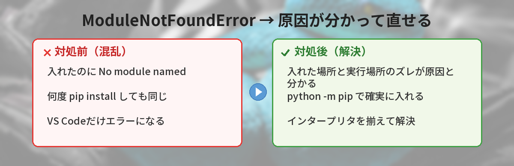
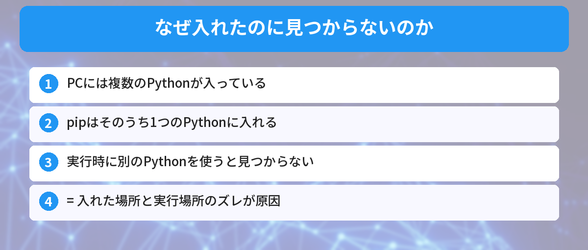
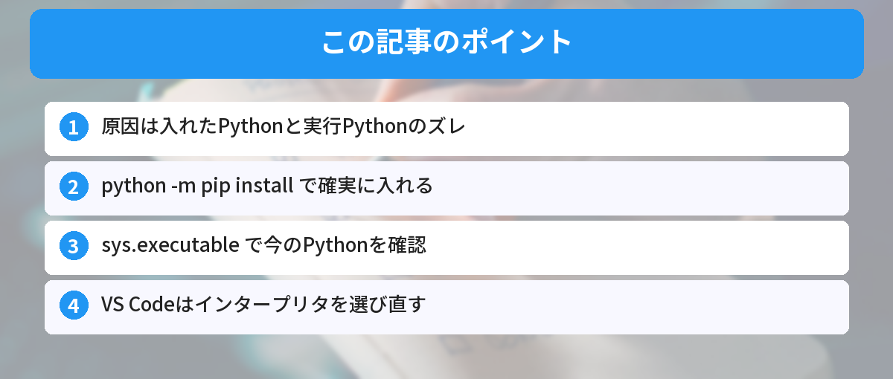

## この記事で分かること


ちゃんと pip install したのに「ModuleNotFoundError」って出るの…！入れたはずなのに、なんで見つからないの？



それ、超あるあるのやつだね。実は「入れた場所」と「実行してる場所」がズレてるのが原因なんだ。仕組みが分かれば一発で直せるよ。自分も昔これで30分溶かしたから、丁寧に説明するね。




ターミナルで `pip install` が成功したのに、いざ実行するとこう出る。

```
ModuleNotFoundError: No module named 'requests'
```

「ちゃんと入れたのに、なんで？」と焦りますよね。でも大丈夫です。これは壊れたわけではなく、**仕組みを知れば必ず直せる**エラーです。この記事では、なぜ見つからないのかという理由から、確実に直す方法、そして二度と悩まないための予防策まで解説します。Pythonを始めたばかりでエラー自体に慣れていない方は、先に[Pythonのtry-exceptでエラーを扱う基本](/posts/python-try-except-beginner/)も読んでおくと理解が深まります。



## ModuleNotFoundErrorとは

`ModuleNotFoundError` は、「import しようとしたモジュール（ライブラリ）が見つからない」というエラーです。

```python
import requests  # ← このrequestsが見つからないと出る
```

ポイントは、**本当にインストールされていない場合もあれば、インストールはされているのに「別の場所」に入っている場合もある**ということです。初心者がハマるのは圧倒的に後者です。

## なぜ「入れたのに見つからない」が起きるのか

ここが一番大事なところです。原因は、**pip がインストールした Python と、あなたが実行している Python が別物**だからです。

多くのPCには Python が複数入っています。

- PC に最初から入っている Python
- 公式サイトから入れた Python
- Anaconda の Python
- 仮想環境（venv）の Python

`pip install` は「どれかの Python」にライブラリを入れます。でも実行時に「別の Python」を使っていると、その Python にはライブラリが無いので「見つからない」と言われるわけです。



つまり、荷物（ライブラリ）を A の家に届けたのに、B の家で「荷物が無い」と探しているような状態です。家が複数あるのが根本原因です。この「どの Python を使うか」の感覚は、仮想環境を理解するとぐっとクリアになります。詳しくは[Pythonのvenvで仮想環境を作る基本](/posts/python-venv-beginner/)で解説しています。

## 確実に直す方法

### ステップ1: 実行しているPythonを確認する

まず、自分がどの Python を使っているか確認します。

```bash
python --version
python -c "import sys; print(sys.executable)"
```

`sys.executable` が、今使っている Python の正確な場所（パス）です。これを覚えておきます。

### ステップ2: python -m pip でインストールする

ここが解決の肝です。`pip install` ではなく、**`python -m pip install` の形で入れます**。

```bash
python -m pip install requests
```

`python -m pip` は「今実行しているその Python に対して pip を使う」という意味です。これなら、入れる場所と実行する場所が必ず一致します。ズレが起きません。

```bash
# NG: どのpipか曖昧
pip install requests

# OK: 実行するpythonに確実に入る
python -m pip install requests
```

### ステップ3: 入ったか確認する

```bash
python -m pip show requests
```

`Location:` に表示されるパスが、ステップ1で確認した Python のパスと同じ系列なら成功です。pip install 自体でつまずく場合は[pip installがエラーになるときの対処法](/posts/python-pip-install-error/)もあわせて確認してください。

## VS Codeで出る場合の確認ポイント

VS Code で実行していて `ModuleNotFoundError` が出るときは、**VS Code が選んでいる Python（インタープリタ）が原因**であることがほとんどです。

VS Code は右下やコマンドパレットで「どの Python で実行するか」を選べます。ここが、`pip install` した Python と違っていると、いくら入れても見つかりません。

確認手順：

1. コマンドパレットを開く（`Ctrl + Shift + P`）
2. 「Python: Select Interpreter」を選ぶ
3. 一覧から、ステップ1で確認したパスの Python を選ぶ

これで VS Code の実行先と、ライブラリを入れた Python が揃います。

## やってはいけないこと

初心者がやりがちで、かえって混乱するNG行動です。

- **とりあえず何度も pip install し直す** — 入れる場所が間違っていると、何回入れても同じ。まず「どこに入っているか」を確認する
- **sudo や管理者権限で無理やり入れる** — 環境が複雑になり、後でもっと分かりにくくなる
- **エラー文を読まずにコピペ対処する** — `No module named 'xxx'` の `xxx` が本当のモジュール名か（タイプミスしていないか）を先に確認する

## 筆者がハマったポイント

実際に自分がハマったのは、「ターミナルでは動くのに VS Code だと ModuleNotFoundError」というパターンでした。

原因は、ターミナルは公式の Python を使っていて、VS Code は別の（昔入れた）Python を選んでいたこと。`sys.executable` を両方で出して、パスが違うことに気づいて一発で解決しました。

教訓は「エラーが出たら、まず `python -c "import sys; print(sys.executable)"` で居場所を確認する」。これだけで原因の8割は見えます。

## よくある質問（FAQ）



### Q: pip install は成功したのに、なぜ見つからないのですか？
A: pip が入れた Python と、実行している Python が別物だからです。`python -m pip install` の形で入れると、実行中の Python に確実に入るのでズレが起きません。

### Q: python と python3、pip と pip3 はどっちを使えばいい？
A: 環境によって違います。迷ったら `python -m pip`（または `python3 -m pip`）の形が一番確実です。`python --version` で今動いているものを確認してから揃えてください。

### Q: VS Codeだけでエラーが出ます。ターミナルでは動きます。
A: VS Codeが選んでいるインタープリタが、ライブラリを入れた Python と違います。「Python: Select Interpreter」で正しいパスの Python を選び直してください。

### Q: 仮想環境（venv）を使うと解決しますか？
A: はい、有効です。仮想環境を有効化してからインストール・実行すれば、使う Python が1つに固定されるのでズレが起きにくくなります。

### Q: No module named のモジュール名に見覚えがありません。
A: タイプミスか、パッケージ名とimport名が違うケースです（例: `pip install beautifulsoup4` だが `import bs4`）。公式ドキュメントで正しいimport名を確認してください。


なるほど…！Pythonが何個もあって、入れた場所と使う場所がズレてたんだ…！`python -m pip` で入れればいいんだね！



その通り！困ったら「今どのPythonを使ってる？」を確認するクセをつけると、このエラーはもう怖くないよ。


## まとめ

- `ModuleNotFoundError` は「入れた Python」と「実行する Python」のズレが主な原因
- 直すコツは `python -m pip install` の形で入れること（実行中の Python に確実に入る）
- まず `python -c "import sys; print(sys.executable)"` で今の Python の居場所を確認する
- VS Codeで出るなら「Python: Select Interpreter」で正しい Python を選ぶ
- 仮想環境（venv）を使うと、使う Python が固定されてズレにくい

---
### あわせて読みたい
- [Pythonのvenvで仮想環境を作る基本 ― 環境のズレを防ぐ](/posts/python-venv-beginner/)
- [pip installがエラーになるときの対処法](/posts/python-pip-install-error/)

<!-- affiliate -->
## 関連リソース

Pythonをこれから基礎から学びたい方に、評価の高い入門書をまとめました。

<!-- START MoshimoAffiliateEasyLink -->
<script type="text/javascript">
(function(b,c,f,g,a,d,e){b.MoshimoAffiliateObject=a;b[a]=b[a]||function(){arguments.currentScript=c.currentScript||c.scripts[c.scripts.length-2];(b[a].q=b[a].q||[]).push(arguments)};c.getElementById(a)||(d=c.createElement(f),d.src=g,d.id=a,e=c.getElementsByTagName("body")[0],e.appendChild(d))})(window,document,"script","//dn.msmstatic.com/site/cardlink/bundle.js?20220329","msmaflink");
msmaflink({
  "n":"Python入門書",
  "b":"","t":"",
  "d":"https://thumbnail.image.rakuten.co.jp",
  "c_p":"",
  "p":[""],
  "u":{"u":"https://search.rakuten.co.jp/search/mall/Python+%E5%85%A5%E9%96%80/","t":"rakuten","r_v":""},
  "v":"2.1",
  "b_l":[
    {"id":1,"u_tx":"楽天市場で見る","u_bc":"#f76956","u_url":"https://search.rakuten.co.jp/search/mall/Python+%E5%85%A5%E9%96%80/","a_id":5490814,"p_id":54,"pl_id":27059,"pc_id":54,"s_n":"rakuten","u_so":1},
    {"u_bc":"#f79256","u_tx":"Amazonで見る","u_url":"https://www.amazon.co.jp/s/ref=nb_sb_noss_1?__mk_ja_JP=%E3%82%AB%E3%82%BF%E3%82%AB%E3%83%8A&url=search-alias%3Daps&field-keywords=Python+%E5%85%A5%E9%96%80","s_n":"amazon","u_so":2,"a_id":5490817,"p_id":170,"pc_id":185,"pl_id":27060,"id":2}
  ],
  "eid":"pymodnotfound",
  "s":"s"
});
</script>
<div id="msmaflink-pymodnotfound">リンク</div>
<!-- MoshimoAffiliateEasyLink END -->
<!-- /affiliate -->
