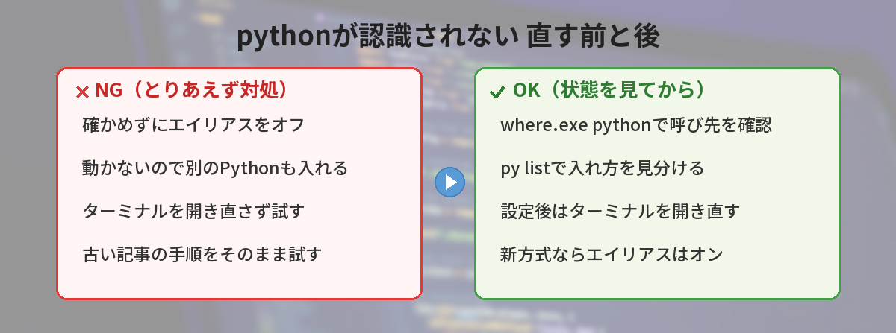
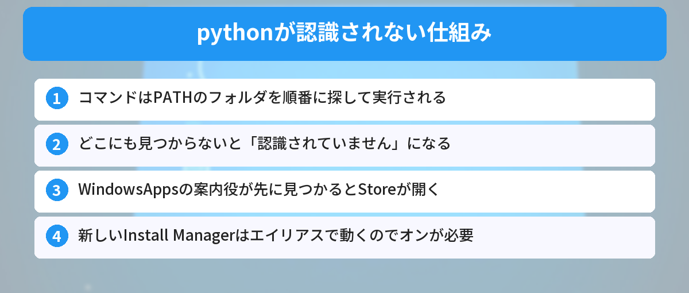
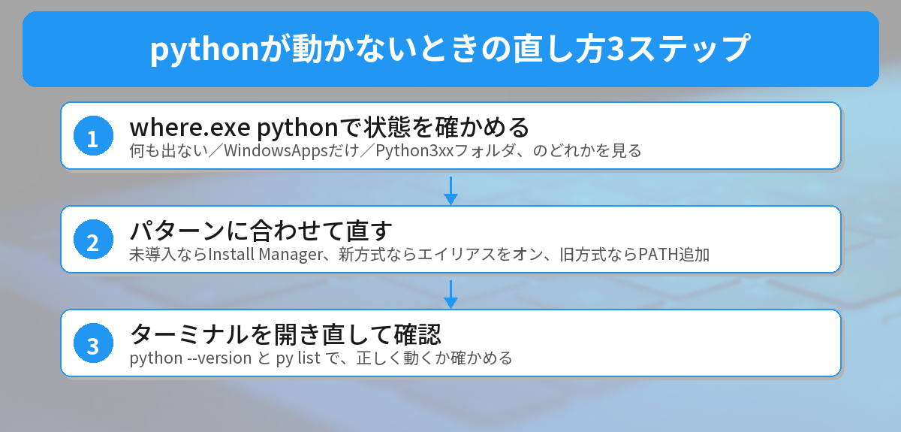
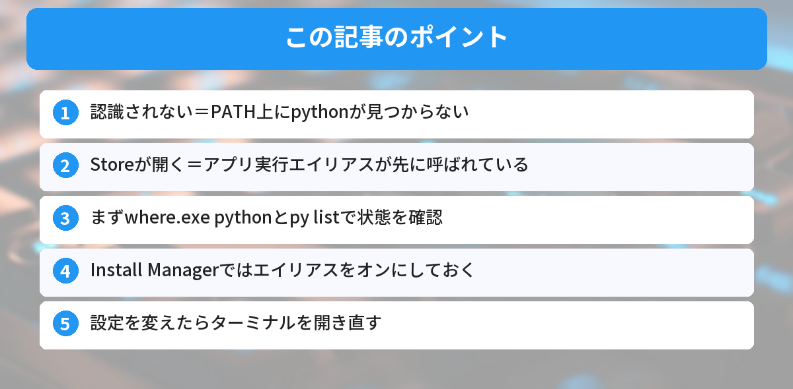

## この記事で分かること


Pythonを入れたはずなのに、pythonって打ったら「認識されていません」って出たの…。別のPCだと、なぜかMicrosoft Storeが開いちゃうし…。どういうこと？



それは「pythonって打ったときに、どのプログラムを動かすか」がうまく決まっていない状態なんだ。しかも2026年はPythonの入れ方そのものが変わっている途中だから、古い記事どおりにやると逆に動かなくなることもあるよ。順番に見分けていこう。




## こんな場面で困っていませんか？

Windowsのターミナルで `python` と打ったら、こんなエラーが出て止まってしまった。

コマンドプロンプトの場合：

```text
'python' は、内部コマンドまたは外部コマンド、操作可能なプログラムまたはバッチ ファイルとして認識されていません。
```

PowerShellの場合：

```text
python : 用語 'python' は、コマンドレット、関数、スクリプト ファイル、または操作可能なプログラムの名前として認識されません。
```

または、エラーの代わりに **Microsoft Storeが勝手に開いた**。英語で `Python was not found; run without arguments to install from the Microsoft Store...` と出ることもあります。

よくある困りごとは、この3つです。

- 公式サイトからPythonを入れたのに、`python` が動かない
- `python` と打つと、なぜかMicrosoft Storeが開く
- 調べた記事の「Add python.exe to PATH にチェック」という項目が、画面に見当たらない

結論から言うと、原因は**`python` と打ったときに呼び出されるプログラムが、見つからないか、別のものになっている**ことです。まず `where.exe python` で今の状態を確かめて、自分がどのパターンかを見分けるのが近道です。



## 一言で説明すると

Windowsは、コマンドを打たれると、**環境変数PATHに書かれたフォルダを順番に探して**、同じ名前のプログラムを実行します。

「認識されていません」は、どのフォルダにも `python` が見つからなかったという意味です。「Storeが開く」は、本物のPythonより先に、Windowsが用意した**「Storeへの案内役」のpython**が見つかってしまった状態です。環境変数の考え方は、[環境変数とは？.envファイルの使い方](/posts/env-variables-beginner/)でも解説しています。

## なぜ起きるのか（仕組み）

### pythonと打つと「PATHの順番」で探される

PATHには、たくさんのフォルダが順番に並んでいます。Windowsは上から順に探して、最初に見つかった `python.exe` を実行します。そのため、

- Pythonを入れたフォルダがPATHに入っていない → 「認識されていません」
- 入っていても、後ろのほうにある → 先に見つかった別の `python.exe` が動く

ということが起きます。

### Storeが開く正体は「アプリ実行エイリアス」

Windowsには、「アプリ実行エイリアス」という仕組みがあります。コマンド名と、Storeなどのアプリを結びつける機能です。Pythonが入っていないWindowsでは、このエイリアスが「`python` と打たれたらStoreを開く」役割をしています。

このエイリアスは、`C:\Users\（ユーザー名）\AppData\Local\Microsoft\WindowsApps` というフォルダに置かれます。だから、本物のPythonより先にこのフォルダが見つかると、Storeが開くわけです。

### 2026年は「Python Install Manager」へ移行中

ここが、古い記事が通用しなくなっているポイントです。

Pythonの公式は、Windows向けの入れ方を「**Python Install Manager**」という新しいツールに切り替えています（PEP 773）。2026年10月9日には、Python 3.15.0と、Install Manager 26.4が同時に公開されました。これまでの `.exe` のインストーラーは、**Python 3.16で提供終了**と告知されています。

新しいInstall Managerは、`python`・`py`・`pymanager` の3つのコマンドを、**アプリ実行エイリアスとして**用意します。つまり、

- 古い記事：「Storeが開くなら、アプリ実行エイリアスをオフにしよう」
- 新しいInstall Manager：「エイリアスで動くので、**オンにしておく**必要がある」

と、真逆になっているのです。昔の対処法をそのまま試すと、Install Managerで入れた `python` まで消えてしまいます。




えっ、ネットで見た「エイリアスをオフ」って、もう古いかもしれないの？



そうなんだ。昔ながらのインストーラーで入れた人には効くけど、新しいInstall Managerで入れた人には逆効果。だから、まず「自分がどの方式で入れたか」を確かめるのが大事なんだよ。


## 実際に試してみた（筆者のPCで再現）

筆者のWindows PCで、今の状態を確かめてから、エラーを再現してみました。

### まず「どこのpythonが呼ばれているか」を確認

```powershell
where.exe python
```

```text
C:\Users\ryomazon\AppData\Local\Microsoft\WindowsApps\python.exe
```

筆者のPCでは、`WindowsApps` の中の `python.exe` が呼ばれていました。調べてみると、これは**Microsoft Store版のPython 3.13**でした。`python --version` を打つと `Python 3.13.14` と表示され、正常に動いています。

ちなみに、PowerShellで `where` とだけ打つと、別のコマンド（Where-Object）として扱われてしまいます。PowerShellでは必ず `where.exe` と打ってください。

### Store版には「py」コマンドがなかった

同じPCで `py` と打ってみると、こう出ました。

```text
py : 用語 'py' は、コマンドレット、関数、スクリプト ファイル、または操作可能なプログラムの名前として認識されません。
```

Store版のPythonには、`py` コマンドは付いてきません。**「pythonは動くのに、pyは動かない」**という状態です。参考書やネットの手順に `py` と書かれていて動かないときは、これが原因のことがあります。

### PATHを外すと「認識されていません」が出た

次に、PCの設定は変えずに、その場だけPATHから `WindowsApps` を外したターミナルで `python` を打ってみました。すると、コマンドプロンプトでもPowerShellでも、「認識されていません」のエラーが出ました。

つまり、**pythonがPATH上のどこにも見つからない**と、このエラーになることが確かめられました。なお、筆者の環境ではエラー文が英語で表示されたため、この記事では日本語の表示に合わせて紹介しています。

## 解決方法（パターン別の直し方）

### ステップ1: 今の状態を確かめる

まずは次のコマンドで、どのパターンかを見分けます。

```powershell
where.exe python
python --version
py list
```

結果によって、パターンが分かれます。

| `where.exe python` の結果 | 状態 | 進む先 |
|---|---|---|
| 何も見つからない | Pythonが入っていない、またはPATHに入っていない | パターンA・B |
| `WindowsApps\python.exe` だけ | エイリアス（Install Manager、Store版、またはStoreへの案内役） | パターンB・C |
| `Python3xx` などのフォルダが出る | 昔ながらのインストーラーで入れたPython | パターンD |

`py list` で、入っているPythonの一覧が表示されれば、Install Managerで入れた状態です。

### パターンA: 何も入っていない → Install Managerを1つだけ入れる

これから入れる人は、新しいInstall Managerがおすすめです。

1. Microsoft Store、または python.org のダウンロードページから「Python Install Manager」を入れる
2. ターミナルを**いったん閉じて、開き直す**
3. `python` と打つと、最新版のPythonが自動でダウンロードされる

初回の設定確認をやり直したいときは、次のコマンドを使います。

```powershell
py install --configure
```

Install Managerは、Windows 10以降で使えます。会社や学校のPCで、Storeやアプリのインストールが制限されている場合は、無理に回避せず管理者に相談してください。

### パターンB: Install Managerを入れたのに動かない・Storeが開く

公式ドキュメントでは、次の確認が案内されています。

1. スタートメニューで「アプリ実行エイリアスの管理」を開く
2. 「Python (default)」がオンになっているか確認する
3. オンになっていたら、**一度オフにしてから、オンに戻す**（登録し直しになる）
4. 「Python install manager」なども同じように確認する

あわせて、PATHに `C:\Users\（ユーザー名）\AppData\Local\Microsoft\WindowsApps` が入っているかも確認しましょう。最後に、ターミナルを開き直してから試します。

### パターンC: pyが動かない・pythonとpyで違うバージョンが動く

昔の「Pythonランチャー（py）」が残っていて、Install Managerより先に動いていることがあります。公式ドキュメントでは、次の対処が案内されています。

1. 「設定」→「アプリ」→「インストールされているアプリ」で「Python launcher」をアンインストールする
2. 古いPythonも、使わないならアンインストールする
3. アプリ実行エイリアスで「Python (default)」をオンにする

Store版のPythonを使っていて `py` が動かない場合は、Store版には `py` がないのが原因です。`python` を使うか、Install Managerに切り替えましょう。

### パターンD: 昔のインストーラーのまま使い続ける

昔ながらの `.exe` インストーラーで入れた人は、次の方法でPATHに追加できます。

1. インストーラーをもう一度実行して「Modify」を選ぶ
2. 「Add Python to environment variables」にチェックを入れて進める
3. ターミナルを開き直す

この場合は、アプリ実行エイリアスの「python.exe」「python3.exe」をオフにすると、Storeが開くのを止められます。ただし、従来のインストーラーは3.16で提供終了予定なので、これから入れ直すならInstall Managerへの移行がおすすめです。



## やってはいけないこと

### 何も確かめずに「エイリアスをオフ」にする

前のセクションのとおり、Install Managerで入れたPythonは、エイリアスで動いています。確かめずにオフにすると、`python` も `py` も消えてしまいます。必ず `where.exe python` で状態を確かめてから対処しましょう。

### 何種類も重ねて入れる

公式ドキュメントでは、Store版・MSIX版・MSI版のPythonが同時に入ってしまい、混乱の原因になることがあると説明されています。「動かないから、とりあえずもう1つ入れる」は逆効果です。入れ直すときは、使わないものをアンインストールしてからにしましょう。

### ターミナルを開き直さずに試す

PATHやエイリアスの変更は、**新しく開いたターミナルから**反映されます。設定を変えたら、VS Codeのターミナルも含めて、いったん閉じて開き直してから試してください。VS Codeの操作は、[VS Codeで最初に覚えるべき設定とショートカット](/posts/vscode-shortcuts-beginner/)でまとめています。

### コマンドプロンプトにPythonのコードを直接打つ

意外と多いのが、`print("hello")` のようなPythonのコードを、コマンドプロンプトに直接打ってしまうケースです。これもエラーになります。コードは `.py` ファイルに書いて `python ファイル名.py` で実行するか、`python` と打ってPythonを起動してから入力します。コマンドの基本は、[コマンドラインが怖い人へ ― 覚えるコマンド5つだけ](/posts/command-line-scary/)も参考になります。

## 筆者がハマったポイント

最初、筆者は自分のPCのPythonを「python.orgのインストーラーで入れたもの」だと思い込んでいました。でも `where.exe python` で確かめると、実は**Microsoft Store版**でした。昔、ストアからなんとなく入れていたのを忘れていたのです。

そのせいで、ネットの手順どおりに `py` を打っても動かず、「Pythonが壊れた？」と焦りました。原因は単純で、Store版には `py` がないだけでした。

教訓は、**直し方を試す前に、まず `where.exe python` で「どこのpythonか」を見る**ことです。これだけで、どの記事の手順が自分に合うかが分かります。Pythonを動かした後に「入れたはずのライブラリが見つからない」と出た人は、[pip installしたのにModuleNotFoundErrorが出る原因](/posts/python-module-not-found-error/)も読んでみてください。

## よくある質問（FAQ）



### Q: 「Add python.exe to PATH」のチェックが見当たりません。
A: 新しいPython Install Managerで入れている可能性があります。Install Managerは、アプリ実行エイリアスで `python` を使えるようにするため、このチェックがなくても動きます。`py list` で一覧が出るか確認してみてください。

### Q: Storeが開くのを止めたいです。
A: 昔のインストーラーで入れた人は、アプリ実行エイリアスの「python.exe」「python3.exe」をオフにすると止まります。Install Managerで入れた人は、逆にオンにしておく必要があるので、まず `where.exe python` で状態を確かめてください。

### Q: pythonは動くのに、pyが動きません。
A: Microsoft Store版のPythonには `py` コマンドが付いていません。`python` を使うか、Install Managerに切り替えると `py` も使えるようになります。

### Q: 設定を変えたのに、まだ「認識されていません」と出ます。
A: ターミナルを開き直していない可能性があります。VS Codeを使っている場合は、VS Codeごと再起動してから試してください。

### Q: MacやLinuxでも同じエラーになりますか？
A: MacやLinuxでは `python3` が標準で、エラーは `command not found: python` のような表示になります。この記事はWindows向けなので、MacやLinuxの場合は `python3` で試してみてください。


まず where.exe python で「どこのpythonか」を見るんだね！ネットの手順をそのまま試す前に、自分のパターンを確かめるようにする！



完璧だよ。2026年はPythonの入れ方が変わっている途中だから、古い記事と新しい方法がまざっているんだ。状態を確かめてから直す、これがいちばんの近道だよ。


## まとめ

- 「認識されていません」は、`python` がPATH上のどこにも見つからない状態
- 「Storeが開く」は、Windowsの「アプリ実行エイリアス」が先に呼ばれている状態
- まず `where.exe python` と `py list` で、自分がどのパターンかを確かめる
- 2026年はPython Install Managerへ移行中。新方式ではエイリアスを**オン**にしておく
- 設定を変えたら、ターミナルを必ず開き直す。何種類も重ねて入れない

---
### あわせて読みたい
- [【Python】pip installしたのにModuleNotFoundErrorが出る原因](/posts/python-module-not-found-error/)
- [【PowerShell】npmが動かない？「スクリプトの実行が無効」の直し方](/posts/powershell-execution-policy-error/)

<!-- affiliate -->
## 関連リソース

Pythonを基礎から学び直したい方向けに、評価の高い入門書を選びました。

**独習Python 第2版**（翔泳社）<br>
変数や制御構文から、標準ライブラリを使ったファイル操作まで、Pythonの文法を順を追って学べる独習用の教科書です。

- <a href="https://af.moshimo.com/af/c/click?a_id=5490814&amp;p_id=54&amp;pc_id=54&amp;pl_id=27059&amp;url=https%3A%2F%2Fitem.rakuten.co.jp%2Fbook%2F18185991%2F" rel="nofollow sponsored noopener" referrerpolicy="no-referrer-when-downgrade" target="_blank">独習Python 第2版（楽天市場）</a>
- <a href="https://af.moshimo.com/af/c/click?a_id=5490817&amp;p_id=170&amp;pc_id=185&amp;pl_id=27060&amp;url=https%3A%2F%2Fwww.amazon.co.jp%2Fdp%2F4798189499" rel="nofollow sponsored noopener" referrerpolicy="no-referrer-when-downgrade" target="_blank">独習Python 第2版（Amazon）</a>
<!-- /affiliate -->
