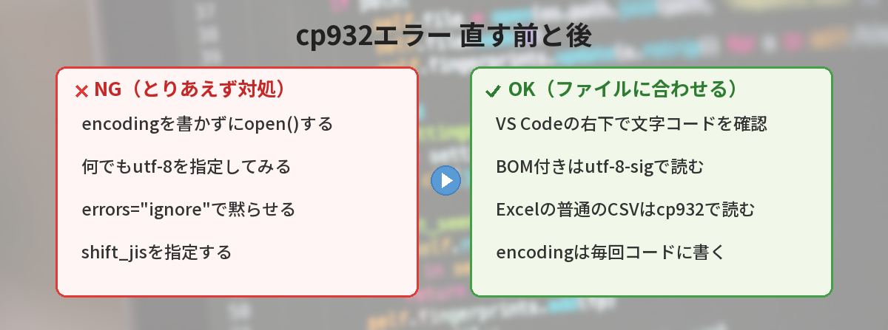
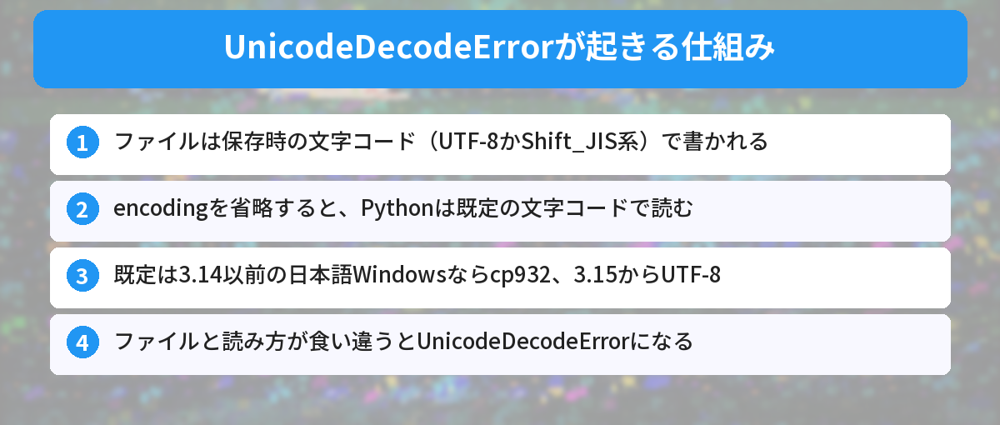
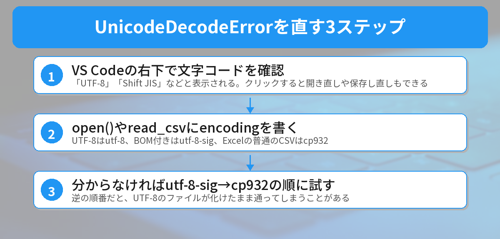
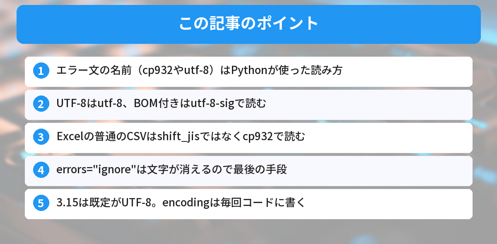

## この記事で分かること


CSVを読み込もうとしたら「UnicodeDecodeError: 'cp932' codec can't decode…」って出たの…。cp932って何？私、変なファイルを作っちゃった？



ファイルは壊れてないから大丈夫。cp932は、日本語のWindowsで使われてきた文字コードの名前なんだ。「この文字コードで読もうとしたけど読めないよ」とPythonが教えてくれているだけ。ファイルに合わせて読み方を指定すれば直るよ。




## こんな場面で困っていませんか？

Windowsでファイルを読み込んだら、こんなエラーが出て止まってしまった。

```text
UnicodeDecodeError: 'cp932' codec can't decode byte 0x87 in position 2: illegal multibyte sequence
```

または、ネットで調べて `encoding="utf-8"` を付けたら、今度はこう出た。

```text
UnicodeDecodeError: 'utf-8' codec can't decode byte 0x8f in position 0: invalid start byte
```

よくある困りごとは、この3つです。

- 参考書と同じコードなのに、自分のWindowsだけエラーになる
- `encoding="utf-8"` を付けたら、別のエラーに変わった
- エラーは出ないのに、文字が「縺薙ｓ縺ｫ縺｡縺ｯ」のように化ける

結論から言うと、原因は**ファイルを保存したときの文字コードと、Pythonが読むときの文字コードが食い違っている**ことです。`open()` に `encoding` を書いて、ファイルに合わせれば直ります。UTF-8なら `utf-8`、BOM付きなら `utf-8-sig`、Excelの普通のCSVなら `cp932` が基本です。



## 一言で説明すると

「このファイルは○○という文字コードで書かれている」とPythonに正しく伝わっていない、というエラーです。

エラー文の `'cp932' codec can't decode` は、「cp932のルールで読もうとしたけど、読めないバイトがあった」という意味です。`'utf-8' codec can't decode` なら、UTF-8のルールで読めなかったということです。**エラー文に出ている名前は「Pythonが使った読み方」で、ファイルの文字コードではない**と覚えておくと、混乱しにくくなります。

## なぜ起きるのか（仕組み）

### 文字コードは「文字と数字の対応表」

コンピュータは、文字を数字（バイト）の並びとして保存しています。どの文字をどの数字にするかを決めた対応表が「文字コード」です。

日本語でよく使われるのは、次の2つです。

| 文字コード | よく使われる場所 |
|---|---|
| UTF-8 | VS Code、Mac、Linux、Webなど、今の標準 |
| Shift_JIS系（cp932） | 日本語Windowsの古いアプリ、Excelの普通のCSV |

同じ「あ」でも、UTF-8とShift_JIS系では保存される数字が違います。だから、書いたときと違う対応表で読むと、読めなかったり、別の文字に化けたりします。

### encodingを省略すると「OSの標準」で読まれる

Pythonの `open()` は、`encoding` を省略すると既定の文字コードで読みます。Python 3.14までは、この既定がOSによって違いました。

- 日本語のWindows: cp932
- Mac / Linux: たいていUTF-8

参考書やネットのコードがMacで書かれていると、`encoding` を書かなくても動きます。でも同じコードを日本語のWindowsで動かすと、UTF-8のファイルをcp932で読もうとしてエラーになります。「参考書どおりなのに、自分だけ動かない」の正体はこれです。

### Python 3.15からは既定がUTF-8に

2026年10月9日に公開されたPython 3.15では、`encoding` を省略したときの既定が、WindowsでもUTF-8になりました（PEP 686）。3.15の新機能の全体像は、[Python 3.15 beta1の新機能まとめ](/posts/python-315-beta1-features/)でも紹介しています。

これで、UTF-8のファイルは `encoding` なしでも読めるようになります。ただし、**ExcelのShift_JIS系CSVを `encoding` なしで読んでいたコードは、逆に `'utf-8' codec can't decode` で止まる**ようになります。3.15に上げれば全部解決、ではない点に注意が必要です。




じゃあ、Macで動いたコードがWindowsで動かないのは、私が悪かったわけじゃないんだ…！



そうなんだ。OSやPythonのバージョンによって「省略したときの読み方」が違うだけ。だから `encoding` は毎回書く。これが一番確実な対策だよ。


## 実際に再現してみた（3.14以前と3.15の違い）

本当にそうなるのか、筆者のWindows PC（日本語環境、Python 3.13）で確かめました。Pythonは起動オプションで読み方を切り替えられます。`-X utf8=0` を付けると3.14以前の日本語Windowsと同じ読み方（cp932）、`-X utf8=1` を付けると3.15と同じ読み方（UTF-8）になります。これを使って、4種類のファイルを `encoding` なしで読みました。

| ファイル | 3.14以前の読み方（cp932） | 3.15の読み方（UTF-8） |
|---|---|---|
| UTF-8のメモ（こんにちは、Python） | エラーなし。でも「縺薙ｓ縺ｫ縺｡縺ｯ…」に化けた | 正しく読めた |
| BOM付きUTF-8のCSV | `'cp932' codec can't decode byte 0xef` | 読めたが、先頭に `\ufeff` が付いた |
| Shift_JIS系のCSV | 正しく読めた | `'utf-8' codec can't decode byte 0x8f` |
| 「①」「髙」入りのShift_JIS系CSV | 正しく読めた | `'utf-8' codec can't decode byte 0x89` |

### 気づいたこと

- **エラーが出ない＝正しく読めた、ではない**: UTF-8のメモは、エラーにならずに化けました。文字によってはエラーになり、「データ分析」という文字列では冒頭の `'cp932' codec can't decode byte 0x87` が再現しました
- **BOM付きは、UTF-8で読んでも油断できない**: 先頭に見えない `\ufeff` が残ります。`csv.DictReader` で読むと、1列目の名前が `'\ufeff名前'` になり、`row["名前"]` で `KeyError` が出ました
- **3.15は「逆向き」のエラーを生む**: Shift_JIS系のCSVは、3.14以前なら `encoding` なしでも読めていたのに、3.15では止まります

どのバージョンでも確実だったのは、`encoding` を自分で書くことでした。

## 解決方法（ファイル別の直し方）

### ステップ1: ファイルの文字コードを確かめる

VS Codeでファイルを開くと、画面右下のステータスバーに「UTF-8」や「Shift JIS」のように文字コードが表示されます。ここをクリックすると、「エンコード付きで再度開く」「エンコード付きで保存」も選べます。VS Codeの基本操作は、[VS Codeで最初に覚えるべき設定とショートカット](/posts/vscode-shortcuts-beginner/)でまとめています。

Excelで作ったCSVは、保存のときに選んだ形式で決まります。

- 「CSV UTF-8（コンマ区切り）」で保存 → BOM付きUTF-8
- 「CSV（コンマ区切り）」で保存 → Shift_JIS系（cp932）

### ステップ2: open()にencodingを書く

文字コードが分かったら、`open()` に `encoding` を書きます。

```python
import csv

# UTF-8で保存されたファイル（VS Codeの標準）
with open("memo.txt", encoding="utf-8") as f:
    print(f.read())

# BOM付きUTF-8（Excelの「CSV UTF-8」）
with open("data.csv", encoding="utf-8-sig", newline="") as f:
    for row in csv.DictReader(f):
        print(row["名前"])

# Shift_JIS系（Excelの「CSV（コンマ区切り）」）
with open("sales.csv", encoding="cp932", newline="") as f:
    for row in csv.reader(f):
        print(row)
```

`utf-8-sig` は、先頭のBOMを自動で取り除いてくれる読み方です。BOMがないUTF-8のファイルも、そのまま読めます。CSVを読むときは `newline=""` も付けておくと、改行の扱いでつまずきません。

### ステップ3: pandasのread_csvも同じ

pandasの `read_csv` は、OSに関係なく既定がUTF-8です。ExcelのShift_JIS系CSVは、`encoding` を指定して読みます。

```python
import pandas as pd

df = pd.read_csv("sales.csv", encoding="cp932")

# Excelで開いても化けにくい形で保存する
df.to_csv("out.csv", index=False, encoding="utf-8-sig")
```

書き出すときに `utf-8-sig` を使うと、Excelでダブルクリックして開いても文字化けしにくくなります。

### ステップ4: どちらか分からないときは順番に試す

いろいろな人から届くファイルを読むなら、UTF-8系 → cp932 の順に試す関数を作っておくと便利です。

```python
def read_text_auto(path):
    # UTF-8系 → cp932 の順に試す（逆にするとUTF-8が化けたまま通ることがある）
    for enc in ("utf-8-sig", "cp932"):
        try:
            with open(path, encoding=enc) as f:
                return f.read(), enc
        except UnicodeDecodeError:
            continue
    raise ValueError(f"{path} はUTF-8でもcp932でも読めませんでした")

text, enc = read_text_auto("sales.csv")
print(enc)  # 読めた文字コードが表示される
```

筆者の環境では、4種類のファイルすべてを正しい文字コードで読み分けられました。`try` と `except` の使い方は、[try-exceptの書き方入門](/posts/python-try-except-beginner/)で詳しく解説しています。




utf-8-sigって、BOMがあってもなくても読めるんだ！じゃあ、迷ったら全部utf-8-sigでいいの？



UTF-8系のファイルなら、それでOKだよ。でも、Excelの普通のCSVのようなShift_JIS系は、utf-8-sigでは読めないんだ。だから「utf-8-sig → cp932」の順に試す関数が便利なんだよ。


## やってはいけないこと

### errors="ignore" で黙らせる

```python
# NG: エラーは消えるが、読めない文字が黙って消える
with open("sales.csv", encoding="utf-8", errors="ignore") as f:
    text = f.read()
```

エラーは出なくなりますが、読めなかった文字が消えます。実際にShift_JIS系のCSV（商品名,売上 / りんご,120 / みかん,80）で試すと、`'i,\n,120\n݂,80\n'` のように日本語がほぼ消えました。データが欠けたことに気づきにくいので、最後の手段にしてください。

### shift_jis を指定する

`shift_jis` は、Windowsでよく使われる「①」「髙」「㈱」などの文字を含みません。実際に「①」入りのファイルを `shift_jis` で読むと、`'shift_jis' codec can't decode byte 0x87` で止まりました。Windowsで作ったファイルは `cp932` を指定します。

### 「おまじない」で直そうとする

ファイルの先頭に書く `# -*- coding: utf-8 -*-` は、Pythonのコードそのものの文字コードを伝える宣言です。`open()` で読むファイルには効きません。コマンドプロンプトで `chcp 65001` を実行しても、`open()` の既定は変わりません。

### 判定の順番を cp932 → UTF-8 にする

先にcp932で読むと、UTF-8のファイルがエラーにならずに化けたまま通ることがあります。今回の実験でも、UTF-8の「こんにちは」がcp932で「縺薙ｓ縺ｫ縺｡縺ｯ」として読めてしまいました。順番はUTF-8系が先です。

## Python 3.15に上げるときの注意

3.15で既定がUTF-8になったことで、これまで動いていたコードが止まる可能性があります。上げる前に、次の2つを知っておくと安心です。

### encodingを省略している場所を探す

起動オプション `-X warn_default_encoding`（Python 3.10以降）を付けると、`encoding` を省略している行で警告が出ます。

```powershell
python -X warn_default_encoding script.py
```

```text
script.py:3: EncodingWarning: 'encoding' argument not specified
  with open(path) as f:
```

警告が出た行に `encoding` を書いておけば、どのバージョンでも同じ動きになります。

### 一時的に元の読み方に戻す

すぐに直せないコードは、`-X utf8=0` を付けるか、環境変数 `PYTHONUTF8=0` を設定すると、3.14以前と同じ読み方に戻せます。逆に、3.14以前のPythonでも `PYTHONUTF8=1` を設定すれば、3.15と同じUTF-8の読み方になります。環境変数の基本は、[環境変数とは？.envファイルの使い方](/posts/env-variables-beginner/)で解説しています。

## 筆者がハマったポイント

この記事のためにエラーを再現しようとしたら、最初はなぜかエラーが出ませんでした。原因は、作業していたターミナルに環境変数 `PYTHONUTF8=1` が設定されていたことです。Windowsの環境変数の設定画面には見当たらず、エディタから開いたターミナルにだけ引き継がれていました。

`PYTHONUTF8=1` があると、Python 3.14以前でも3.15と同じUTF-8の読み方になります。つまり、**同じコードでも、環境変数によって動きが変わる**ということです。「エディタのターミナルでは動くのに、別のターミナルではエラーになる」「自分のPCでは動くのに、友達のPCでは止まる」も、これが原因のことがあります。

今の自分の環境がどちらの読み方かは、次のコマンドで確かめられます。

```powershell
python -c "import sys, locale; print(sys.flags.utf8_mode, locale.getpreferredencoding(False))"
```

筆者の環境では `1 utf-8` と表示されました。`0 cp932` ならcp932の読み方、`1 utf-8` ならUTF-8の読み方です。教訓は、「環境に頼らず、`encoding` はコードに書く」でした。

## よくある質問（FAQ）



### Q: encoding="utf-8" を付けたのに、'utf-8' codec can't decode が出ます。
A: ファイルがShift_JIS系（cp932）で保存されている可能性が高いです。Excelの「CSV（コンマ区切り）」で保存したファイルによくあります。`encoding="cp932"` で読んでみてください。

### Q: Pythonで書き出したCSVを、Excelで開くと文字化けします。
A: 書き出すときに `encoding="utf-8-sig"` を指定してください。先頭にBOMが付くので、ExcelがUTF-8のファイルだと判断できるようになります。

### Q: Python 3.15に上げれば、このエラーは出なくなりますか？
A: UTF-8のファイルは、`encoding` なしでも読めるようになります。ただし、Shift_JIS系のファイルは逆に `'utf-8'` のエラーになります。バージョンに関係なく、`encoding` を書くのが確実です。

### Q: print() で 'cp932' codec can't encode というエラーが出ます。
A: 読み込みではなく、出力側の問題です。3.14以前のWindowsでは、出力をファイルなどに流すとcp932で書き出されるため、絵文字などで止まります。実行前に `$env:PYTHONIOENCODING = "utf-8"` を設定するか、コードの先頭で `sys.stdout.reconfigure(encoding="utf-8")` を呼ぶと解決します。

### Q: Macでもこのエラーは起きますか？
A: Macは既定がUTF-8なので、`'cp932'` のエラーは基本的に起きません。ただし、Windowsで作ったShift_JIS系のCSVをMacで読むと、`'utf-8' codec can't decode` になります。直し方は同じで、`encoding="cp932"` を指定します。


エラー文に出てるのは「Pythonが使った読み方」なんだね！ファイルの文字コードを確かめて、encodingをちゃんと書くようにする！



完璧だよ。迷ったらVS Codeの右下を見る。Excelの普通のCSVは `cp932`、BOM付きは `utf-8-sig`。この3つを覚えておけば、もう慌てないね。


## まとめ

- UnicodeDecodeErrorは、ファイルの文字コードとPythonの読み方の食い違いで起きる
- エラー文に出ている名前（cp932やutf-8）は、Pythonが使った読み方
- UTF-8は `utf-8`、BOM付きは `utf-8-sig`、Excelの普通のCSVは `cp932` で読む
- `shift_jis` や `errors="ignore"` に頼らず、ファイルに合った `encoding` を書く
- Python 3.15は既定がUTF-8。Shift_JIS系のファイルは逆にエラーになるので、encodingは毎回書く

---
### あわせて読みたい
- [【Python】try-exceptの書き方入門！エラー処理を基礎から解説](/posts/python-try-except-beginner/)
- [【Python】3.15 beta1リリース！初心者が知っておくべき新機能5つ](/posts/python-315-beta1-features/)

<!-- affiliate -->
## 関連リソース

ファイルやCSVの扱いも含めて、Pythonを基礎から学びたい方向けに、評価の高い2冊を選びました。

**退屈なことはPythonにやらせよう 第3版**（オライリー・ジャパン）<br>
ファイルの読み書きやCSVの扱いを含め、Pythonで日常の作業を自動化する方法を基礎から学べる定番書の第3版です。

- <a href="https://af.moshimo.com/af/c/click?a_id=5490814&amp;p_id=54&amp;pc_id=54&amp;pl_id=27059&amp;url=https%3A%2F%2Fitem.rakuten.co.jp%2Fbook%2F18513569%2F" rel="nofollow sponsored noopener" referrerpolicy="no-referrer-when-downgrade" target="_blank">退屈なことはPythonにやらせよう 第3版（楽天市場）</a>
- <a href="https://af.moshimo.com/af/c/click?a_id=5490817&amp;p_id=170&amp;pc_id=185&amp;pl_id=27060&amp;url=https%3A%2F%2Fwww.amazon.co.jp%2Fdp%2F4814401523" rel="nofollow sponsored noopener" referrerpolicy="no-referrer-when-downgrade" target="_blank">退屈なことはPythonにやらせよう 第3版（Amazon）</a>

**独習Python 第2版**（翔泳社）<br>
変数や制御構文から、標準ライブラリを使ったファイル操作まで、Pythonの文法を順を追って学べる独習用の教科書です。

- <a href="https://af.moshimo.com/af/c/click?a_id=5490814&amp;p_id=54&amp;pc_id=54&amp;pl_id=27059&amp;url=https%3A%2F%2Fitem.rakuten.co.jp%2Fbook%2F18185991%2F" rel="nofollow sponsored noopener" referrerpolicy="no-referrer-when-downgrade" target="_blank">独習Python 第2版（楽天市場）</a>
- <a href="https://af.moshimo.com/af/c/click?a_id=5490817&amp;p_id=170&amp;pc_id=185&amp;pl_id=27060&amp;url=https%3A%2F%2Fwww.amazon.co.jp%2Fdp%2F4798189499" rel="nofollow sponsored noopener" referrerpolicy="no-referrer-when-downgrade" target="_blank">独習Python 第2版（Amazon）</a>
<!-- /affiliate -->
