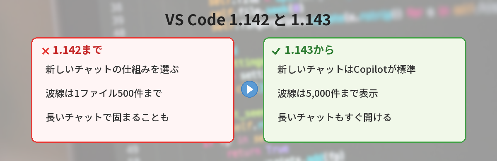
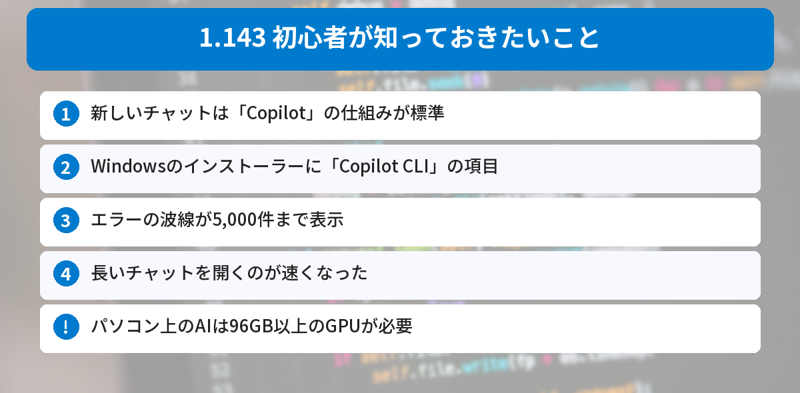
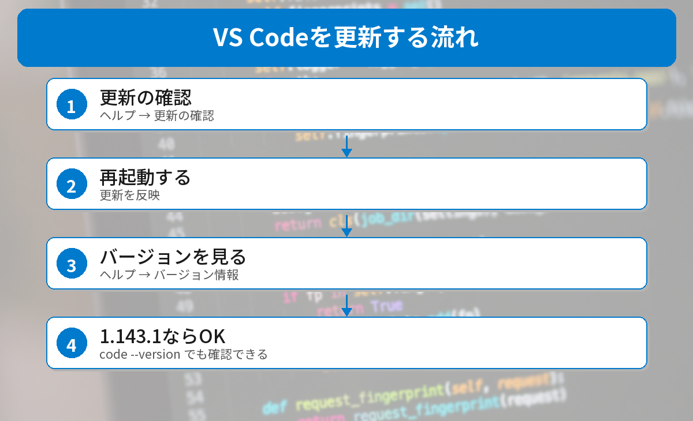

## この記事で分かること

VS Codeを開いたら「更新があります」って出たの。1.143って書いてあるけど、何が変わったの？更新しても大丈夫？


1.143は、AIのチャットまわりの変更が中心の更新だよ。10月23日には修正版の1.143.1も出ているんだ。初心者が知っておきたいところにしぼって説明するね。



こんなことで迷っていませんか？
- 更新の通知が出たけれど、何が変わるのか分からない
- 「Copilotが標準になった」と聞いて、勝手に何か変わるのか心配
- インストーラーに見たことのない項目が出てきた

この記事は、[VS Code 1.143の公式リリースノート](https://code.visualstudio.com/updates/v1_143)（2026年10月24日に確認）をもとにまとめています。

## 最新版はどれ？（確かめてみた）
VS Codeの更新サーバーに、2026年10月24日に問い合わせて確かめました。

```powershell
Invoke-RestMethod "https://update.code.visualstudio.com/api/releases/stable"
```

| 順番 | バージョン |
|------|------|
| 最新 | **1.143.1** |
| ひとつ前 | 1.143.0 |
| その前 | 1.142.0 |

Windows版（ユーザー用インストーラー）の最新は **1.143.1**、公開日時は **2026年10月23日 2時35分（日本時間）** でした。これから更新する人は、1.143.1が入ります。



## 初心者が知っておきたい変更点


### 1. 新しいチャットは「Copilot」の仕組みが標準に
VS Codeのチャット（エージェント）には、動かす仕組みを選ぶ「ハーネス」という項目があります。1.143から、**新しく始めるチャットは「Copilot」のハーネスが標準**になりました。

「Copilot」のハーネスは、GitHub Copilotのほかの製品と同じ土台（Copilot SDK）で作られています。ふだんの編集画面と、エージェント専用の「Agentsウィンドウ」の両方から、同じセッションを開けます。


ハーネスってはじめて聞いた…。何か設定し直さないといけないの？


ふつうに使うだけなら、何もしなくて大丈夫だよ。「チャットを動かすエンジンが新しいものに切り替わった」くらいに覚えておけばOK。チャットを使わない人には、ほとんど関係ないんだ。


### 2. Windowsのインストーラーに「Copilot CLI」の項目
WindowsのVS Codeインストーラーに、**GitHub Copilot CLI**（ターミナルでCopilotを使うツール）を一緒に入れる項目が増えました。

- ターミナルでCopilotを使う予定がなければ、**チェックを外してもかまいません**
- すでにCopilot CLIが入っている場合は、この項目は出ません
- 会社のパソコンでは、管理者の設定で出ないこともあります

Copilot CLIについては、[GitHub Copilot CLIの使い方の記事](/posts/github-copilot-cli-beginner/)で解説しています。

### 3. エラーの波線が5,000件まで表示されるように
コードのまちがいを示す波線（診断）は、これまで**1つのファイルで500件まで**でした。1.143から**5,000件まで**表示されます。上限に達したときは、画面下のステータスバーに注意の表示が出ます。

### 4. 長いチャットを開くのが速くなった
とても長いチャットを開くと、ウィンドウが30秒近く固まることがありました。公式の計測では、固まる時間が**28.3秒から0.6秒**に短くなっています。

## 話題になっているけれど、ふつうは使えない機能
### パソコン上でAIを動かす機能（試験中）
Copilotのモデル「MAI Code 1.1 Flash」を、**自分のパソコンの上で動かす**機能が試験的に入りました。パソコン上で動いた答えは、AIクレジットを使いません。

ただし、**96GB以上のGPUメモリーを持つNVIDIAのGPU**が必要です。ふつうのノートパソコンやデスクトップでは使えません。

### 複数のAIモデルの比べっこ（プレビュー）
同じ作業を複数のモデルに同時にやらせて、結果を比べる機能です。Agentsウィンドウで設定をオンにしたときだけ使えます。

## 更新のしかたと確かめ方


### ステップ1: 更新する
- **Windows**：［ヘルプ］→［更新の確認］
- **Mac**：［Code］→［更新の確認］

更新が終わったら、VS Codeを再起動します。

### ステップ2: バージョンを確かめる
- **Windows**：［ヘルプ］→［バージョン情報］
- **Mac**：［Code］→［Visual Studio Code について］

ターミナルで次のように確かめることもできます。

```bash
code --version
```

1行目が `1.143.1` になっていれば最新です。`code` が見つからないと言われる場合は、VS Codeのコマンドがパスに入っていません。[Pythonの「認識されていません」の記事](/posts/python-not-recognized-windows/)にある、パス（PATH）の考え方が参考になります。

### 日本語表示になっていない場合
メニューが英語のときは、［Help］→［Check for Updates］、［Help］→［About］が同じ場所です。




チャットのエンジンが新しくなって、インストーラーにCopilot CLIの項目が増えたんだね。ふつうに使うなら、更新するだけでいいんだ！


そうだね。更新したら、バージョン情報で1.143.1になっているか見ておけば安心だよ。


## まとめ
- VS Code 1.143が公開され、2026年10月23日に修正版の1.143.1が出た（更新サーバーで確認）
- 新しく始めるチャットは「Copilot」のハーネスが標準に。ふつうに使うだけなら設定は不要
- Windowsのインストーラーに「Copilot CLI」を入れる項目が増えた。不要ならチェックを外せる
- エラーの波線は1ファイル5,000件まで表示されるように
- パソコン上でAIを動かす機能は、96GB以上のGPUメモリーが必要

---
### あわせて読みたい
- [【VS Code】「作成者を信頼しますか？」どっちを押す？10月の更新も解説](/posts/vscode-workspace-trust-update/)
- [【2026年版】GitHub Copilot CLIの使い方 ― ターミナルで動くAIエージェント入門](/posts/github-copilot-cli-beginner/)
