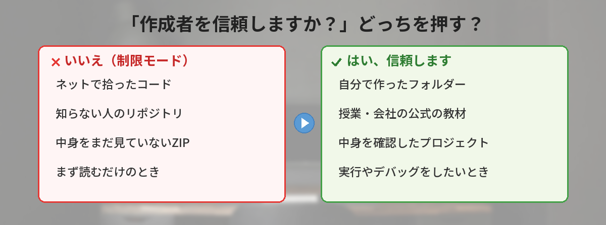
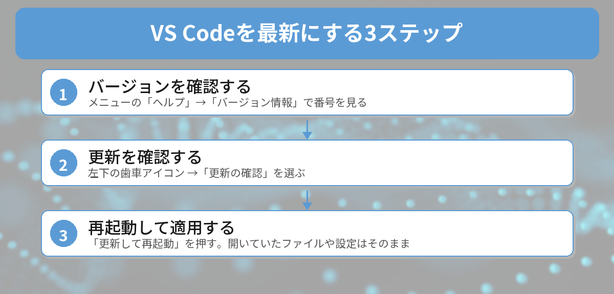

## この記事で分かること

VS Codeでフォルダーを開いたら「このフォルダー内のファイルの作成者を信頼しますか？」って出たの…。「いいえ」を押したら何かできなくなるの？いつも何も考えずに「はい」を押してたんだけど…


いい質問だね。実はこの画面、10月に直されたVS Codeの重大な脆弱性とも関係があるんだ。押し分けのルールと、VS Codeを最新にする方法をまとめて説明するね。


こんなことで困っていませんか？

- フォルダーを開くたびに「作成者を信頼しますか？」と聞かれて、どっちを押せばいいか分からない
- 「いいえ」を押したら、画面上に「制限モード」と出て、実行やデバッグができなくなった
- VS Codeの左下に更新のお知らせが出ているけど、更新していいのか不安

結論から言うと、**自分で作ったフォルダーや、中身を確認した信頼できるプロジェクトなら「はい」、ネットで拾ったコードや知らない人のリポジトリなら、まず「いいえ」**が基本です。そして、10月13日にVS Codeの重大な脆弱性を直す更新が出ているので、**まだならVS Codeを最新版に更新しておきましょう**。

## 10月に何があった？VS Codeのセキュリティ修正

VS Codeは毎月新しいバージョンが出ます。2026年10月は、次のように更新が続きました。

| 日付 | バージョン | 内容 |
|------|------|------|
| 10月7日 | 1.141 | エージェント機能の強化など、毎月の定例リリース |
| 10月13日 | 1.141.1 | セキュリティの問題を直す更新 |
| その後 | 1.141.2 | 不具合を直す更新 |
| 10月14日 | 1.142 | 次の定例リリース |

公式のリリースノートでは、1.141.1について「セキュリティの問題に対応する更新」と案内されています。海外の技術ニュースによると、直された問題には、**細工されたフォルダーやプロジェクトを開くと、パソコンで勝手にプログラムを動かされるおそれがある**深刻なもの（危険度の目安で10点中9.6）が含まれていました。


えっ、フォルダーを開いただけで？こわい…


ポイントは「攻撃する人が用意したフォルダーを、自分で開いたときだけ」ってこと。勝手に外から入ってくるタイプではないんだ。だから、知らないコードを開くときの「信頼しますか？」の答え方が大事になるんだよ。


ニュースでは、悪用が広がっているという報告は出ていないと伝えられています。ただ、古いバージョンのままにしておく理由はないので、更新しておくのが安心です。

## 「作成者を信頼しますか？」は何を聞いている？

この画面は、VS Codeの「ワークスペースの信頼」という仕組みです。フォルダーの中には、開くだけで自動で動く設定や、拡張機能が実行するファイルが入っていることがあります。そこで、VS Codeは最初に「このフォルダーの中身を作った人を信頼して、自動で動かしてもいいですか？」と確認しているのです。

### 「はい、作成者を信頼します」を押すと

フォルダーの中の設定やタスク、デバッグ、拡張機能がすべて使えるようになります。ふだん通りの使い方です。

### 「いいえ、作成者を信頼しません」を押すと

「制限モード」になります。コードを**読む・編集する**ことはできますが、次のような、勝手に何かを動かすおそれのある機能が止まります。

- タスクの実行
- デバッグ
- フォルダー内のワークスペース設定の一部
- 一部の拡張機能


じゃあ「いいえ」でも、中身を見るのはできるんだね。


そう！だから迷ったら、まず「いいえ」で開いて中身を見る。大丈夫そうだと分かってから信頼すればいいんだ。あとからでも切り替えられるよ。


## どっちを押す？押し分けのルール

迷ったときは、次のルールで決めると安心です。

| こんなフォルダー | 押すボタン |
|------|------|
| 自分で作ったフォルダー | はい |
| 授業や会社が配った公式の教材・プロジェクト | はい |
| 自分のGitHubリポジトリ | はい |
| ネットの記事やSNSで見つけたコード | まず「いいえ」 |
| 知らない人のリポジトリ、ダウンロードしたZIP | まず「いいえ」 |
| 「このプロジェクトを開いて」と知らない人から送られてきたもの | いいえ（開かないのがいちばん安全） |

特に気をつけたいのは、**知らない人から「このフォルダーを開いて動かしてみて」と頼まれるケース**です。今回の脆弱性も、こうした「用意されたフォルダーを開かせる」形で悪用されるおそれがあるものでした。

GitHubのリポジトリの見方に自信がない人は、[GitHubとは？最初の使い方ガイド](/posts/github-what-is-it/)も参考にしてください。

### あとから信頼に切り替える方法

「いいえ」で開いたあとに信頼したくなったら、画面上部の「制限モード」の表示をクリックして、信頼に切り替えられます。コマンドパレット（`Ctrl + Shift + P`）で「ワークスペースの信頼を管理」と入力して開く方法もあります。

## VS Codeを最新版に更新する手順

### ステップ1: 今のバージョンを確認する

メニューの「ヘルプ」→「バージョン情報」（Macは「Code」→「Visual Studio Codeについて」）を開くと、バージョン番号が表示されます。**1.141.1より古い番号なら更新が必要**です。

### ステップ2: 更新を確認する

画面左下の歯車アイコンをクリックして、「更新の確認」を選びます。新しいバージョンがあれば、ダウンロードが始まります。

### ステップ3: 再起動して適用する

ダウンロードが終わると、歯車アイコンに印が付きます。「更新して再起動」を押すと、新しいバージョンになります。開いていたフォルダーや、自分で変えた設定・入れた拡張機能はそのまま残ります。


更新したら設定が消えちゃうと思って、ずっと後回しにしてた…。


消えないから大丈夫だよ。むしろ古いままのほうが危ないこともある、って今回の件で分かったよね。


### 更新が出てこないときは

- 会社のパソコンなどで、管理者が更新を止めている場合があります。社内の担当者に確認しましょう
- うまくいかないときは、公式サイト（code.visualstudio.com）から最新版をダウンロードして、上から入れ直しても設定は残ります

## 筆者がリリースノートを読んで気づいたこと

今回、10月のリリースノートを順番に読んで気づいたのは、**VS Codeが「AIのエージェントにコードを任せる道具」に急速に変わっている**ことです。1.141ではエージェントの作業を制限する「サンドボックス」の機能が入り、1.142では管理者がエージェントの権限を細かく決められるようになりました。

AIが自動でコマンドを動かす時代だからこそ、「このフォルダーの中身を信頼していいか」を人間が判断する場面は、これからも大事になります。エージェント機能の変化は、[VS Code 1.121アップデート](/posts/vscode-121-update/)のころと比べてもかなり進んでいます。

また、ニュースの見出しには「危険度9.6」と大きく書かれますが、中身を読むと「自分で用意されたフォルダーを開いたときだけ」という条件がありました。数字だけを見てあわてず、**更新する・知らないフォルダーは信頼しない**という2つを守れば十分です。

VS Codeの基本設定をまだ見直していない人は、[最初に覚えるべき設定とショートカット10選](/posts/vscode-shortcuts-beginner/)もあわせてどうぞ。

## よくある質問（FAQ）

### Q: 今まで何も考えずに「はい」を押してきました。大丈夫ですか？
A: 自分で作ったフォルダーや、信頼できるところから入手したプロジェクトだけなら、問題はありません。心配なら、VS Codeを最新版に更新しておきましょう。

### Q: 「いいえ」を押すと、何ができなくなりますか？
A: コードを読む・編集することはできます。タスクの実行、デバッグ、一部の拡張機能など、自動で何かを動かす機能が止まります。

### Q: 毎回聞かれるのが面倒です。止められますか？
A: 画面の「親フォルダー内のすべてのファイルの作成者を信頼します」にチェックを入れると、自分のプロジェクトをまとめて置いているフォルダーの中では聞かれなくなります。確認そのものをオフにする設定もありますが、安全のためおすすめしません。

### Q: どのバージョンなら安全ですか？
A: 10月13日に出た1.141.1以降でセキュリティの問題が直されています。この記事を書いた10月16日時点の最新は1.142です。

### Q: 更新すると拡張機能や設定は消えますか？
A: 消えません。更新後も、入れた拡張機能や自分で変えた設定はそのまま使えます。


自分のフォルダーは「はい」、知らないコードはまず「いいえ」で中を見る。それとVS Codeは最新にしておく、だね！


完璧！特に、知らない人から「これを開いて」と言われたフォルダーには気をつけてね。今すぐ左下の歯車から「更新の確認」をしておこう。


## まとめ

- 「作成者を信頼しますか？」は、フォルダー内の設定や拡張機能を自動で動かしていいかの確認
- 自分で作った・信頼できるフォルダーは「はい」、知らないコードはまず「いいえ」（制限モード）で中身を見る
- 2026年10月13日のVS Code 1.141.1で、細工されたフォルダーを開くと危険な脆弱性が直された
- 「ヘルプ」→「バージョン情報」で確認し、1.141.1より古ければ歯車アイコンの「更新の確認」で更新
- 更新しても設定や拡張機能は消えない

確認日：2026年10月16日（出典：Visual Studio Code 公式リリースノート 1.141・1.142）

---
### あわせて読みたい
- [【VS Code】最初に覚えるべき設定とショートカット10選](/posts/vscode-shortcuts-beginner/)
- [【2026年最新】npm staged publishingとは？パッケージ乗っ取りを防ぐ新機能を解説](/posts/npm-staged-publishing/)

<!-- affiliate -->
## 関連リソース
VS Codeの機能を基礎からしっかり押さえたい方向けに、定番の解説書を選びました。
**改訂新版 Visual Studio Code実践ガイド**（技術評論社） 
基本操作から拡張機能、リモート開発やGitHubとの連携まで、VS Codeの使い方を幅広く解説した定番書の改訂新版です。
- <a href="https://af.moshimo.com/af/c/click?a_id=5490814&amp;p_id=54&amp;pc_id=54&amp;pl_id=27059&amp;url=https%3A%2F%2Fitem.rakuten.co.jp%2Fbook%2F17714301%2F" rel="nofollow sponsored noopener" referrerpolicy="no-referrer-when-downgrade" target="_blank">改訂新版 Visual Studio Code実践ガイド（楽天市場）</a>
- <a href="https://af.moshimo.com/af/c/click?a_id=5490817&amp;p_id=170&amp;pc_id=185&amp;pl_id=27060&amp;url=https%3A%2F%2Fwww.amazon.co.jp%2Fdp%2F429713909X" rel="nofollow sponsored noopener" referrerpolicy="no-referrer-when-downgrade" target="_blank">改訂新版 Visual Studio Code実践ガイド（Amazon）</a>
<!-- /affiliate -->
