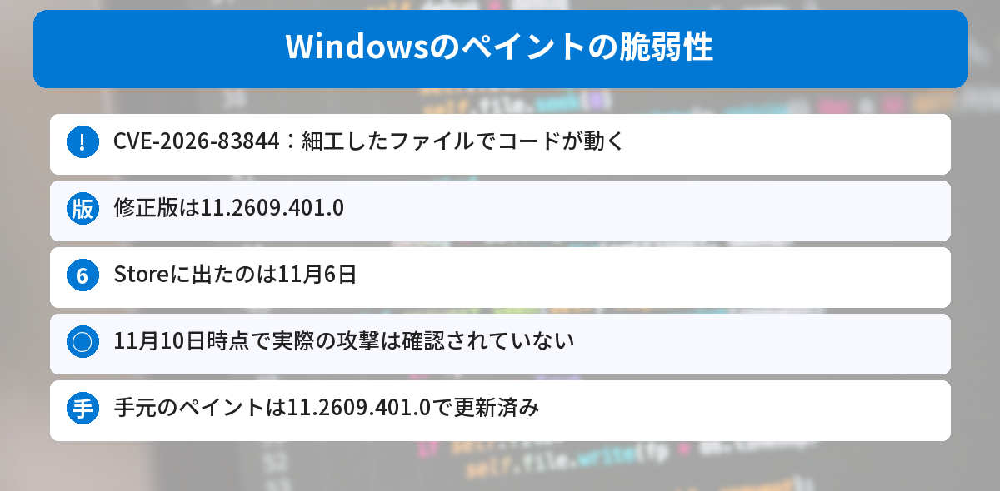
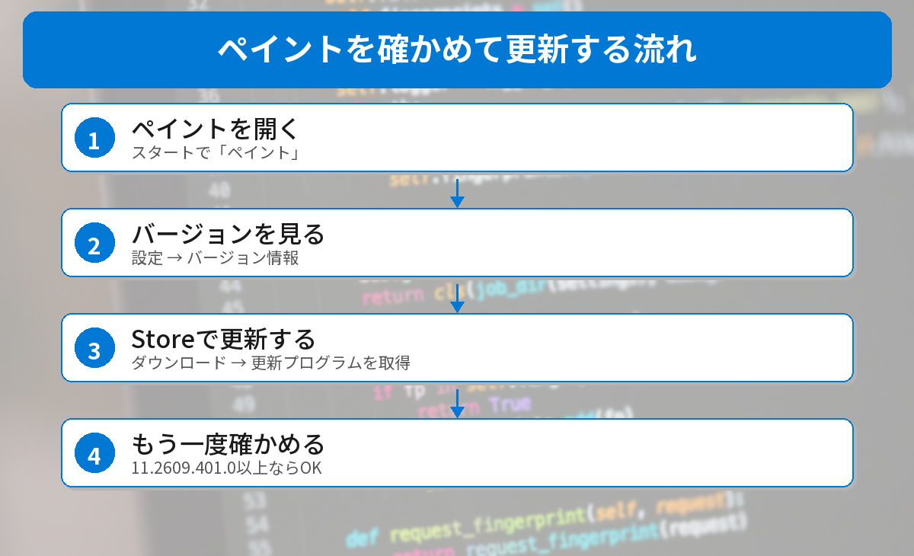

## この記事で分かること

「ペイントに脆弱性」ってニュースを見たの。お絵かきのアプリでもあぶないことがあるの？


画像を開くアプリは、細工したファイルでねらわれることがあるんだ。修正版はもう出ているよ。このパソコンで確かめた結果と、確かめ方を説明するね。



こんなことが気になっていませんか？
- どんな不具合なの？
- 自分のペイントは大丈夫？
- どうやって更新するの？

この記事は、[Dark Readingの記事](https://www.darkreading.com/application-security/microsoft-rce-bug-windows-paint-confusion)と、Microsoftのセキュリティ情報をもとにまとめています（2026年11月10日に確認）。

## 何が起きたの？
| 項目 | 内容 |
|------|------|
| 脆弱性 | **CVE-2026-83844**（深刻度7.0） |
| 対象 | Windowsの**ペイント** |
| 起きること | 細工したファイルを開くと、**コードを動かされる**おそれ |
| 修正版 | **11.2609.401.0**（11月6日にStoreに登場） |
| 実際の攻撃 | 確認されていない（悪用の可能性は「低い」） |



### 発表がゆれていた
この脆弱性は、すこしややこしい経過をたどりました。

- **10月13日**：Microsoftが発表。このとき書かれていた修正版は、Storeにはまだ出ていなかった
- **11月4日**：修正版が「11.2609.401.0」に書き直されたが、Storeにはまだなかった
- **11月6日**：11.2609.401.0がStoreに登場
- **11月7日**：深刻度が8.1から7.0に下がり、「ネットワーク経由」から「**ファイルを開かせる攻撃**」に書き直された

つまり、**10月に更新したつもりでも、直っていなかった**人がいるかもしれません。

## 手元のペイントを確かめてみた
2026年11月10日に、このWindows 11のパソコンで、PowerShellを使ってペイントのバージョンを確かめました。

```powershell
Get-AppxPackage -Name Microsoft.Paint | Select-Object Name, Version
```

結果は次の通りです。

```text
Name            Version
----            -------
Microsoft.Paint 11.2609.401.0
```

**修正版の11.2609.401.0**になっていました。Microsoft Storeの自動更新で、すでに入っていたようです。


よかった、勝手に直ってたんだね。


Storeの自動更新がオンならそうなるよ。でも、修正版が出たのは11月6日だから、オフにしている人はまだ古いかもしれない。自分の目で見ておこう。


## 確かめ方と更新のしかた


### ステップ1: ペイントを開く
スタートメニューで「ペイント」と入れて開きます。

### ステップ2: バージョンを見る
右上の［**設定**］（歯車のマーク）を開き、［**バージョン情報**］のところでバージョンを見ます。

- **11.2609.401.0 以上**なら、直っています
- **それより前**なら、更新が必要です

### ステップ3: Microsoft Storeで更新する
**Microsoft Store**を開いて、左下の［**ダウンロード**］→［**更新プログラムを取得する**］を押します。ペイントの更新が出てきたら入れます。

### ステップ4: もう一度確かめる
ペイントを開き直して、バージョンが11.2609.401.0以上になったか確かめます。

## ふだんから気をつけたいこと
- **知らない人から届いた画像やファイル**は、すぐに開かない
- Microsoft Storeの**自動更新をオン**にしておく（Storeの［設定］→［アプリの更新］）
- 毎月第2火曜日（日本では水曜日の朝）には、Windowsの月例更新も出ます

Windowsの更新は[Windows 11 24H2の更新終了の記事](/posts/windows11-24h2-end-26h2-update/)、Chromeは[Chromeの52件の脆弱性を直す更新の記事](/posts/chrome-156-security-update-2026-10/)で解説しています。




ペイントの設定でバージョンを見て、11.2609.401.0より古かったらStoreで更新、だね！


その通り。ついでにStoreの自動更新もオンにしておこう。


## まとめ
- Windowsのペイントに、細工したファイルを開くとコードを動かされるおそれがある脆弱性（CVE-2026-83844）
- 修正版は11.2609.401.0。11月6日にMicrosoft Storeに出たばかり
- 10月に更新したつもりでも、直っていなかった可能性がある
- 11月10日時点で、実際の攻撃は確認されていない
- 手元のペイントは、すでに11.2609.401.0になっていた

---
### あわせて読みたい
- [【Windows 11】24H2のHome・Proは更新終了 26H2に上げよう（バージョンの確かめ方つき）](/posts/windows11-24h2-end-26h2-update/)
- [【スマホ】古いiPhone・Androidのまま、サイトを見ただけで情報が盗まれる攻撃 最新の更新を入れよう](/posts/old-phone-watering-hole-attack-2026-11/)
