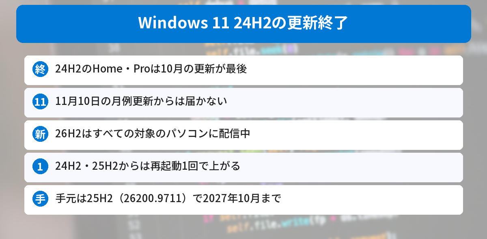
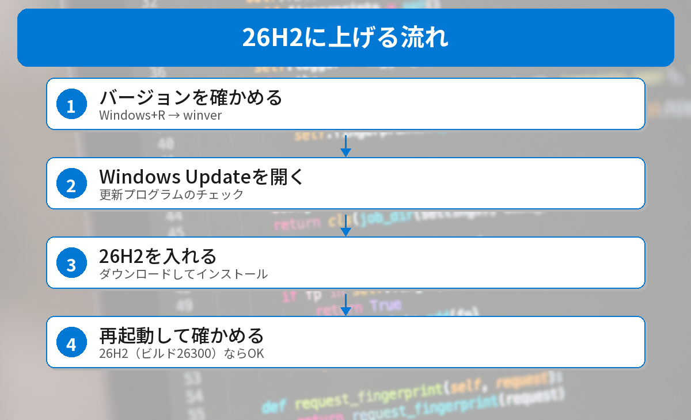

## この記事で分かること

「Windows 11の24H2は更新が終わった」ってニュースを見たの。わたしのパソコン、大丈夫なのかな？


Windows 11は、年に1回の「バージョン」ごとに更新の期限があるんだ。24H2のHomeとProは10月で期限が来たよ。確かめ方と上げ方を、このパソコンで見ながら説明するね。



こんなことが気になっていませんか？
- 24H2の更新が終わると、どうなるの？
- 自分のパソコンのバージョンはどう確かめる？
- 26H2にはどうやって上げるの？

この記事は、Microsoftの「[Windows 11 リリース情報](https://learn.microsoft.com/en-us/windows/release-health/windows11-release-information)」「[26H2の既知の問題と通知](https://learn.microsoft.com/ja-jp/windows/release-health/status-windows-11-26h2)」と、[Windows Modeの記事](https://www.windowsmode.com/windows-11-26h2-all-eligible-pcs-restore-summary/)をもとにまとめています（2026年11月4日に確認）。

## 何が起きたの？
Windows 11には「24H2」「25H2」のような**バージョン**があり、それぞれ**更新が届く期限**が決まっています。HomeとProは、出てから**24か月**です。

| バージョン | Home・Proの更新期限 | Enterprise・Educationの更新期限 |
|------|------|------|
| **26H2**（最新） | 2028年10月10日 | 2029年10月9日 |
| 25H2 | 2027年10月12日 | 2028年10月10日 |
| **24H2** | **終了（2026年10月の更新が最後）** | 2027年10月12日 |

24H2のHome・Proは、**10月13日の月例更新が最後**でした。次の月例更新は**11月10日**（毎月第2火曜日）ですが、24H2のHome・Proにはもう届きません。



### 26H2は、すべての対象のパソコンへ
新しい**26H2**は9月29日に出て、少しずつ配られていました。いまはMicrosoftが「**すべての対象のデバイスで利用可能**」としています。

## 自分のパソコンを確かめてみた
2026年11月4日に、このパソコンでバージョンと入っている更新を確かめました。PowerShellで次のように打ちます。

```powershell
(Get-CimInstance Win32_OperatingSystem).Caption
$r = Get-ItemProperty 'HKLM:\SOFTWARE\Microsoft\Windows NT\CurrentVersion'
"$($r.DisplayVersion) build $($r.CurrentBuild).$($r.UBR)"
```

結果は次の通りです。

```text
Microsoft Windows 11 Enterprise
25H2 build 26200.9711
```

- バージョンは**25H2**なので、更新はまだ続きます
- ビルド26200.**9711**は、**10月13日の月例更新（KB5127648）**が入った状態です。`Get-HotFix` でも、10月16日に入ったことを確かめられました
- 10月26日の臨時の更新（KB5134133、証明書の入れかえなど）と、10月28日の試験的な更新は、まだ入っていませんでした
- 会社が管理するEnterpriseのパソコンなので、26H2に上げる時期は会社のルールに従います


数字だらけでむずかしい…。わたしは何を見ればいいの？


家のパソコンなら、`winver` で「バージョン 24H2」と出るかどうかだけ見ればOKだよ。24H2ならHomeとProは更新が止まっているから、26H2に上げよう。


## バージョンの確かめ方と上げ方


### ステップ1: バージョンを確かめる
［Windows］キー＋［R］を押して、`winver` と入れて［Enter］を押します。「バージョン 24H2」「25H2」などと出ます。

［設定］→［システム］→［バージョン情報］でも確かめられます。

### ステップ2: Windows Updateを開く
［設定］→［**Windows Update**］を開いて、［**更新プログラムのチェック**］を押します。たまっている更新があれば、先に入れます。

### ステップ3: 26H2を入れる
「Windows 11, version 26H2 is available」などと出たら、［**ダウンロードしてインストール**］を押します。

### ステップ4: 再起動して確かめる
再起動は**1回**です。もう一度 `winver` を開いて、**バージョン 26H2（OSビルド 26300）**になっていれば完了です。

### 26H2が出てこないとき
- **たまっている更新を先に入れる**：9月22日の更新（KB5124010）以降が入っていないと出てきません
- **相性の問題で止められている**ことがある：Microsoftが、問題のあるパソコンには一時的に配っていません。無理に入れず、待ちましょう
- **会社のパソコン**は、情報システム部門のルールで更新されます

### 更新の前に知っておきたい不具合
古いUSBのヘッドセットやオーディオ機器の一部で、デバイスマネージャーに「コード10」が出たり、音が出なかったりする不具合が報告されています。9月8日の更新から起きていて、10月28日の時点でもまだ直っていません。こうした機器を使っている人は、更新のあとに音が出るか確かめましょう。

## Windows 10の人は？
Windows 10には、26H2への小さな更新はありません。Windows 11に**まるごとアップグレード**する必要があり、Windows 11の動作条件を満たすパソコンでしかできません。

ブラウザも古いままになりがちです。Chromeの更新は[Chromeの52件の脆弱性を直す更新の記事](/posts/chrome-156-security-update-2026-10/)で解説しています。




winverで24H2だったら、Windows Updateから26H2に上げる。再起動は1回だけ、だね！


その通り。11月10日の月例更新の前に済ませておくと安心だよ。


## まとめ
- Windows 11 24H2のHome・Proは、2026年10月の更新で更新の提供が終わった
- 11月10日の月例更新からは、セキュリティの修正が届かない
- 26H2はすべての対象のパソコンに配られている。24H2・25H2からは再起動1回で上がる
- winverでバージョンを確かめ、Windows Updateから26H2を入れる
- 手元のパソコンは25H2（26200.9711）で、2027年10月まで更新が続く

---
### あわせて読みたい
- [【Chrome】52件の脆弱性を修正 156.0.8078.73以上か確かめよう（手元は古いままだった）](/posts/chrome-156-security-update-2026-10/)
- [【Node.js】Brotli脆弱性が「実際に悪用」された 24.22.1以上に上げよう／26がLTSに](/posts/nodejs-node2shell-exploited-26-lts/)
