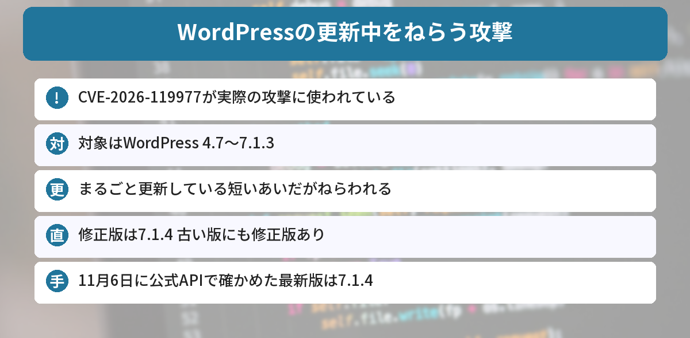
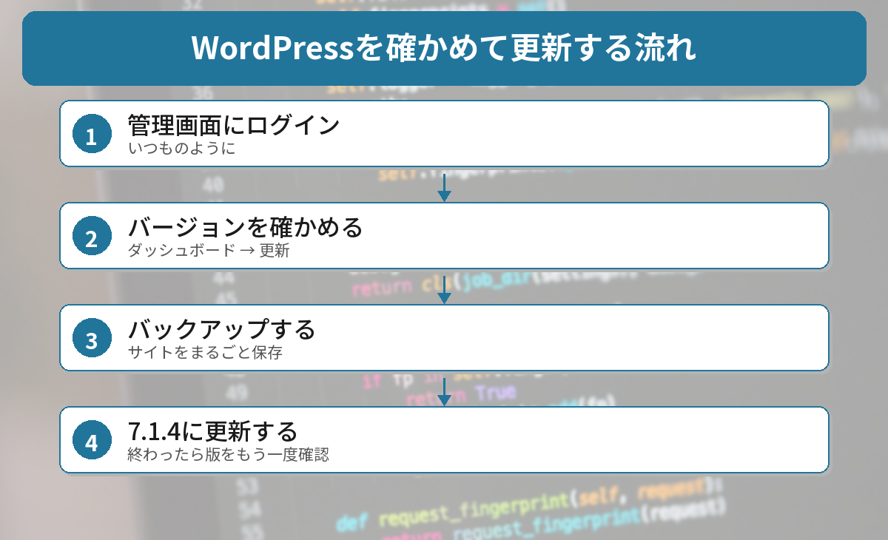

## この記事で分かること

WordPressでブログをやってるんだけど、「更新中をねらう攻撃」ってニュースを見たの。更新するとあぶないってこと？


ねらわれるのは、修正前の版で更新しているあいだなんだ。修正版にしてしまえば大丈夫。確かめ方と、更新のしかたを説明するね。



こんなことが気になっていませんか？
- どんな攻撃なの？
- 自分のWordPressは大丈夫？
- 何をすればいいの？

この記事は、[Daily Security Reviewの記事](https://dailysecurityreview.com/resources/cisa-adds-wordpress-core-flaw-cve-2026-119977-to-kev-catalog/)などの報道と、WordPress公式のバージョン確認API（api.wordpress.org）をもとにまとめています（2026年11月6日に確認）。

## 何が起きたの？
| 項目 | 内容 |
|------|------|
| 脆弱性 | **CVE-2026-119977**（深刻度8.1） |
| 対象 | WordPress本体 **4.7〜7.1.3** |
| 起きるとき | WordPressを**まるごと更新しているあいだ** |
| 攻撃者に必要なもの | **ログイン不要** |
| 修正版 | **7.1.4**（10月下旬）。古い版にも修正版あり |
| 実際の攻撃 | **あり**（CISAが11月3日に警告） |



### どんなしくみ？
WordPressをまるごと更新するとき、新しいファイルを**いったん決まった場所に置いてから**入れかえます。その場所は**外から見え、名前も予想しやすい**ものでした。

攻撃者はそのすき間をねらって、更新中のわずかな時間に、サーバーの中でコードを動かそうとします。時間は短いものの、**自動でくり返しねらう**ので、たくさんのサイトが試されます。

### どれくらいねらわれている？
セキュリティ会社のWordfenceは、公開から21時間で**1万8,500件以上**の、更新用ファイル（setup-config.php）をねらうアクセスを記録しました。その後も、1日で1万2,632件の攻撃を止めたと報告しています。これは**試された数**で、実際に乗っ取られたサイトの数は公表されていません。

## 最新版を確かめてみた
2026年11月6日に、WordPress公式のバージョン確認APIで、いま配られている版を確かめました。

```powershell
(Invoke-RestMethod "https://api.wordpress.org/core/version-check/1.7/").offers |
  Select-Object response, version
```

結果は次の通りです（一部）。

```text
response   version
--------   -------
upgrade    7.1.4
autoupdate 7.1.4
autoupdate 7.0.8
autoupdate 6.9.11
autoupdate 6.8.12
autoupdate 6.7.11
```

- いちばん新しい版は **7.1.4**
- 7.0、6.9、6.8、6.7など、**古い版にも自動更新で修正版**が配られている


古い版を使っている人にも、ちゃんと直した版があるんだね。


そう。4.7まで、さかのぼって直しているんだ。自動更新がオンなら、もう入っているかもしれないよ。



## 確かめ方と更新のしかた


### ステップ1: 管理画面にログインする
いつものように、WordPressの管理画面にログインします。

### ステップ2: バージョンを確かめる
［**ダッシュボード**］→［**更新**］を開くと、いまのバージョンが出ます。管理画面のいちばん下（右下）にも書かれています。

- **7.1.4 以上**なら、最新版です
- 7.0.8、6.9.11、6.8.12、6.7.11 など、**それぞれの版の修正版**になっていれば、この問題は直っています
- **それより前**なら、更新が必要です

### ステップ3: 更新する前にバックアップ
更新の前に、レンタルサーバーのバックアップ機能や、バックアップ用のプラグインで、**サイトをまるごと保存**しておきましょう。

### ステップ4: 更新する
［ダッシュボード］→［更新］で、［**バージョン7.1.4に更新**］を押します。終わったら、もう一度バージョンを確かめます。

### あやしいアクセスがないか見る
レンタルサーバーの管理画面でアクセスの記録が見られるなら、**setup-config.php** へのアクセスがたくさん残っていないか見てみましょう。身に覚えのないファイルが増えていたら、レンタルサーバーの会社に相談してください。

## ブログサービスを使っている人は？
今回の対象は、**自分でサーバーに入れて使うWordPress**です。

- **WordPress.com** など、会社が運営するサービスは、その会社が更新を担当します
- **はてなブログ**や**note**など、WordPressではないサービスは対象ではありません

先月は、WordPressを動かすPHPにも重大な脆弱性が見つかっています。[PHPの緊急の更新の記事](/posts/php-critical-rce-2026-10/)もあわせて確かめてください。




管理画面で7.1.4以上か見て、まだならバックアップしてから更新。だね！


その通り。古い版の人も、その版の修正版になっていれば大丈夫だよ。


## まとめ
- WordPress本体の脆弱性CVE-2026-119977が、実際の攻撃に使われている（CISAが11月3日に警告）
- 対象は4.7〜7.1.3。まるごと更新している短いあいだに、ログインなしでコードを動かされるおそれ
- 修正版は7.1.4。古い版にも7.0.8、6.9.11、6.8.12などの修正版がある
- 11月6日に公式APIで確かめた最新版は7.1.4
- 管理画面でバージョンを確かめ、バックアップしてから更新する

---
### あわせて読みたい
- [【PHP緊急】重大な脆弱性の修正版が公開 今すぐやる更新方法まとめ](/posts/php-critical-rce-2026-10/)
- [【Android】11月のセキュリティ更新 タップしなくても乗っ取られるおそれ 「2026-11-01」以降か確かめよう](/posts/android-security-update-2026-11/)
