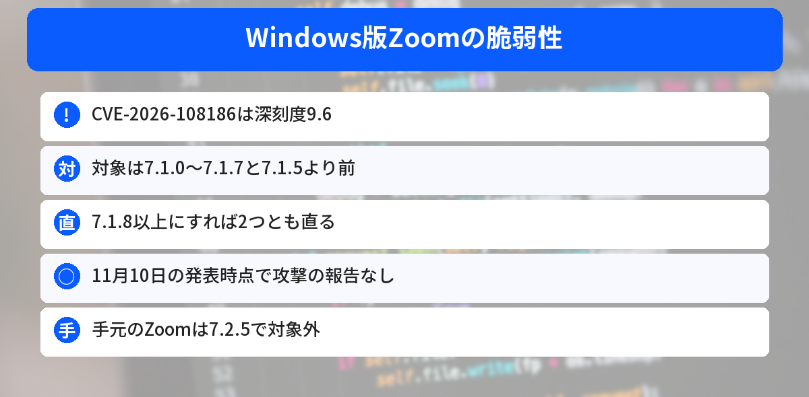
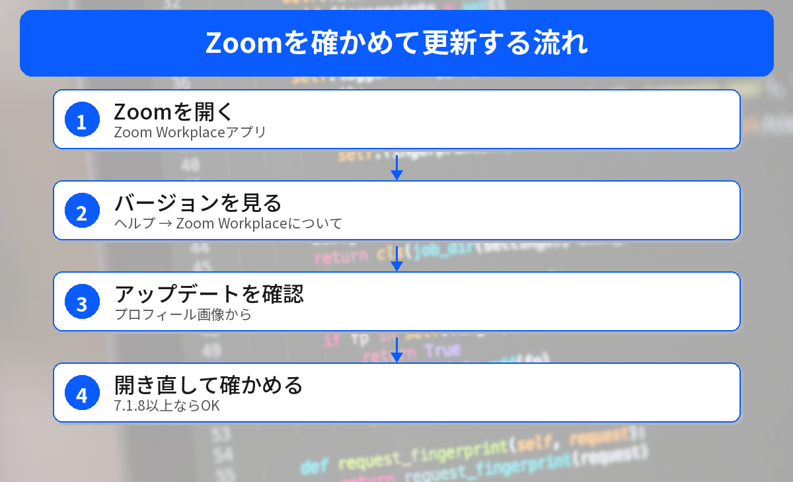

## この記事で分かること

Zoomに「深刻度9.6」の脆弱性ってニュースを見たの。毎日会議で使ってるけど、大丈夫かな？


Windows版のZoomで、7.1.8より古い版が対象なんだ。このパソコンで確かめたら、もっと新しい版だったよ。確かめ方を説明するね。



こんなことが気になっていませんか？
- どんな不具合なの？
- 自分のZoomは大丈夫？
- どうやって更新するの？

この記事は、[eSecurity Planetの記事](https://www.esecurityplanet.com/ja/threats/news-zoom-critical-windows-security-update-november-2026-ja/)と、Zoomのセキュリティ情報をもとにまとめています（2026年11月25日に確認）。

## 何が見つかったの？
| 脆弱性 | 深刻度 | 対象のバージョン |
|------|------|------|
| **CVE-2026-108186** | **9.6（緊急）** | Windows版 **7.1.0〜7.1.7** |
| **CVE-2026-108187** | 8.1（高） | Windows版 **7.1.5より前** |

- どちらも、**ログインしていない攻撃者**が、ネットワークを通じて**強い権限を取れる**おそれがある
- ただし、攻撃には**利用者の何らかの操作**が必要（どんな操作かは公表されていない）
- **7.1.8以上**にすれば、2つとも直る
- 11月10日の発表時点で、**実際の攻撃は報告なし**



### 「権限を取られる」って？
パソコンの中では、ふつうのアプリができることには制限があります。**権限を取られる**と、その制限をこえて、ファイルを見たり設定を変えたりできるようになるおそれがあります。

## 手元のZoomを確かめてみた
2026年11月25日に、このWindows 11のパソコンで、Zoomのファイルのバージョンを確かめました。

```powershell
(Get-Item "$env:ProgramFiles\Zoom\bin\Zoom.exe").VersionInfo.ProductVersion
```

結果は次の通りです。

```text
7.2.5.51704
```

- バージョンは **7.2.5**。修正版の **7.1.8より新しい**
- 2つの脆弱性とも、**対象外**でした


7.2.5なら大丈夫なんだね。わたしのも見てみよう。


Zoomは入れっぱなしで古いままの人も多いから、一度確かめておくと安心だよ。


## 確かめ方と更新のしかた


### ステップ1: Zoomを開く
パソコンでZoom Workplaceのアプリを開きます。

### ステップ2: バージョンを見る
右上の［**プロフィール画像**］→［**ヘルプ**］→［**Zoom Workplaceについて**］を開きます。

- **7.1.8 以上**なら、大丈夫です
- **それより前**なら、更新が必要です

### ステップ3: 更新する
［プロフィール画像］→［**アップデートを確認**］を押して、新しい版を入れます。

### ステップ4: 再起動して確かめる
アプリを開き直して、もう一度バージョンを確かめます。

アプリから更新できないときは、[Zoomの公式ダウンロードセンター](https://zoom.us/download)から新しいインストーラーを入れ直す方法もあります。

### 会社のパソコンは
会社が一括で管理していると、アプリに［アップデートを確認］が出ないことがあります。社内の案内を確かめてください。

## 今月のほかの更新も
今月は、ほかのアプリでも大きな更新が続いています。

- [11月のWindows更新（Outlookの脆弱性）の記事](/posts/patch-tuesday-2026-11-outlook-zero-day/)
- [Firefox 160の記事](/posts/firefox-160-security-2026-11/)




Zoom Workplaceについてを開いて、7.1.8以上ならOK。古ければアップデートを確認、だね！


その通り。会議の前に確かめておくと、あわてずにすむよ。


## まとめ
- Windows版Zoom Workplaceに、深刻度9.6（CVE-2026-108186）と8.1（CVE-2026-108187）の脆弱性
- 対象は7.1.0〜7.1.7と、7.1.5より前。強い権限を取られるおそれ
- 7.1.8以上にすれば、2つとも直る
- 11月10日の発表時点で、実際の攻撃は報告されていない
- 手元のZoomは7.2.5で、対象外だった

---
### あわせて読みたい
- [【Firefox】99件の脆弱性を修正 160.0.1かESR 153.7以上か確かめよう（手元のESRは更新済みだった）](/posts/firefox-160-security-2026-11/)
- [【11月のWindows更新】Outlookの脆弱性が悪用中 Windows Updateだけでは直らない（手元はOfficeが古いままだった）](/posts/patch-tuesday-2026-11-outlook-zero-day/)
